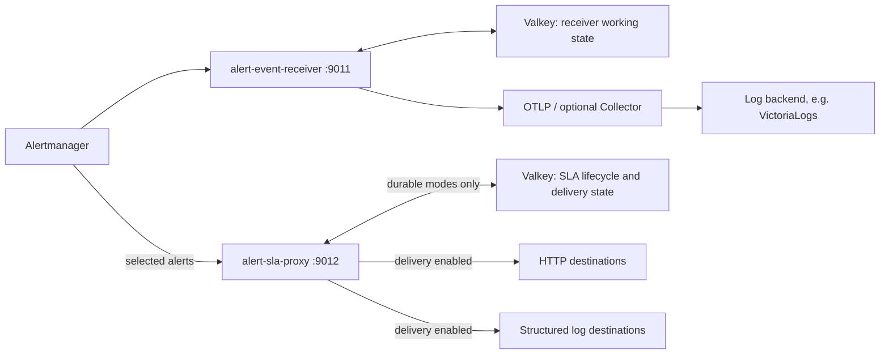

# Alert lifecycle logging and SLA delivery

This repository provides two independent applications for Alertmanager webhooks:

| Application | Use it to | Output |
|---|---|---|
| **alert-event-receiver** | Record firing and resolved lifecycle transitions for search and analysis | Structured OpenTelemetry log events |
| **alert-sla-proxy** | Deliver alerts according to label-selected schedules and holidays | Independent HTTP and structured log destinations |

Run either application on its own, or use Alertmanager routing to send selected
alerts to the SLA proxy while the event receiver records all alerts. They have
separate configuration, state, metrics and deployment lifecycles.



The Valkey stores may share a server, but their data and reliability contracts
are independent. Alertmanager routes must use `send_resolved: true`.

## Start here

- [Event receiver: getting started](docs/event-receiver/getting-started.md) — run Valkey and a local OTLP backend, send an alert, inspect events.
- [SLA proxy: getting started](docs/sla-proxy/getting-started.md) — begin without dependencies in observe-only mode, then try durable state and delivery.
- [Documentation index](docs/README.md) — configuration, concepts, operations and references for both applications.

The receiver tracks the latest occurrence per fingerprint, suppresses repeated
transition emissions, and exports over OTLP/gRPC or OTLP/HTTP. The SLA proxy
supports weekly IANA schedules, [offline holiday datasets](docs/sla-proxy/holiday-datasets.md)
for operator-supplied countries/subdivisions, explicit closure dates, durable
pending work, and independent named log/HTTP sinks with retries and receipts.

## Build and run

For source builds, install **Go 1.26.11 or newer**. Getting-started examples also
use Bash, curl and Docker for local dependencies; Python 3 generates test
webhooks. The local HTTP destination uses the Go mock in `cmd/httpsink-mock`.

Run these commands from the repository root:

```bash
go build -o /tmp/alert_event_receiver ./cmd/server
go build -o /tmp/alert-sla-proxy ./cmd/alert-sla-proxy
```

The receiver needs Redis/Valkey and an OTLP-compatible logs endpoint. With those
running, its minimal startup is:

```bash
REDIS_ADDR=127.0.0.1:6379 OTEL_EXPORTER_OTLP_PROTOCOL=http/protobuf OTEL_EXPORTER_OTLP_ENDPOINT=http://127.0.0.1:9428/insert/opentelemetry /tmp/alert_event_receiver
```

The SLA proxy can start without Valkey or downstream destinations:

```bash
/tmp/alert-sla-proxy -config docs/examples/alert-sla-proxy-observe.yaml
```

Use the [SLA getting-started guide](docs/sla-proxy/getting-started.md) to select
observe-only, durable-state-only or durable delivery mode. Minimal examples are
linked there; [alert-sla-proxy.yaml](docs/examples/alert-sla-proxy.yaml) is the
complete annotated configuration reference.

## Reliability and security

- **Event receiver:** OTLP delivery is best effort. State is written before
  emission; process crashes, queue overflow and export failures can permanently
  lose events. It has no durable replay, and concurrent lifecycle decisions can
  race. HTTP 200 or SDK submission does not prove backend persistence.
- **Durable SLA proxy:** accepted occurrences and delivery work survive restart
  subject to Valkey persistence. Delivery is at least once: an external success
  followed by an unconfirmed receipt can cause duplicates. HTTP 2xx proves API
  acceptance, not completed downstream processing. Lost resolutions can leave
  alerts firing in known state.
- The applications provide no inbound HTTP authentication or TLS configuration.
  Use trusted networking or an authenticated TLS reverse proxy. Protect stored
  alert labels, annotations and credentials. Use HTTPS for remote Basic Auth.

## Documentation

| Task | Event receiver | SLA proxy |
|---|---|---|
| Configure | [Environment reference](docs/event-receiver/configuration.md) | [YAML reference](docs/sla-proxy/configuration.md) |
| Understand behavior | [Lifecycle concepts](docs/event-receiver/concepts.md) | [Policies and delivery concepts](docs/sla-proxy/concepts.md) |
| Operate and troubleshoot | [Operations](docs/event-receiver/operations.md) | [Operations](docs/sla-proxy/operations.md) |
| Inspect contracts and metrics | [Reference](docs/event-receiver/reference.md) | [Reference](docs/sla-proxy/reference.md) |

[Redis/Valkey inspection and recovery](docs/redis-debugging.md) ·
[Load testing with alertload](docs/alertload.md) ·
[Development and tests](docs/development.md) ·
[Design and implementation history](docs/specifications/README.md)
