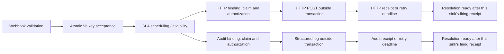

# Alert SLA Proxy — observation, durable state and multi-sink delivery

`alert-sla-proxy` is independent of the existing OTLP event receiver. It validates
Alertmanager notifications, selects label-based SLA policies and evaluates calendar
eligibility and active-interval overlap. It supports three explicitly selected modes:

| Configuration | Mode | Behavior |
|---|---|---|
| Defaults | `observe_only` | Phase 2: stateless validation and calendar/lifecycle evidence observations |
| `durable.enabled: true` | `durable_state_only` | Phase 3: Valkey acceptance, lifecycle state, scheduling and prepared intents; no sink calls |
| Also `delivery.enabled: true` | `delivery_enabled` | Phase 4B: independent log/HTTP destinations with per-sink retries and receipts |

There is no Alertmanager API verification, silence/inhibition recheck, invented
freshness timeout. Delivery is explicitly enabled; keep existing operational
notification routes until the new destinations are verified. See the
[Phase 3 guide](sla-proxy-phase3.md), [durable example](examples/alert-sla-proxy-durable.yaml)
and [logging delivery example](examples/alert-sla-proxy-delivery-log.yaml).

The calendar/lifecycle evidence tables below describe **Phase 2 observe_only
responses and notification observation metrics**. Phase 3's durable known state
trusts firing until a resolution is received: a passed opportunity can therefore
be durable eligible even when the Phase 2 per-notification evidence remains
unknown. This distinction is intentional; lost/delayed resolutions are an accepted
limitation of the approved Phase 3 architecture.

The existing event receiver continues to process lifecycle transitions and emit
OTLP logs independently. SLA selections do not generate lifecycle OTLP events.

## Build and run

With Go 1.26.11 or newer:

```bash
go build -o /tmp/alert-sla-proxy ./cmd/alert-sla-proxy
/tmp/alert-sla-proxy -config docs/examples/alert-sla-proxy.yaml
```

The `-config` flag defaults to `alert-sla-proxy.yaml` in the working directory.
`-version` prints the build version (`unknown` unless injected with
`-ldflags "-X main.version=..."`). Configuration is loaded once at startup;
receiver environment variables have no effect on this service.

| YAML setting | Default | Meaning |
|---|---|---|
| `listen_address` | `:9012` | TCP host:port; port 0 permits an ephemeral listener |
| `webhook_path` | `/webhook` | Exact absolute path, distinct from built-in endpoints |
| `max_body_bytes` | `1048576` | Request body limit, 1 byte through 64 MiB |
| `shutdown_timeout` | `10s` | HTTP drain deadline, greater than zero through 1 minute |
| `evaluation_horizon_days` | `370` | Local calendar dates searched from startsAt; 1 through 3660 |
| `sla_definitions` | required | Ordered, independent label/policy namespaces |

The checked-in [configuration example](examples/alert-sla-proxy.yaml) contains
two independent entries that deliberately reuse a policy name. The conventional
label `sla_id` is explicit in the example; each definition requires `sla_label`.

Unknown YAML fields, duplicate mapping keys, extra documents, duplicate/empty
selection labels, empty SLA names and empty policy maps fail startup. Label names
use ASCII `[a-zA-Z_][a-zA-Z0-9_]*`. Each policy requires an explicit IANA time zone
(including `UTC`; process-dependent `Local` is rejected) and a nonempty schedule
map. IANA data is embedded for minimal deployment images.

Weekday keys are lowercase full English names. Windows use exact
`HH:MM-HH:MM` syntax; `24:00` is allowed only as an end. Equal start/end is
invalid; use `00:00-24:00` for a full day. Starts are inclusive and ends exclusive.
Overnight windows continue into the following weekday. Overlaps are rejected
within and across weekdays, including Sunday/Monday and Saturday/Sunday boundaries;
adjacent windows are allowed. An empty weekday list represents no configured
windows, though an overnight window from the previous weekday may still apply.

An optional holidays block requires country or explicit dates; subdivision
requires country. Country syntax is two uppercase ASCII letters. Explicit dates
must be valid, exact `YYYY-MM-DD` values. Coverage is checked before listening:

| Country | Subdivision | Coverage |
|---|---|---|
| `SE` | omitted | Swedish public holidays |
| `DE` | omitted | Holidays common nationally in Germany |
| `DE` | `BY` | Bavaria's statewide public holidays |

Other combinations fail startup. The offline adapter uses `rickar/cal/v2`
v2.1.32; no remote calendar service is contacted. Only public holidays are used.
Swedish Christmas Eve, New Year's Eve and Midsummer's Eve are not included as
public holidays; add explicit dates for company closures. Bavarian municipality-
specific holidays, including Augsburg's Peace Festival and local Assumption Day
observance, also need explicit dates. A country-less list of explicit dates is
supported. Provider upgrades require reviewed dependency updates and regression
tests; expanding coverage requires explicit adapter support.

## Calendar versus lifecycle eligibility

The calendar engine answers whether a supplied instant is inside SLA and returns
its first eligible instant at or after that instant. The webhook evaluates this
calendar at startsAt, but **does not treat that boolean as final alert eligibility**.
An alert is eligible when its active interval intersects an SLA window.

For resolved alerts, the known interval is `[startsAt, endsAt)`. If the first
eligible calendar instant is strictly before endsAt, overlap is confirmed.
If it equals or follows endsAt, no overlap occurred. Equality is excluded: an
alert ending exactly at 08:00 never overlaps a window opening at 08:00.
A zero-duration interval is empty, even if startsAt is inside SLA.
Webhook arrival time does not change these historical conclusions.

For firing alerts, the end is unknown. A firing notification establishes activity
at startsAt; it does not verify continuous activity through reception. A firing
endsAt may be an expiry estimate and is not treated as a resolution. evaluated_at
is the processing clock and observation cutoff, never a replacement start/end.
It distinguishes a future calendar opportunity from one whose time has passed;
it does not prove the alert was still active when that opportunity arrived.

| eligibility_status | Required evidence / meaning |
|---|---|
| eligible | Resolved: first eligible instant is strictly before endsAt. Firing: startsAt itself is inside SLA and is not after the observation cutoff. This confirms historical overlap, not current activity or delivery. |
| ineligible | Resolved only: the complete active interval is proven to have no overlap, or is empty. Never assigned merely because a firing alert started outside SLA. |
| pending | Firing: startsAt is not after the cutoff, the calendar found a future eligible instant, and that instant is strictly after the cutoff. This is a conditional opportunity, not a durable pending record. |
| unknown | Firing: the later eligible instant has arrived but activity then is unverified; or startsAt is after the cutoff; or the calendar search cannot establish overlap/no overlap over the required range. |
| error | Calendar evaluation failed. No authoritative calendar or lifecycle conclusion is returned. |

For an 08:00–17:00 calendar:

| Notification evidence | Processing time | Lifecycle observation |
|---|---|---|
| Resolved 07:30–07:45 | 08:05 or later | ineligible |
| Resolved 07:30–08:00 | any arrival time | ineligible; endsAt is exclusive |
| Resolved 07:30–08:30 | any arrival time | eligible from 08:00 |
| Firing since 07:30 | 07:35 | pending; first calendar opportunity 08:00 |
| Firing since 07:30 | 08:05 | unknown; activity at 08:00 needs verification |
| Firing since 16:55 | 17:10 | eligible based on activity at startsAt |
| Resolved 16:55–17:30 | later | eligible; future delivery continuity applies outside SLA too |
| Resolved 17:05–18:00 | later | ineligible |

### Calendar search and precision

Calendar evaluations are reused only for the same selected policy pair and exact
startsAt instant within one request. Equivalent time-zone offsets share a cache
entry without losing nanoseconds. No decisions are cached across requests.
Lifecycle observations remain separate by policy, fingerprint, startsAt, alert
status and (for resolved alerts) endsAt. Repeats of exactly that evidence share
alert_count. Firing/resolved inputs or different resolution times must not merge.
Enrichment remains a no-op.

Holiday exclusions cover the entire local date being tested, including overnight
carry. For Monday 22:00–Tuesday 06:00, a Tuesday holiday excludes Tuesday's carry;
a Monday holiday alone does not exclude Tuesday. Explicit dates take precedence
over country checks. With no holidays block, only the weekly schedule applies.

IANA offset intervals preserve the existing DST behavior: nonexistent spring
wall times have no eligible instants; matching autumn wall times are eligible
on both occurrences. Partial gaps, non-hour offsets and skipped dates remain
supported. Window starts are inclusive and ends exclusive.

Search examines startsAt's local date and the next horizon-1 local dates,
independently of day length. next_eligible_at is the **first eligible calendar
instant at or after startsAt**, in canonical UTC with nanosecond precision.
It equals startsAt when the start is inside SLA and may precede evaluated_at
for delayed notifications. It is still reported when it falls at/after a resolved
alert's end; it must not be interpreted as overlap with that resolved interval.

On exhaustion, calendar_reason is no_eligibility_within_horizon and no next
instant is returned. calendar_search_until, when present, is exclusive: no
eligible instant was found between startsAt and that boundary. A resolved
interval ending at/before this boundary is fully covered and can be ineligible;
if it extends beyond the boundary (or coverage is unavailable), status is unknown.
A firing alert with no known future instant is unknown. None of these bounded
search results claims permanent calendar ineligibility.

The Phase 3 scheduler uses the first eligible calendar instant as its scheduling target. It
uses the approved webhook-authoritative non-resolution check, without API
verification or a freshness timeout. The scheduler records eligibility; only
the enabled delivery dispatcher invokes a sink.
Phase 2 creates no wakeup, durable pending state, activity verification or delivery.

policy_version hashes policy configuration, horizon, provider and calendar rule
versions; the calendar algorithm and its versioning are unchanged by the lifecycle
helper. It is not an occurrence ID or a serialization of deployed IANA data.
Rebuild/retest after time-zone data updates; config changes require restart.

## HTTP contract

| Method | Path | Meaning |
|---|---|---|
| POST | configured webhook path | Validate and observe a notification batch |
| GET | `/metrics` | Independent Prometheus registry |
| GET | `/healthz` | HTTP liveness |
| GET | `/readyz` | Observation capability, or active policy/store readiness in Phase 3; HTTP 503 while stopping/unavailable |

Webhook input uses the shared Alertmanager v4 wire model. Strict JSON decoding
rejects unknown fields, duplicate keys, null payloads, malformed timestamps and
trailing documents. Require `version: "4"`, a nonempty receiver, group status
`firing` or `resolved`, a non-null alerts array and nonnegative truncatedAlerts.
Each alert requires firing/resolved status, a nonempty fingerprint and nonzero
startsAt. Resolved alerts also require nonzero endsAt at or after startsAt.
An explicit empty alerts array is accepted. Group metadata, original labels,
annotations and exact alert timestamps are preserved; fingerprints are never
recomputed. The entire batch is validated before incrementing alert counters.

Selection is per alert:

1. Find the first configured entry whose label has a nonempty value.
2. Look up the value only in that entry's SLA map.
3. Count a known pair as selected. Skip unknown values as `unknown_sla`, without
   falling back to later entries.
4. If no label matches, skip as `missing_sla_label`.

Skips do not reject an otherwise valid batch. Repeated, old and orphan
notifications are observed independently; there is no occurrence state machine.
Selected means a configured policy was found, not that its SLA window is open.

For example, submit an alert resolved after the SLA window opened:

```bash
curl -i http://localhost:9012/webhook \
  -H 'Content-Type: application/json' \
  -d '{"version":"4","receiver":"sla-proxy","status":"resolved","alerts":[{"status":"resolved","fingerprint":"demo-001","startsAt":"2026-11-11T06:30:00Z","endsAt":"2026-11-11T07:30:00Z","labels":{"alertname":"Demo","sla_id":"business-hours-se"}}]}'
```

Example schema version 2 response, processed the following day:

```json
{
  "schema_version": 2,
  "mode": "observe_only",
  "persisted": false,
  "forwarded": false,
  "received": 1,
  "selected": 1,
  "skipped": 0,
  "evaluated": 1,
  "eligible": 1,
  "ineligible": 0,
  "pending": 0,
  "unknown": 0,
  "evaluation_errors": 0,
  "evaluated_at": "2026-11-12T09:00:00Z",
  "policy_observations": [{
    "sla_label": "sla_id",
    "sla_value": "business-hours-se",
    "fingerprint": "demo-001",
    "starts_at": "2026-11-11T06:30:00Z",
    "alert_status": "resolved",
    "ends_at": "2026-11-11T07:30:00Z",
    "alert_count": 1,
    "eligible_at_start": false,
    "calendar_reason": "outside_window",
    "eligibility_status": "eligible",
    "eligibility_reason": "active_interval_overlaps_sla",
    "next_eligible_at": "2026-11-11T07:00:00Z",
    "policy_version": "<SHA-256 of calendar configuration and rules>"
  }]
}
```

The per-observation eligible boolean has been removed. eligible_at_start answers
only the calendar question; eligibility_status and eligibility_reason answer the
lifecycle question. Resolved ends_at and alert_status make the evidence explicit.
Calendar reasons retain eligible, outside_window, holiday, additional_date and
no_eligibility_within_horizon. Lifecycle reasons are bounded:
start_in_sla, active_interval_overlaps_sla, empty_active_interval,
resolved_before_first_eligible_instant, resolved_interval_searched,
awaiting_first_eligible_instant, activity_at_eligibility_unverified,
start_after_observation_cutoff, search_horizon_exhausted, calendar_evaluation_error.

HTTP 200 acknowledges successful **observation only**, including pending and
unknown statuses. There is no persistence, forwarding guarantee or replay.
Invalid batches return 400 without observing alerts; oversized bodies return
413, wrong webhook methods 405, and requests arriving while stopping 503.
Calendar failures return HTTP 500 with eligibility_status=error and a bounded
error code; eligible_at_start, calendar_reason, policy_version, next_eligible_at
and calendar_search_until are absent for those failed evaluations. Other policies
are still observed. Errors are not counted as authoritative ineligibility.

Schema version 2 intentionally changes the response contract: top-level eligible
and ineligible are now lifecycle counts, with pending and unknown added. Together
these successful counts equal evaluated; selected = evaluated + evaluation_errors.
Per-observation counts, including error entries, sum to selected. INFO logs retain
an observation object exactly matching this response. Consumers of the former
calendar-only boolean/counts must update to schema 2 and eligible_at_start.
Repeated notifications and retried batches can increase counters again; these
process-local metrics and logs are not an exactly-once historical audit store.

## Metrics and logs

| Metric | Labels | Meaning |
|---|---|---|
| `sla_proxy_notifications_received_total` | `status` = 2xx/4xx/5xx | Requests to the webhook handler by response class |
| `sla_proxy_webhook_duration_seconds` | `status` | Webhook handler latency |
| `sla_proxy_alerts_received_total` | `status` = firing/resolved | Alerts in fully valid batches, including selected/skipped alerts and repeats |
| `sla_proxy_alerts_selected_total` | `sla_label`, `sla_value`, `status` | Observation selections by configured policy pair |
| `sla_proxy_alerts_skipped_total` | `reason` = missing_sla_label/unknown_sla | Selection skips |
| `sla_proxy_calendar_classifications_total` | `sla_label`, `sla_value`, `classification`, `reason` | Successful per-notification calendar classification at startsAt; inside_sla/outside_sla |
| `sla_proxy_alert_eligibility_observations_total` | `sla_label`, `sla_value`, `alert_status`, `eligibility_status`, `reason` | Per-notification lifecycle status, including pending, unknown and error |
| `sla_proxy_policy_errors_total` | `reason` | Failed evaluator calls; one call per unique policy pair plus exact startsAt in each batch |
| `sla_proxy_holiday_evaluations_total` | `country`, `result` | Country calendar checks, including future search dates; result = holiday/not_holiday/error |

The ambiguous sla_proxy_policy_decisions_total metric is removed; update queries
to the calendar or lifecycle metric above. Existing policy error, holiday, request,
selection and skip metrics retain their meanings. Calendar success metrics count
notifications (including cache reuse); error metrics count actual evaluator calls.

Policy-pair labels are bounded by loaded configuration; unknown values never
create metric series. No fingerprints, alert names, site IDs or alert label sets
are metric labels. The registry includes Go/process collectors, without receiver
metrics or speculative delivery counters. All counters reset on restart.

Holiday-check counters measure date checks, not alerts or decisions; explicit
dates and omitted country calendars do not invoke the country provider. Error
reason labels are bounded: calendar_error, unknown_policy,
invalid_evaluation_time, cancelled and evaluation_error. There is no sink label
or destination-specific policy configuration yet. The evaluator accepts a policy
reference; future routing must select it per destination.

JSON logs go to stdout. Startup reports the active mode and whether delivery is enabled. Rejections, policy evaluation failures
and shutdown/listener errors have component
and operation fields. Each fully validated webhook produces one INFO
`webhook observation` log with `http_status` and an `observation` object matching
the JSON response, including counts and occurrence/policy classifications.
This also applies to HTTP 500 evaluation results; the separate ERROR logs remain.
Rejected malformed requests retain their warning logs without an observation.
The INFO record describes processing, not proof of successful HTTP delivery, log-output persistence or a sink receipt. It includes fingerprints and selected policy identifiers, but
does not include full webhook payloads, original label sets or annotations.

## Shutdown and routing

SIGINT/SIGTERM stops readiness, closes the listener and drains active HTTP
requests for at most shutdown_timeout. Expiry force-closes connections and exits
nonzero. Listener failures, including occupied ports, also exit nonzero.
HTTP header/read/write/idle timeouts are 5/10/15/60 seconds.

Adapt the design's [fan-out route example](sla-proxy-design.md#3-alertmanager-routing-and-input-contract)
to your existing routing tree. Set `send_resolved: true` for each webhook and
keep `continue: true` on the selected SLA child route followed by an unconditional
operational/log receiver route. A parent's receiver is a fallback, not automatic
fan-out. Verify the final configuration with `amtool check-config` and a real
Alertmanager integration before deployment; httptest tests exercise the proxy,
not Alertmanager routing itself.

See the [decision register](sla-proxy-decisions.md) for architecture reuse and
approval gates. Phase 3 durable state/scheduling is described in its separate
guide. Multi-sink delivery is described below; real enrichment remains outside scope.


## Multi-sink delivery (Phase 4B)

A `Sink.Deliver(context.Context, DeliveryEvent) error` implementation performs one
external operation. It knows nothing about Valkey or scheduling. The existing
dispatcher owns claims, authorization, retries, ordering and receipts. Supported
sinks are `log` and generic `http`; multiple named sinks of either type can run
simultaneously. Every selected occurrence targets all configured sinks. There is
no SLA-dependent destination routing or ServiceNow-specific transformation.



Webhook acceptance, SLA eligibility, intent readiness, sink acceptance and a
committed delivery receipt are separate events. The webhook handler never waits
for delivery. Enabled responses use schema 3, `mode: delivery_enabled` and
`delivery_enabled: true`. `persisted` means every selected occurrence committed;
`forwarded: false` means the handler does not forward synchronously. Its binding
summaries are acceptance-time snapshots; inspect receipts and metrics for later
asynchronous progress. HTTP 503 permits safe retry of the entire webhook batch.
A Valkey transaction acknowledgement is subject to Valkey's disk/replica settings.

### Configuration and destination identity

See the complete [HTTP + audit example](examples/alert-sla-proxy-delivery-http.yaml)
and [log-only example](examples/alert-sla-proxy-delivery-log.yaml).

```yaml
durable:
  enabled: true
  policy_epoch: 1
  valkey:
    address: 127.0.0.1:6379
    namespace: sla

delivery:
  enabled: true
  sinks:
    - id: servicenow
      type: http
      http:
        url: https://sn.acme.se/api/sn_em_connector/em/inbound_event?source=prometheus
        timeout: 10s
        basic_auth:
          username_env: SERVICENOW_USERNAME
          password_env: SERVICENOW_PASSWORD
        idempotency_key: true
    - id: audit
      type: log
  dispatcher:
    poll_interval: 1s
    workers: 4
    batch_size: 100
    claim_lease: 30s
    delivery_timeout: 10s
    retry_initial: 5s
    retry_max: 5m
```

Set credentials through the deployment's secret mechanism, then start:

```bash
# SERVICENOW_USERNAME and SERVICENOW_PASSWORD must be set in the environment.
/tmp/alert-sla-proxy -config docs/examples/alert-sla-proxy-delivery-http.yaml
```

Delivery defaults to disabled. The native default sink list is one `default` log
sink. Explicit durable configuration must contain 1–32 sinks with unique stable
IDs matching `[A-Za-z0-9_][A-Za-z0-9_.-]{0,127}`. Unknown types/fields, duplicate
IDs, malformed URLs, userinfo/fragments, missing authentication variables and
invalid timeouts fail startup. Both credential variable names must be provided
together. Values must be nonempty; username colons and credential CR/LF are
rejected. All configured sinks are validated even when dispatch is disabled.

HTTP timeout must be positive and no greater than `dispatcher.delivery_timeout`.
Shared delivery timeout must be positive and at most 1 minute; claim lease must
cover it plus **three** durable `operation_timeout` budgets and be at most 10
minutes. Workers: 1–64; batch: 1–1000; poll: 10ms–1m. Retry initial must be at least
the polling interval; maximum must be at least initial and at most 1 hour.
The default 30s lease covers 10s delivery plus 3 × 5s state-store budgets.

**Binding snapshot:** the complete sink set is frozen in the occurrence's first
successful Valkey acceptance, including occurrences initially pending SLA. A
repeat webhook, SLA opening, resolution or restart never adds historical bindings.
Occurrence identity remains the hash of fingerprint and canonical UTC
RFC3339Nano startsAt. Binding identity includes occurrence, SLA label/value and
sink ID; firing/resolved intent IDs include occurrence, binding and action.
Claim tokens, fences, retries, authorization snapshots and receipts live on each
binding. The occurrence remains the single authoritative lifecycle document.

An immutable `destinations` registry stores sink IDs and SHA-256 configuration
fingerprints. It stores no credential values. Fingerprints include type, URL
(including query), timeout, authentication variable names and idempotency-header
setting. Rotating credential **values** is supported on restart without changing
identity. Changing any fingerprint field or removing a registered sink fails
startup, even if its known work has completed. This conservative append-only rule
prevents accidental discard/redirection; automated retirement/redrive is outside
this phase. Do not delete registry entries to bypass it.

Adding a new unique sink is supported with a higher `durable.policy_epoch` and
retention of all registered destinations. It affects new occurrences only. The
active registry digest also includes policies, sink catalog and delivery enablement.
Enable/disable or approved catalog/policy changes require a higher epoch; the
same configuration and epoch can restart or run concurrently. Roll out catalog
changes deliberately: a new active epoch fences old instances. Policy changes
hold pinned affected bindings instead of reinterpreting their historical calendar.
Resolution remains accepted against the original stored occurrence.

This release uses the new `delivery.sinks` YAML and occurrence format 2 directly.
`durable.sink_id` and `delivery.sink` are rejected. There is no legacy schema
adoption, migration or compatibility path. Development data from earlier formats
requires a deliberately separate/empty namespace, not an in-place upgrade.

### HTTP payload and security

Every HTTP request is a POST with `Content-Type: application/json` and **exactly
one alert**, using the original Alertmanager notification metadata and alert data:

```json
{
  "receiver": "sla-proxy",
  "status": "firing",
  "alerts": [{
    "status": "firing",
    "labels": {"alertname": "HighCPU", "sla_id": "production"},
    "annotations": {"summary": "CPU utilization is high"},
    "startsAt": "2026-11-15T07:00:00.123456789Z",
    "endsAt": "0001-01-01T00:00:00Z",
    "generatorURL": "https://prometheus.example/graph",
    "fingerprint": "original-fingerprint"
  }],
  "groupLabels": {}, "commonLabels": {}, "commonAnnotations": {},
  "externalURL": "", "version": "4", "groupKey": "", "truncatedAlerts": 0
}
```

Receiver, groupKey, group/common labels and annotations, externalURL, version and
truncatedAlerts are preserved where supplied. Missing original strings stay empty;
empty map containers serialize as `{}`. No receiver, group key, labels or
annotations are synthesized from unrelated records. Fingerprint, generatorURL,
labels, annotations and nanosecond timestamps are preserved. Top-level and alert
statuses match the intent action. Resolved delivery uses the stored resolution
notification. Firing endsAt is forwarded as originally received; it is **not**
used as authoritative resolution state. No SLA-specific labels are injected.

The full per-alert notification and original group metadata are already retained
in the occurrence. Authorization freezes that notification onto the intent before
I/O, so later webhook updates and process restarts do not change its logical retry
payload. Different alerts in an incoming batch never share reconstructed payloads.

This is a generic Alertmanager webhook, suitable for the
[ServiceNow Prometheus connector](https://www.servicenow.com/docs/r/it-operations-management/event-management/prometheus-events-integration.html).
Configure its Event Management connector/plugin, integration user permissions and
field/CI handling in ServiceNow. The proxy does not implement a ServiceNow API,
severity mapping or guarantee connector processing after acceptance. Validation
uses local HTTP fixtures; a real ServiceNow tenant must be tested before production.

Use HTTPS for production Basic Authentication. TLS verifies certificates through
normal system roots; there is no insecure-skip option. Plain HTTP is allowed for
local/private deployment testing and exposes credentials/payloads on the wire.
Redirects are never followed. One shared HTTP transport reuses connections; HTTP/1
with a non-rewindable POST body prevents transparent transport replays, including
when Idempotency-Key is present. All retries belong to the durable dispatcher.
Responses have a 64 KiB header limit; at most 64 KiB + 1 response-body bytes are
read/discarded before closing. Oversized bodies are not retained or logged and may
prevent connection reuse. A 2xx remains API acceptance even if its discarded body
is truncated; body contents do not define application-level success here.

URLs, authentication values/headers, response bodies and alert payloads are not
included in HTTP delivery logs or returned transport errors. Labels and annotations
are deliberately sent to the configured destination and remain sensitive stored
payload data. Protect YAML, credential environment, Valkey, logs and network access.
There is no arbitrary per-alert URL routing. Endpoints and any environment proxy
settings are trusted operator configuration.

### Delivery, ordering and retries

| Condition | Action |
|---|---|
| Pending SLA | Persist and schedule; no sink call |
| Eligible, known firing | Ready firing intent for each frozen sink |
| Resolution before authorization | Cancel that sink's unsent firing; no standalone resolution |
| Resolution after authorization | Preserve potentially delivered firing and recover its receipt/retry |
| Successful firing receipt for a sink | That sink may deliver the corresponding resolution, even outside SLA |
| Receipt already committed | Repeated webhooks/discovery do not resend that action |
| 2xx HTTP | Sink success; attempt to commit receipt |
| 408, 429, 5xx, network error or timeout | Durable retry; timeout/connection failure may have an unknown external outcome |
| Other 4xx, redirects or other unsupported status | Explicit permanent failure/hold; no automatic redrive |
| Shutdown cancellation | Retain authorization and a retryable outcome for restart recovery |

Retry delay uses exponential backoff with jitter, default 5s initially and 5m
maximum, without an arbitrary attempt limit. Valid `Retry-After` on 429/503 delays
the next attempt by at least that hint or the backoff, whichever is longer. Delta
seconds and HTTP dates are supported; hints are capped at 24h. Other responses
ignore this header. A failing binding does not hot-loop or retry successful sinks.

`Idempotency-Key` defaults to the stable intent ID and can be disabled with
`http.idempotency_key: false`. It remains identical across retries. Do not assume
ServiceNow or another receiver deduplicates this header. The guarantee is **at
least once**, never exactly once. HTTP 2xx means transport/API acceptance, not
confirmed downstream event creation, persistence or workflow completion.

Authorization is the durable send decision. Resolution before it cancels a first
firing. Resolution racing after authorization may coincide with the external call;
the firing receipt merges into the latest resolved occurrence and enables that
sink's resolution. No transaction can atomically coordinate Valkey and HTTP/log
side effects. A crash after authorization but before I/O is indistinguishable from
a successful send followed by a lost receipt. Recovery may retry that authorized
firing even when a resolution is now known. Stable intent IDs identify duplicates.
There is no retroactive **first authorization** after resolution.

### Concurrency, corruption and recovery

Ready work is a binding member `<occurrence_id>:<binding_id>` in the shared
`delivery-due` sorted set. Each binding has its own `DeliveryClaim`, monotonically
increasing fence and token key `delivery-claim:<occurrence_id>:<binding_id>`.
Other keys retain the namespace hash tag, e.g. `sla:{sla}:...`, for same-slot
transactions. Lifecycle JSON, claims, receipts and required index changes commit
in one WATCH/MULTI/EXEC. No Lua is used.

Ordinary transactions WATCH the occurrence, occurrence scheduler token, targeted
binding delivery token (when applicable), policy registry, destination registry
and index-schema fence. Shared indexes are never watched. Independent occurrences
therefore avoid conflicts caused solely by shared membership updates. Sinks on
the same occurrence may briefly contend on its authoritative JSON; each retry
merges current state. A slow external call holds no WATCH connection or transaction
and does not block a different binding's claim or receipt. The shared fixed worker
pool is bounded; enough slow calls can occupy all workers until timeout.

Claim → durable authorization → sink outside transaction → fenced receipt/retry
is unchanged. Expired owners cannot commit. Immediately before I/O the worker
checks its token, server time and PTTL, subtracts round-trip time and reserves a
state-store operation budget. The request context is capped by the lesser of the
remaining lease and configured delivery timeout. Cancellation cannot undo a remote
side effect. Restarted/multiple instances discover durable deadlines and expired
claims, preserving per-sink firing-before-resolved ordering.

Index types are checked at startup and before operations. Checked EXEC results
quarantine the namespace on command failures; readiness fails and workers stop.
Valkey cannot roll back runtime command errors: hostile/out-of-contract type
changes can partially commit an EXEC. Such work is never acknowledged as complete.
Keep exclusive schema ownership and follow the fence-first administrative repair
protocol in the [hardening guide](sla-proxy-hardening.md). Missing/wrong memberships
and scores are repaired without rewriting unchanged source records, renewing leases
or changing source timestamps/versions. Orphan and cross-sink index entries are removed.

Unresolved occurrences have no automatic expiry. Resolved payloads normally compact
30 days after resolution and tombstones expire after 90 days. Outstanding or held
delivery, including ambiguous authorized sends and resolutions awaiting receipts,
pins required state beyond these deadlines. Configure persistence/noeviction and
monitor growth; tombstone expiration limits very old replay protection.

For an outage, restore Valkey and restart with the same catalog/epoch: pending
work and expired claims recover. For policy holds restore the pinned policy under
an approved higher epoch; do not silently reinterpret the occurrence. Permanent
HTTP failures require operator correction; this phase has no redrive/retirement
API. Restore an accidentally changed endpoint to its registered configuration;
changing the registry manually can redirect queued notifications and is unsupported.

### Logging sink and observability

The real log destination emits one `SLA alert delivered` structured record per
successful sink call. Record time and `delivery_at` are actual sink processing
time. `starts_at`, optional `ends_at` and `eligible_at` remain separate historical
attributes. Intent/occurrence/binding IDs, sink, action, policy and attempt are
included; full labels/annotations/payloads are omitted. The handler's reported
error is honored and disabled INFO output is not successful delivery. `slog` does
not guarantee durable log storage; a handler that hides write errors cannot prove
persistence. Duplicate log records with the same intent ID are possible.

HTTP attempts log `SLA HTTP request completed` with sink/type, intent/occurrence/
binding, action, attempt, status, duration and outcome. A receipt-commit log is
separate from sink success. Failure logs omit raw sink errors.

| Metric | Meaning |
|---|---|
| `sla_proxy_delivery_attempts_total{sink_id,action,result}` | Calls by success/temporary_failure/permanent_failure |
| `sla_proxy_delivery_receipts_total{sink_id,action}` | Observed successful durable receipt commits |
| `sla_proxy_delivery_receipt_commits_total{sink_id,result}` | Committed, error or fenced outcome persistence |
| `sla_proxy_delivery_retries_total{sink_id,action}` | Calls after first authorized attempt |
| `sla_proxy_delivery_claims_total{sink_id,result}` | Claimed, busy, inactive, reclaimed, fenced or error |
| `sla_proxy_delivery_errors_total{operation}` | Poll/dispatch operational errors |
| `sla_proxy_delivery_duration_seconds{sink_id,action}` | Individual sink call latency |
| `sla_proxy_delivery_eligibility_delay_seconds{sink_id}` | First SLA opportunity to firing success, after receipt commit |
| `sla_proxy_delivery_pending_bindings{sink_id}` | Queued binding work, including retry-delayed work |
| `sla_proxy_delivery_inflight_bindings{sink_id}` | Persisted claims, including expired claims awaiting recovery |
| `sla_proxy_delivery_failed_bindings{sink_id}` | Held/permanently failed delivery bindings |
| `sla_proxy_delivery_ready_bindings` | Due work, including expired claims |
| `sla_proxy_delivery_claimed_bindings` | All persisted binding claims |
| `sla_proxy_delivery_held_bindings` | All held delivery bindings |
| `sla_proxy_http_requests_total{sink_id,status_class,result}` | HTTP API call outcomes with bounded status classes |
| `sla_proxy_http_request_duration_seconds{sink_id}` | HTTP request plus bounded response-drain time |

Gauges are namespace-wide snapshots sampled during polling: use **max**, not sum,
across replicas. Pending delivery gauges count prepared binding work, not alerts
still waiting for SLA with no ready intent. Counters/histograms are process-local;
sum replica rates as appropriate. Labels contain configured sink IDs and bounded
outcomes, never fingerprints, URLs, usernames or alert labels. A sink success with
an unconfirmed receipt can increment attempts without a corresponding receipt
counter. A lost EXEC reply can also undercount actual persisted receipts.

See [Phase 4B validation and benchmarks](sla-proxy-phase4b-validation.md) for measured
results and remaining production validation. Real enrichment, routing rules,
sink editing/redrive APIs and downstream processing guarantees remain outside scope.
