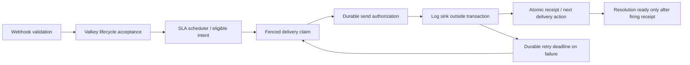

# Alert SLA Proxy — observation, durable state and logging delivery

`alert-sla-proxy` is independent of the existing OTLP event receiver. It validates
Alertmanager notifications, selects label-based SLA policies and evaluates calendar
eligibility and active-interval overlap. It supports three explicitly selected modes:

| Configuration | Mode | Behavior |
|---|---|---|
| Defaults | `observe_only` | Phase 2: stateless validation and calendar/lifecycle evidence observations |
| `durable.enabled: true` | `durable_state_only` | Phase 3: Valkey acceptance, lifecycle state, scheduling and prepared intents; no sink calls |
| Also `delivery.enabled: true` | `delivery_enabled` | Phase 4A: durable dispatcher and real logging destination; successful sink calls gain durable receipts |

There is no Alertmanager API verification, silence/inhibition recheck, invented
freshness timeout or HTTP sink. Keep existing operational notification routes
until logging delivery is the destination you intend. See the
[Phase 3 guide](sla-proxy-phase3.md), [durable example](examples/alert-sla-proxy-durable.yaml)
and [logging delivery example](examples/alert-sla-proxy-delivery-log.yaml).

The calendar/lifecycle evidence tables below describe **Phase 2 observe_only
responses and notification observation metrics**. Phase 3's durable known state
trusts firing until a resolution is received: a passed opportunity can therefore
be durable eligible even when the Phase 2 per-notification evidence remains
unknown. This distinction is intentional; lost/delayed resolutions are an accepted
limitation of the approved Phase 3 architecture.

The existing event receiver continues to process lifecycle transitions and emit
OTLP logs independently. SLA selections do not generate lifecycle OTLP events.

## Build and run

With Go 1.26.11 or newer:

```bash
go build -o /tmp/alert-sla-proxy ./cmd/alert-sla-proxy
/tmp/alert-sla-proxy -config docs/examples/alert-sla-proxy.yaml
```

The `-config` flag defaults to `alert-sla-proxy.yaml` in the working directory.
`-version` prints the build version (`unknown` unless injected with
`-ldflags "-X main.version=..."`). Configuration is loaded once at startup;
receiver environment variables have no effect on this service.

| YAML setting | Default | Meaning |
|---|---|---|
| `listen_address` | `:9012` | TCP host:port; port 0 permits an ephemeral listener |
| `webhook_path` | `/webhook` | Exact absolute path, distinct from built-in endpoints |
| `max_body_bytes` | `1048576` | Request body limit, 1 byte through 64 MiB |
| `shutdown_timeout` | `10s` | HTTP drain deadline, greater than zero through 1 minute |
| `evaluation_horizon_days` | `370` | Local calendar dates searched from startsAt; 1 through 3660 |
| `sla_definitions` | required | Ordered, independent label/policy namespaces |

The checked-in [configuration example](examples/alert-sla-proxy.yaml) contains
two independent entries that deliberately reuse a policy name. The conventional
label `sla_id` is explicit in the example; each definition requires `sla_label`.

Unknown YAML fields, duplicate mapping keys, extra documents, duplicate/empty
selection labels, empty SLA names and empty policy maps fail startup. Label names
use ASCII `[a-zA-Z_][a-zA-Z0-9_]*`. Each policy requires an explicit IANA time zone
(including `UTC`; process-dependent `Local` is rejected) and a nonempty schedule
map. IANA data is embedded for minimal deployment images.

Weekday keys are lowercase full English names. Windows use exact
`HH:MM-HH:MM` syntax; `24:00` is allowed only as an end. Equal start/end is
invalid; use `00:00-24:00` for a full day. Starts are inclusive and ends exclusive.
Overnight windows continue into the following weekday. Overlaps are rejected
within and across weekdays, including Sunday/Monday and Saturday/Sunday boundaries;
adjacent windows are allowed. An empty weekday list represents no configured
windows, though an overnight window from the previous weekday may still apply.

An optional holidays block requires country or explicit dates; subdivision
requires country. Country syntax is two uppercase ASCII letters. Explicit dates
must be valid, exact `YYYY-MM-DD` values. Coverage is checked before listening:

| Country | Subdivision | Coverage |
|---|---|---|
| `SE` | omitted | Swedish public holidays |
| `DE` | omitted | Holidays common nationally in Germany |
| `DE` | `BY` | Bavaria's statewide public holidays |

Other combinations fail startup. The offline adapter uses `rickar/cal/v2`
v2.1.32; no remote calendar service is contacted. Only public holidays are used.
Swedish Christmas Eve, New Year's Eve and Midsummer's Eve are not included as
public holidays; add explicit dates for company closures. Bavarian municipality-
specific holidays, including Augsburg's Peace Festival and local Assumption Day
observance, also need explicit dates. A country-less list of explicit dates is
supported. Provider upgrades require reviewed dependency updates and regression
tests; expanding coverage requires explicit adapter support.

## Calendar versus lifecycle eligibility

The calendar engine answers whether a supplied instant is inside SLA and returns
its first eligible instant at or after that instant. The webhook evaluates this
calendar at startsAt, but **does not treat that boolean as final alert eligibility**.
An alert is eligible when its active interval intersects an SLA window.

For resolved alerts, the known interval is `[startsAt, endsAt)`. If the first
eligible calendar instant is strictly before endsAt, overlap is confirmed.
If it equals or follows endsAt, no overlap occurred. Equality is excluded: an
alert ending exactly at 08:00 never overlaps a window opening at 08:00.
A zero-duration interval is empty, even if startsAt is inside SLA.
Webhook arrival time does not change these historical conclusions.

For firing alerts, the end is unknown. A firing notification establishes activity
at startsAt; it does not verify continuous activity through reception. A firing
endsAt may be an expiry estimate and is not treated as a resolution. evaluated_at
is the processing clock and observation cutoff, never a replacement start/end.
It distinguishes a future calendar opportunity from one whose time has passed;
it does not prove the alert was still active when that opportunity arrived.

| eligibility_status | Required evidence / meaning |
|---|---|
| eligible | Resolved: first eligible instant is strictly before endsAt. Firing: startsAt itself is inside SLA and is not after the observation cutoff. This confirms historical overlap, not current activity or delivery. |
| ineligible | Resolved only: the complete active interval is proven to have no overlap, or is empty. Never assigned merely because a firing alert started outside SLA. |
| pending | Firing: startsAt is not after the cutoff, the calendar found a future eligible instant, and that instant is strictly after the cutoff. This is a conditional opportunity, not a durable pending record. |
| unknown | Firing: the later eligible instant has arrived but activity then is unverified; or startsAt is after the cutoff; or the calendar search cannot establish overlap/no overlap over the required range. |
| error | Calendar evaluation failed. No authoritative calendar or lifecycle conclusion is returned. |

For an 08:00–17:00 calendar:

| Notification evidence | Processing time | Lifecycle observation |
|---|---|---|
| Resolved 07:30–07:45 | 08:05 or later | ineligible |
| Resolved 07:30–08:00 | any arrival time | ineligible; endsAt is exclusive |
| Resolved 07:30–08:30 | any arrival time | eligible from 08:00 |
| Firing since 07:30 | 07:35 | pending; first calendar opportunity 08:00 |
| Firing since 07:30 | 08:05 | unknown; activity at 08:00 needs verification |
| Firing since 16:55 | 17:10 | eligible based on activity at startsAt |
| Resolved 16:55–17:30 | later | eligible; future delivery continuity applies outside SLA too |
| Resolved 17:05–18:00 | later | ineligible |

### Calendar search and precision

Calendar evaluations are reused only for the same selected policy pair and exact
startsAt instant within one request. Equivalent time-zone offsets share a cache
entry without losing nanoseconds. No decisions are cached across requests.
Lifecycle observations remain separate by policy, fingerprint, startsAt, alert
status and (for resolved alerts) endsAt. Repeats of exactly that evidence share
alert_count. Firing/resolved inputs or different resolution times must not merge.
Enrichment remains a no-op.

Holiday exclusions cover the entire local date being tested, including overnight
carry. For Monday 22:00–Tuesday 06:00, a Tuesday holiday excludes Tuesday's carry;
a Monday holiday alone does not exclude Tuesday. Explicit dates take precedence
over country checks. With no holidays block, only the weekly schedule applies.

IANA offset intervals preserve the existing DST behavior: nonexistent spring
wall times have no eligible instants; matching autumn wall times are eligible
on both occurrences. Partial gaps, non-hour offsets and skipped dates remain
supported. Window starts are inclusive and ends exclusive.

Search examines startsAt's local date and the next horizon-1 local dates,
independently of day length. next_eligible_at is the **first eligible calendar
instant at or after startsAt**, in canonical UTC with nanosecond precision.
It equals startsAt when the start is inside SLA and may precede evaluated_at
for delayed notifications. It is still reported when it falls at/after a resolved
alert's end; it must not be interpreted as overlap with that resolved interval.

On exhaustion, calendar_reason is no_eligibility_within_horizon and no next
instant is returned. calendar_search_until, when present, is exclusive: no
eligible instant was found between startsAt and that boundary. A resolved
interval ending at/before this boundary is fully covered and can be ineligible;
if it extends beyond the boundary (or coverage is unavailable), status is unknown.
A firing alert with no known future instant is unknown. None of these bounded
search results claims permanent calendar ineligibility.

The Phase 3 scheduler uses the first eligible calendar instant as its scheduling target. It
uses the approved webhook-authoritative non-resolution check, without API
verification or a freshness timeout. The scheduler records eligibility; only
the enabled delivery dispatcher invokes a sink.
Phase 2 creates no wakeup, durable pending state, activity verification or delivery.

policy_version hashes policy configuration, horizon, provider and calendar rule
versions; the calendar algorithm and its versioning are unchanged by the lifecycle
helper. It is not an occurrence ID or a serialization of deployed IANA data.
Rebuild/retest after time-zone data updates; config changes require restart.

## HTTP contract

| Method | Path | Meaning |
|---|---|---|
| POST | configured webhook path | Validate and observe a notification batch |
| GET | `/metrics` | Independent Prometheus registry |
| GET | `/healthz` | HTTP liveness |
| GET | `/readyz` | Observation capability, or active policy/store readiness in Phase 3; HTTP 503 while stopping/unavailable |

Webhook input uses the shared Alertmanager v4 wire model. Strict JSON decoding
rejects unknown fields, duplicate keys, null payloads, malformed timestamps and
trailing documents. Require `version: "4"`, a nonempty receiver, group status
`firing` or `resolved`, a non-null alerts array and nonnegative truncatedAlerts.
Each alert requires firing/resolved status, a nonempty fingerprint and nonzero
startsAt. Resolved alerts also require nonzero endsAt at or after startsAt.
An explicit empty alerts array is accepted. Group metadata, original labels,
annotations and exact alert timestamps are preserved; fingerprints are never
recomputed. The entire batch is validated before incrementing alert counters.

Selection is per alert:

1. Find the first configured entry whose label has a nonempty value.
2. Look up the value only in that entry's SLA map.
3. Count a known pair as selected. Skip unknown values as `unknown_sla`, without
   falling back to later entries.
4. If no label matches, skip as `missing_sla_label`.

Skips do not reject an otherwise valid batch. Repeated, old and orphan
notifications are observed independently; there is no occurrence state machine.
Selected means a configured policy was found, not that its SLA window is open.

For example, submit an alert resolved after the SLA window opened:

```bash
curl -i http://localhost:9012/webhook \
  -H 'Content-Type: application/json' \
  -d '{"version":"4","receiver":"sla-proxy","status":"resolved","alerts":[{"status":"resolved","fingerprint":"demo-001","startsAt":"2026-11-11T06:30:00Z","endsAt":"2026-11-11T07:30:00Z","labels":{"alertname":"Demo","sla_id":"business-hours-se"}}]}'
```

Example schema version 2 response, processed the following day:

```json
{
  "schema_version": 2,
  "mode": "observe_only",
  "persisted": false,
  "forwarded": false,
  "received": 1,
  "selected": 1,
  "skipped": 0,
  "evaluated": 1,
  "eligible": 1,
  "ineligible": 0,
  "pending": 0,
  "unknown": 0,
  "evaluation_errors": 0,
  "evaluated_at": "2026-11-12T09:00:00Z",
  "policy_observations": [{
    "sla_label": "sla_id",
    "sla_value": "business-hours-se",
    "fingerprint": "demo-001",
    "starts_at": "2026-11-11T06:30:00Z",
    "alert_status": "resolved",
    "ends_at": "2026-11-11T07:30:00Z",
    "alert_count": 1,
    "eligible_at_start": false,
    "calendar_reason": "outside_window",
    "eligibility_status": "eligible",
    "eligibility_reason": "active_interval_overlaps_sla",
    "next_eligible_at": "2026-11-11T07:00:00Z",
    "policy_version": "<SHA-256 of calendar configuration and rules>"
  }]
}
```

The per-observation eligible boolean has been removed. eligible_at_start answers
only the calendar question; eligibility_status and eligibility_reason answer the
lifecycle question. Resolved ends_at and alert_status make the evidence explicit.
Calendar reasons retain eligible, outside_window, holiday, additional_date and
no_eligibility_within_horizon. Lifecycle reasons are bounded:
start_in_sla, active_interval_overlaps_sla, empty_active_interval,
resolved_before_first_eligible_instant, resolved_interval_searched,
awaiting_first_eligible_instant, activity_at_eligibility_unverified,
start_after_observation_cutoff, search_horizon_exhausted, calendar_evaluation_error.

HTTP 200 acknowledges successful **observation only**, including pending and
unknown statuses. There is no persistence, forwarding guarantee or replay.
Invalid batches return 400 without observing alerts; oversized bodies return
413, wrong webhook methods 405, and requests arriving while stopping 503.
Calendar failures return HTTP 500 with eligibility_status=error and a bounded
error code; eligible_at_start, calendar_reason, policy_version, next_eligible_at
and calendar_search_until are absent for those failed evaluations. Other policies
are still observed. Errors are not counted as authoritative ineligibility.

Schema version 2 intentionally changes the response contract: top-level eligible
and ineligible are now lifecycle counts, with pending and unknown added. Together
these successful counts equal evaluated; selected = evaluated + evaluation_errors.
Per-observation counts, including error entries, sum to selected. INFO logs retain
an observation object exactly matching this response. Consumers of the former
calendar-only boolean/counts must update to schema 2 and eligible_at_start.
Repeated notifications and retried batches can increase counters again; these
process-local metrics and logs are not an exactly-once historical audit store.

## Metrics and logs

| Metric | Labels | Meaning |
|---|---|---|
| `sla_proxy_notifications_received_total` | `status` = 2xx/4xx/5xx | Requests to the webhook handler by response class |
| `sla_proxy_webhook_duration_seconds` | `status` | Webhook handler latency |
| `sla_proxy_alerts_received_total` | `status` = firing/resolved | Alerts in fully valid batches, including selected/skipped alerts and repeats |
| `sla_proxy_alerts_selected_total` | `sla_label`, `sla_value`, `status` | Observation selections by configured policy pair |
| `sla_proxy_alerts_skipped_total` | `reason` = missing_sla_label/unknown_sla | Selection skips |
| `sla_proxy_calendar_classifications_total` | `sla_label`, `sla_value`, `classification`, `reason` | Successful per-notification calendar classification at startsAt; inside_sla/outside_sla |
| `sla_proxy_alert_eligibility_observations_total` | `sla_label`, `sla_value`, `alert_status`, `eligibility_status`, `reason` | Per-notification lifecycle status, including pending, unknown and error |
| `sla_proxy_policy_errors_total` | `reason` | Failed evaluator calls; one call per unique policy pair plus exact startsAt in each batch |
| `sla_proxy_holiday_evaluations_total` | `country`, `result` | Country calendar checks, including future search dates; result = holiday/not_holiday/error |

The ambiguous sla_proxy_policy_decisions_total metric is removed; update queries
to the calendar or lifecycle metric above. Existing policy error, holiday, request,
selection and skip metrics retain their meanings. Calendar success metrics count
notifications (including cache reuse); error metrics count actual evaluator calls.

Policy-pair labels are bounded by loaded configuration; unknown values never
create metric series. No fingerprints, alert names, site IDs or alert label sets
are metric labels. The registry includes Go/process collectors, without receiver
metrics or speculative delivery counters. All counters reset on restart.

Holiday-check counters measure date checks, not alerts or decisions; explicit
dates and omitted country calendars do not invoke the country provider. Error
reason labels are bounded: calendar_error, unknown_policy,
invalid_evaluation_time, cancelled and evaluation_error. There is no sink label
or destination-specific policy configuration yet. The evaluator accepts a policy
reference; future routing must select it per destination.

JSON logs go to stdout. Startup reports the active mode and whether delivery is enabled. Rejections, policy evaluation failures
and shutdown/listener errors have component
and operation fields. Each fully validated webhook produces one INFO
`webhook observation` log with `http_status` and an `observation` object matching
the JSON response, including counts and occurrence/policy classifications.
This also applies to HTTP 500 evaluation results; the separate ERROR logs remain.
Rejected malformed requests retain their warning logs without an observation.
The INFO record describes processing, not proof of successful HTTP delivery, log-output persistence or a sink receipt. It includes fingerprints and selected policy identifiers, but
does not include full webhook payloads, original label sets or annotations.

## Shutdown and routing

SIGINT/SIGTERM stops readiness, closes the listener and drains active HTTP
requests for at most shutdown_timeout. Expiry force-closes connections and exits
nonzero. Listener failures, including occupied ports, also exit nonzero.
HTTP header/read/write/idle timeouts are 5/10/15/60 seconds.

Adapt the design's [fan-out route example](sla-proxy-design.md#3-alertmanager-routing-and-input-contract)
to your existing routing tree. Set `send_resolved: true` for each webhook and
keep `continue: true` on the selected SLA child route followed by an unconditional
operational/log receiver route. A parent's receiver is a fallback, not automatic
fan-out. Verify the final configuration with `amtool check-config` and a real
Alertmanager integration before deployment; httptest tests exercise the proxy,
not Alertmanager routing itself.

See the [decision register](sla-proxy-decisions.md) for architecture reuse and
approval gates. Phase 3 durable state/scheduling is described in its separate
guide. Logging delivery is described below; HTTP delivery and real enrichment remain outside this implementation.


## Phase 4A delivery framework

The logging sink is a **real destination**. It is not a dry run and is explicitly
opt-in. A sink performs one operation through `Sink.Deliver(context.Context,
DeliveryEvent) error`; it knows nothing about Valkey or scheduling. The dispatcher
owns discovery, claims, authorization, ordering, retries and receipts. Future
transports can implement this interface without replacing the dispatcher. No
HTTP destination or transport credentials are configured in Phase 4A.



These are distinct events: HTTP acceptance does not mean SLA eligibility;
eligibility does not mean sink acceptance; a successful log operation does not
mean its receipt was committed; a receipt does not guarantee durable log storage.
The HTTP handler never waits for sink delivery. Enabled responses retain schema
3, use `mode: delivery_enabled`, and add `delivery_enabled: true`. `persisted`
means all selected occurrences committed. `forwarded: false` describes the
webhook handler's lack of synchronous forwarding, not absence of asynchronous
logging delivery. The occurrence/binding summaries show the acceptance-time delivery snapshot,
which may already lag the asynchronous dispatcher when the response arrives;
receipts in Valkey and delivery metrics/logs show dispatcher outcomes.

### Configuration and activation

```yaml
durable:
  enabled: true
  policy_epoch: 2
  sink_id: default
  # Other Valkey/scheduler/retention settings: see complete example.
delivery:
  enabled: true
  sink:
    type: log
  dispatcher:
    poll_interval: 1s
    workers: 4
    batch_size: 100
    claim_lease: 30s
    delivery_timeout: 10s
    retry_initial: 5s
    retry_max: 5m
```

Build and run the [complete example](examples/alert-sla-proxy-delivery-log.yaml):

```bash
go build -o /tmp/alert-sla-proxy ./cmd/alert-sla-proxy
/tmp/alert-sla-proxy -config docs/examples/alert-sla-proxy-delivery-log.yaml
```

Delivery defaults to disabled and requires durable mode. Only `type: log` is
accepted. Polling must be 10ms–1m, workers 1–64, batch size 1–1000, and delivery
timeout positive and at most 1m. The claim lease must cover **delivery timeout +
three state-store operation timeouts**, and be at most 10m. Authorization also
checks the remaining lease budget before allowing sink I/O. Retry initial must
be at least the poll interval; retry maximum must be at least initial and at most
1h. Unknown YAML fields still fail strict decoding.

Before enabling in an existing namespace, upgrade **all instances** to this
version and increase `durable.policy_epoch`. Delivery activation changes the
registry digest with a `delivery-v1` format/implementation marker, while disabled
mode keeps the Phase 3 digest unchanged. An unchanged epoch with a different
mode fails startup. The higher epoch fences old running instances, and affected
instances fail readiness and cannot commit. Do not run an old binary against an
activated namespace or try to downgrade it by increasing its epoch.

Activation adopts existing unconsumed Phase 3 firing intents through bounded
maintenance. It never creates a first firing delivery for an already resolved
occurrence. The extra `destination:<hash-of-sink-id>` string permanently pins the
logical sink ID to `log`. Changing transport for that ID requires a reviewed
migration; a higher policy epoch alone does not bypass the pin. No such migration
or HTTP transport is implemented here. To disable delivery deliberately, deploy
this same version with a higher epoch and delivery disabled; it preserves existing
receipts/work but stops dispatch. Reenable with another higher epoch.

### State, concurrency and resolution races

The existing occurrence identity and lifecycle state remain unchanged. New
optional JSON fields extend the same authoritative occurrence record:

- Binding `sink_type`; existing `firing_delivered_at` now contains receipt evidence.
- Intent `attempts`, first `authorized_at`, `next_attempt_at`, bounded
  `last_failure`, `permanent_failure`, frozen retry `payload` and `receipt`.
- Occurrence `delivery_fence` and `delivery_claim` containing owner token, fence,
  binding/intent/action, expiration and `sending` authorization state.
- Receipt intent/sink IDs, sink-completion and commit times, cumulative authorized
  attempts, fence, committing record version and `status: delivered`.

Legacy Phase 3 records decode with zero/nil defaults; no occurrence-key migration
or identity recomputation occurs. Per-action receipts, not the aggregate binding
status, decide whether an action has already succeeded.

| Condition | Result |
|---|---|
| Firing not yet SLA eligible | Lifecycle remains firing, eligibility pending; no sink call |
| Eligible firing, no receipt or hold | Firing intent is ready; dispatcher may claim it |
| Resolution committed before send authorization | Cancel unsent firing; no standalone resolution |
| Resolution committed after authorization / during the call | Preserve the authorized firing attempt and its evidence; merge a successful firing receipt into latest resolved state |
| Successful firing receipt plus known resolution | Resolution becomes ready even outside SLA hours |
| Successful action receipt plus repeated webhook | Keep receipt; do not send that action again |
| Retryable failure | `delivery_failed`, durable future retry deadline, same intent ID |
| Permanent/preparation failure | `delivery_failed`, retained payload/state and operational hold; no automatic retry/discard |
| Policy change/removal | Preserve accepted lifecycle and historical facts; pending delivery is held, including pending resolutions, until the approved pinned policy is restored/migrated |

Claims are **occurrence-scoped**, serializing even multiple bindings in one
occurrence. Different occurrences can run concurrently. This is stronger than
per-sink ordering and avoids a second lifecycle state machine.

`delivery-due` is a sorted set of occurrence IDs: ready/retry deadlines for
unclaimed work, lease expiration for claimed work. `delivery-ready` is a set of
unclaimed queued work (including retry-delayed work), `delivery-claimed` contains
persisted claims, and `delivery-held` contains permanent/preparation failures.
The existing `intent-index` remains readiness metadata; it is not a substitute
for deadline-based delivery discovery. Bounded reconciliation repairs missing or
inconsistent secondary indexes without rewriting unchanged records. Claims also
use a separate expiring `delivery-claim:<occurrence-id>` token key with an absolute
expiration, so unrelated webhook writes do not renew the lease.

Every claim/authorization/receipt uses WATCH/MULTI/EXEC, the existing JSON source
of truth and guarded index updates. No transaction is held during the sink call.
The final pre-send validation and authorization transaction checks the latest
lifecycle, policy hold, eligibility, intent and claim. Its successful commit is
the **send linearization point**. A resolution committed before it cancels the
first firing send; after it, the attempt is considered in progress. There is an
unavoidable gap between authorization commit and the first instruction in the
external sink: a resolution in that gap does not revoke the authorized attempt.
Authorization alone is never a successful delivery receipt.

Receipt commit checks the delivery token, fencing generation, intent and lease,
then merges into the latest occurrence. It intentionally does **not** require an
unchanged occurrence version, because a webhook may have legitimately recorded a
resolution or repeat during sink I/O. Delivery fencing is separate from the SLA
scheduler's claim/version fencing. A stale or expired delivery owner cannot
commit a receipt. Sink success is still recorded if a resolution arrived during
a valid owned attempt, enabling the corresponding resolution afterwards.

### At-least-once recovery and retries

This implements **at-least-once attempts**, not exactly-once side effects. A crash,
connection loss or claim expiration after external acceptance but before a
receipt commit makes the outcome uncertain. The durable authorization and frozen
payload survive. After lease expiry, another worker may retry with the **same
intent ID**, including when the occurrence is now resolved. This retries an
already authorized send; it never initiates a first authorization for an
occurrence resolved beforehand. A crash after authorization but before actual
sink I/O may therefore require the same recovery treatment.

A firing success receipt must exist before resolution authorization. A resolution
cannot overtake the successful firing on the normal claimed path. Stable IDs
allow downstream deduplication; duplicate logging records are acceptable. Fencing
protects Valkey commits, not external I/O: a sink that ignores cancellation and
continues after losing its lease may emit late duplicates, even after another
worker has completed a later action. No Valkey transaction can atomically order
that stale external side effect or prove whether a crashed process wrote a log.

Ordinary sink errors retry with exponential backoff and up to 25% positive jitter
below retry_max. At the cap, jitter uses 80–100% of the maximum, bounded below
by retry_initial, to avoid synchronizing all capped retries. No retry count limit silently discards work. A
`DeliveryError{Permanent: true}` creates an explicit retained failure needing
operator intervention; no automatic redrive/migration endpoint is provided.
Raw sink error text is neither logged nor persisted; failure fields use bounded
classifications. Per-worker and polling backoff prevent hot loops on state-store
outages, and a failed occurrence does not monopolize the worker pool.

The claim's remaining budget is checked before a call. Delivery timeout is passed
through context; sinks must honor cancellation. Go cannot forcibly interrupt a
custom logging handler or a blocking writer that ignores context. Shutdown stops
polling, cancels workers and attempts bounded outcome persistence; the service's
existing shutdown deadline still bounds its wait and closes the store. A process
exit before receipt commit is recovered through the same lease/authorization path.

### Logging semantics and retention

A successful `log` delivery emits exactly one `SLA alert delivered` structured
record per successful attempt. It contains component/sink type and ID, action,
occurrence/binding/intent IDs, SLA reference/version, starts_at, eligible_at,
optional known ends_at and authorized attempt number. Full labels, annotations
and payloads are omitted. Retry payloads remain original Alertmanager notification
information; enrichment is not introduced.

The record's timestamp is the alert event time: startsAt for firing and endsAt
for resolution, serialized in UTC with nanosecond precision. It is **not the
current send time**, so historical test alerts appear in historical log queries.
`SLA delivery receipt committed` is a separate current-time processing log.
Receipt delivered_at is the observed completion time of the successful sink call;
committed_at is the Valkey server time used for the receipt transaction. Attempt
numbers count committed authorizations, not provable network/writer invocations.

The sink calls `slog.Handler.Handle` directly to receive handler-reported write
errors. INFO filtering is treated as a retryable failure rather than successful
delivery. A nil handler error means only completion according to that API: standard
stdout logging does not fsync, and custom handlers may buffer or discard output
without returning an error. Log collection/backend persistence is not guaranteed.
Receipts cannot make such unreported loss observable.

Completed payload/tombstone retention remains 30/90 days by default **when no
delivery is outstanding**. Pending, retrying, uncertain or permanent-failed work
pins its occurrence and needed payload instead of silently expiring it. Retry
snapshots are released when their success receipt commits; original payloads
follow completed-payload retention afterwards. Normal compaction/deletion resumes
once work is complete, using the original deadlines (so an overdue record may
then be removed promptly). Monitor storage/held work: delivery retention can be
unbounded during an outage or unresolved permanent failure. Tombstone expiry
still limits protection against very old webhook replays.

### Delivery observability

New metrics use only configured sink IDs and bounded action/result/operation
labels; never fingerprints, occurrence IDs, arbitrary alert labels or intent IDs:

| Metric | Meaning |
|---|---|
| `sla_proxy_delivery_attempts_total{sink_id,action,result}` | Actual sink calls: success, temporary_failure or permanent_failure |
| `sla_proxy_delivery_receipts_total{sink_id,action}` | Successfully observed durable success-receipt commits |
| `sla_proxy_delivery_receipt_commits_total{result}` | Outcome persistence committed, fenced or failed; failures may be ambiguous |
| `sla_proxy_delivery_retries_total{sink_id,action}` | Sink calls after the first authorized attempt |
| `sla_proxy_delivery_claims_total{result}` | Claimed, busy, inactive, held, reclaimed, fenced or error outcomes |
| `sla_proxy_delivery_errors_total{operation}` | Dispatcher dispatch/poll operational failures |
| `sla_proxy_delivery_duration_seconds{sink_id,action}` | Individual sink call duration |
| `sla_proxy_delivery_eligibility_delay_seconds{sink_id}` | First calendar eligibility to firing sink success, recorded after a receipt commit |
| `sla_proxy_delivery_ready_occurrences` | Due work including expired claims eligible for recovery |
| `sla_proxy_delivery_claimed_occurrences` | Persisted claims, including expired claims awaiting recovery |
| `sla_proxy_delivery_held_occurrences` | Permanent delivery/preparation failures needing intervention |

Gauges describe the namespace, refresh on polling and can lag until reconciliation;
use max rather than sum across replicas. Delivery is serialized per occurrence,
so discovery/gauge work units are occurrences with an actionable head intent,
not a count of every future conditional intent. Counters describe the current
process's observations and can undercount durable receipts if a successful commit
was followed by a lost response. Valkey receipt records remain authoritative.

Phase 4B HTTP delivery, destination authentication, sink migration/redrive APIs,
real enrichment and guarantees of downstream storage remain unimplemented.

See [Phase 4A validation and regression measurements](sla-proxy-phase4a-validation.md)
for executed checks, scenario coverage, benchmark methodology and raw samples.
