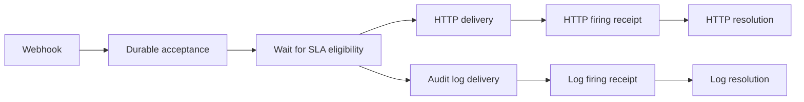

# SLA proxy concepts

The SLA proxy answers: **when may each destination receive this alert, and how do
we deliver its resolution in order?** It does not replace Alertmanager's routing,
silences or inhibition, and does not use the event receiver's lifecycle engine.

## Choose a mode

Observe-only validates notifications and reports calendar/lifecycle evidence. It
has no Valkey state, schedule or sink calls. HTTP 200 acknowledges observation.
Durable-state-only retains lifecycle, eligibility, scheduling and prepared delivery
intent in Valkey. Durable delivery additionally runs the asynchronous dispatcher.
HTTP 200 in either durable mode acknowledges selected state commits, not delivery.

## Policy selection

For each alert, inspect `sla_definitions` in order. The first label with a nonempty
value selects its own policy map. Missing labels are skipped as
`missing_sla_label`; an unknown value is skipped as `unknown_sla` without trying
later definitions. Policy identity is the pair of selection label and value.

For example, `sla_id: business-hours-se` selects that name in the `sla_id`
definition. A second definition using `sla_name` may independently reuse the same
name with a different schedule. Selection does not mean the SLA window is open.
Known durable resolutions remain accepted after policy removal.

## Eligibility and notification evidence

The calendar engine answers whether a supplied instant is inside SLA and returns
its first eligible instant at or after that instant. The webhook evaluates this
calendar at startsAt, but **does not treat that boolean as final alert
eligibility**. An alert is eligible when its active interval intersects an SLA
window. This section describes notification evidence; durable scheduling is
described below.

For resolved alerts, the known interval is `[startsAt, endsAt)`. If the first
eligible calendar instant is strictly before endsAt, overlap is confirmed. If it
equals or follows endsAt, no overlap occurred. Equality is excluded: an alert
ending exactly at 08:00 never overlaps a window opening at 08:00. A
zero-duration interval is empty, even if startsAt is inside SLA. Webhook arrival
time does not change these historical conclusions.

For firing alerts, the end is unknown. A firing notification establishes
activity at startsAt; it does not verify continuous activity through reception.
A firing endsAt may be an expiry estimate and is not treated as a resolution.
evaluated_at is the processing clock and observation cutoff, never a replacement
start/end. It distinguishes a future calendar opportunity from one whose time
has passed; it does not prove the alert was still active when that opportunity
arrived.

| eligibility_status | Required evidence / meaning |
|---|---|
| eligible | Resolved: first eligible instant is strictly before endsAt. Firing: startsAt itself is inside SLA and is not after the observation cutoff. This confirms historical overlap, not current activity or delivery. |
| ineligible | Resolved only: the complete active interval is proven to have no overlap, or is empty. Never assigned merely because a firing alert started outside SLA. |
| pending | Firing: startsAt is not after the cutoff, the calendar found a future eligible instant, and that instant is strictly after the cutoff. This is a conditional opportunity, not a durable pending record. |
| unknown | Firing: the later eligible instant has arrived but activity then is unverified; or startsAt is after the cutoff; or the calendar search cannot establish overlap/no overlap over the required range. |
| error | Calendar evaluation failed. No authoritative calendar or lifecycle conclusion is returned. |

For an 08:00–17:00 calendar:

| Notification evidence | Processing time | Lifecycle observation |
|---|---|---|
| Resolved 07:30–07:45 | 08:05 or later | ineligible |
| Resolved 07:30–08:00 | any arrival time | ineligible; endsAt is exclusive |
| Resolved 07:30–08:30 | any arrival time | eligible from 08:00 |
| Firing since 07:30 | 07:35 | pending; first calendar opportunity 08:00 |
| Firing since 07:30 | 08:05 | unknown; activity at 08:00 needs verification |
| Firing since 16:55 | 17:10 | eligible based on activity at startsAt |
| Resolved 16:55–17:30 | later | eligible; a sink that received firing also receives resolution outside SLA |
| Resolved 17:05–18:00 | later | ineligible |

### Search, holidays and precision

Calendar evaluations are reused only for the same selected policy pair and exact
startsAt instant within one request. Equivalent time-zone offsets share a cache
entry without losing nanoseconds. No decisions are cached across requests.
Lifecycle observations remain separate by policy, fingerprint, startsAt, alert
status and (for resolved alerts) endsAt. Repeats of exactly that evidence share
alert_count. Firing/resolved inputs or different resolution times must not
merge. Enrichment remains a no-op.

Holiday exclusions cover the entire local date being tested, including overnight
carry. For Monday 22:00–Tuesday 06:00, a Tuesday holiday excludes Tuesday's
carry; a Monday holiday alone does not exclude Tuesday. Explicit dates take
precedence over dataset or legacy country checks within valid coverage. With no holidays block, only the weekly schedule
applies.

IANA offset intervals preserve the existing DST behavior: nonexistent spring
wall times have no eligible instants; matching autumn wall times are eligible on
both occurrences. Partial gaps, non-hour offsets and skipped dates remain
supported. Window starts are inclusive and ends exclusive.

Search examines startsAt's local date and the next horizon-1 local dates,
independently of day length. next_eligible_at is the **first eligible calendar
instant at or after startsAt**, in canonical UTC with nanosecond precision. It
equals startsAt when the start is inside SLA and may precede evaluated_at for
delayed notifications. It is still reported when it falls at/after a resolved
alert's end; it must not be interpreted as overlap with that resolved interval.

On exhaustion, calendar_reason is no_eligibility_within_horizon and no next
instant is returned. calendar_search_until, when present, is exclusive: no
eligible instant was found between startsAt and that boundary. A resolved
interval ending at/before this boundary is fully covered and can be ineligible;
if it extends beyond the boundary (or coverage is unavailable), status is
unknown. A firing alert with no known future instant is unknown. None of these
bounded search results claims permanent calendar ineligibility.

In durable modes, the scheduler uses the first eligible calendar instant as its
scheduling target. If no resolution is recorded, it treats the occurrence as
firing and records eligibility. Only the enabled delivery dispatcher invokes
sinks. Observe-only mode creates no wakeup, durable pending state or delivery.

`policy_version` hashes policy configuration, search horizon, holiday provider
and calendar rule versions. It is separate from occurrence identity and does not
encode the deployed IANA database. Rebuild and retest after time-zone data
updates; configuration changes require restart.

## Occurrences and known lifecycle

An occurrence is the original fingerprint plus exact startsAt instant, normalized
to UTC without losing nanoseconds. Different starts remain independent. endsAt
records resolution timing, not identity. Labels, annotations and fingerprints are
preserved; there is no enrichment or fingerprint recalculation.

Durable lifecycle trusts received webhooks. If an alert starts at 07:30 and the SLA
opens at 08:00, the scheduler can make it eligible at 08:00 without a repeat webhook.
No recorded resolution means firing in known state. A delayed/lost resolution can
therefore lead to delivery after the underlying condition resolved. There is no
API verification or invented receipt-age timeout.

First resolution wins. Conflicting endsAt values hold work for investigation. Late
firing cannot reopen a retained resolved occurrence. An orphan resolution creates
terminal state without retroactive first firing delivery. Lifecycle, eligibility,
hold and delivery status are separate dimensions.

## Destinations and asynchronous delivery

A destination is a named `log` or `http` sink. Every selected occurrence freezes
all configured destinations at first durable acceptance, including pending alerts
and state-only mode. New destinations apply only to new occurrences. Each sink's
receipts and retries are independent; one sink's failure does not erase another's
success. There is no SLA-dependent destination routing.

A delivery intent is prepared work, not proof of an external call. A sink success
is acceptance at its boundary, not a durable receipt. The receipt is committed to
Valkey separately. For each sink, a firing receipt enables resolution even outside
SLA. Resolution before first firing authorization cancels the unsent firing;
resolution after authorization may race an already permitted external operation.

## At-least-once delivery

Sink I/O and Valkey cannot commit atomically. If a sink accepts but the receipt is
lost or unconfirmed, recovery may repeat the same intent. Stable intent IDs and
optional Idempotency-Key identify retries; downstream deduplication is not assumed.
A log handler success does not promise fsync or log-backend persistence. HTTP 2xx
means API acceptance, not completed incident processing.

Durable work, claims and retry deadlines recover after restart subject to Valkey
persistence. Unresolved records do not expire automatically; outstanding/held work
can retain payloads beyond normal resolved retention. See [operations](operations.md)
for practical recovery and [configuration](configuration.md) for supported settings.

## File-backed holiday data

Each policy can select one immutable [ICS dataset](holiday-datasets.md). Its dates
are local civil-day exclusions and its manifest explicitly asserts covered years.
Missing coverage is an error, not a workday. The runtime has no Python, network
provider or reload dependency. Legacy country/subdivision settings remain available.

Policy versions include the dataset's sorted date-set/coverage hash. Changed data
or coverage requires a higher durable epoch and holds affected historical bindings;
scheduler recovery retains their original decisions rather than applying new dates.
Even a coverage extension is a policy change. This iteration uses safe holds, not
automatic migration or persistent dataset snapshots; see [update guidance](holiday-datasets.md#install-and-update-safely).
