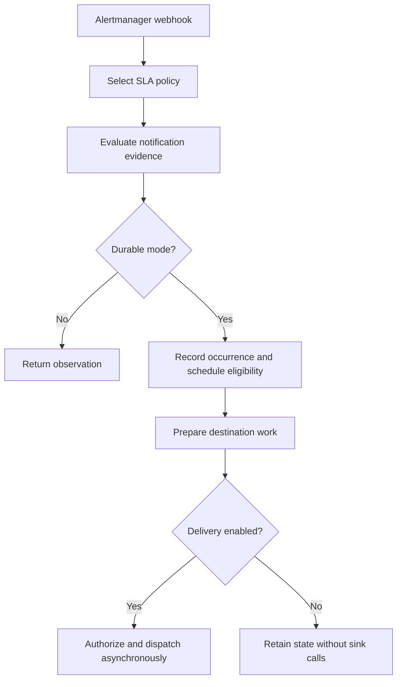
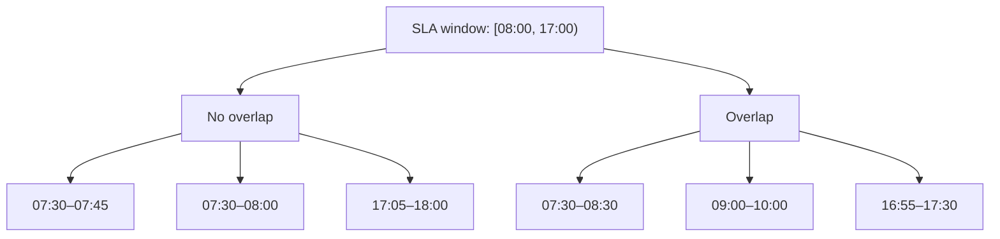
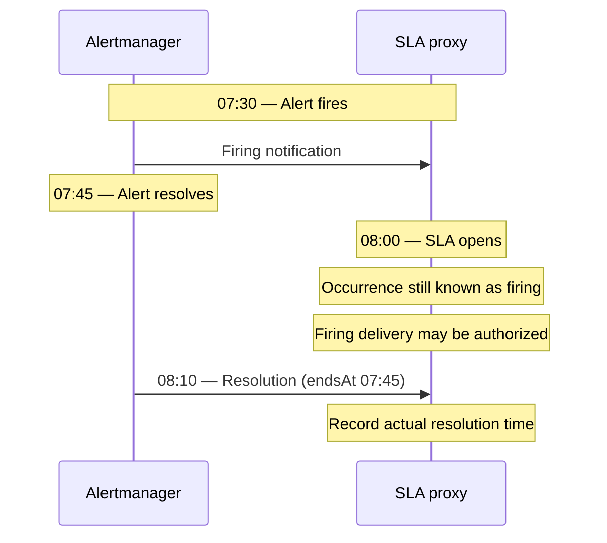
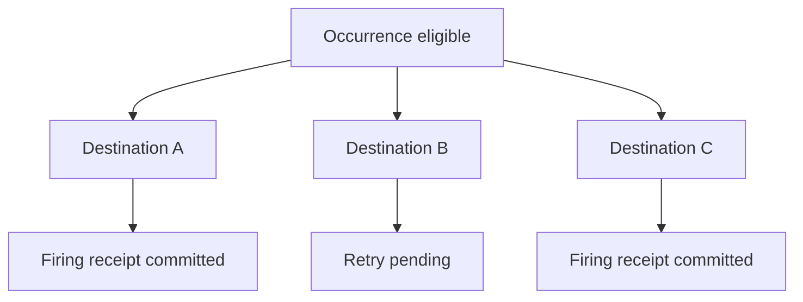
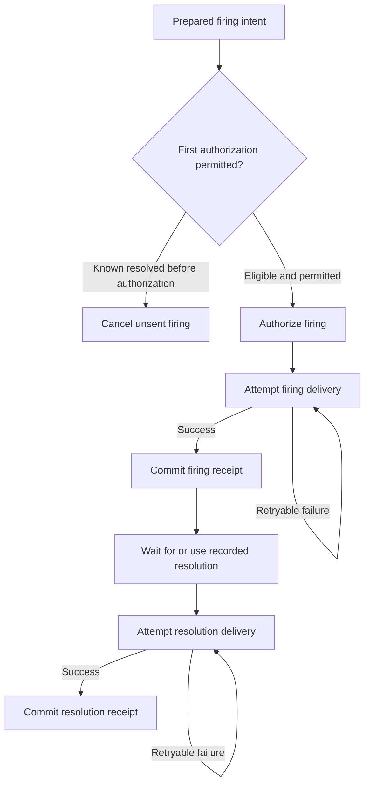

# SLA proxy concepts

The SLA proxy controls when alerts qualify for notification under an SLA calendar and maintains ordered firing and resolution delivery independently for each destination. It complements Alertmanager routing, silences and inhibition; it does not replace them or share the event receiver's lifecycle engine.

## Purpose and operating modes

| Mode | Behavior |
|---|---|
| Observe-only | Select policies and evaluate notification evidence. No Valkey state, scheduling or sink calls. |
| Durable-state-only | Persist occurrences, eligibility, scheduling and delivery intents in Valkey without contacting destinations. |
| Durable delivery | Additionally dispatch authorized notifications asynchronously and record delivery receipts. |

A successful webhook response confirms observation or durable acceptance, depending on the mode. It does not confirm downstream delivery.

The diagram shows conceptual stages, not a synchronous request sequence. Durable eligibility and delivery can progress without another webhook. Known resolutions can still be accepted after policy removal.

## SLA policies and calendars

An SLA policy defines when an alert qualifies under a calendar. Policies contain weekly time windows, a time zone and optional holiday exclusions.

### Policy selection

The proxy examines `sla_definitions` in configuration order. The first definition whose selection label has a nonempty value determines the policy map to consult. For example, `sla_id: business-hours-se` selects the policy `business-hours-se` in the `sla_id` definition.

Policy identity is the label/value pair: `sla_id: business-hours-se` and `sla_name: business-hours-se` may select different policies. If no selection label has a value, the alert is skipped as `missing_sla_label`. An unknown value is skipped as `unknown_sla`, without falling through to later definitions.

### Calendar rules

Windows use local civil time in the configured IANA time zone. Starts are inclusive and ends exclusive. Nonexistent spring wall times have no eligible instants; matching repeated autumn wall times are eligible on both occurrences.

Holiday exclusions apply to entire local dates, including the portion of an overnight window falling on that date. For a Monday 22:00–Tuesday 06:00 window, a Tuesday holiday excludes the Tuesday portion, while a Monday holiday alone does not exclude Tuesday's carry.

Public holidays are supplied through immutable ICS datasets with explicit coverage years; no country-specific logic or runtime network holiday provider is required. Explicit additional dates take precedence within valid coverage. Missing required coverage is an error, not a workday. Without a holidays block, only the weekly schedule applies.

See [configuration](configuration.md) for policy settings and [holiday datasets](holiday-datasets.md) for dataset preparation and updates.

## Alert occurrences and lifecycle

An occurrence is identified by the original Alertmanager fingerprint and exact `startsAt` instant. Different start times identify different occurrences, even if the fingerprint is identical. `endsAt` is not part of identity. Original fingerprints, labels and annotations are preserved.

A firing notification reports the start of an occurrence. A resolved notification reports its end. A firing notification's `endsAt` can be an expiry estimate and is not treated as a resolution.

In durable modes the proxy maintains **known lifecycle state** from accepted notifications. An occurrence remains known firing until a resolution is recorded. The proxy does not continuously query Alertmanager or automatically resolve an occurrence based on notification age.

| Incoming notification | Durable lifecycle behavior |
|---|---|
| First firing | Record a firing occurrence |
| Repeated firing | Retain the same occurrence |
| First resolution | Record terminal resolved state |
| Resolution without prior firing | Record terminal state; no retroactive first firing authorization |
| Late firing for retained resolved occurrence | Do not reopen |
| Conflicting resolution time | Retain first resolution time and hold work for investigation |

Lifecycle, eligibility, holds and destination delivery are separate dimensions of state.

## SLA eligibility

An alert need not start inside an SLA window. It qualifies if its active interval overlaps an eligible window. For a resolved alert, the interval includes `startsAt` but excludes `endsAt`.

### Calendar overlap

Assume a daily SLA window of 08:00–17:00. The following diagram illustrates six resolved intervals (times are local).

| Active interval | Calendar result | Reason |
|---|---|---|
| 07:30–07:45 | Ineligible | Ends before SLA opens |
| 07:30–08:00 | Ineligible | End at opening is excluded |
| 07:30–08:30 | Eligible | Active at opening |
| 09:00–10:00 | Eligible | Starts inside SLA |
| 16:55–17:30 | Eligible | Starts before SLA closes |
| 17:05–18:00 | Ineligible | Ends before next opening |

Historical overlap does not establish that delivery occurred or should now be authorized.

### Finding the next eligible time

The calendar searches from `startsAt` for the first eligible instant within a configured horizon of local dates. `next_eligible_at` describes that calendar opportunity, not a delivery deadline or proof of activity. It can be in the past or, for a resolved alert, at or after `endsAt`. Search exhaustion does not establish permanent ineligibility. See [reference](reference.md) for exact boundary semantics.

### Notification evidence

The observation field `eligibility_status` describes what the notification establishes, rather than the durable scheduler's decision. A resolved notification provides a complete interval. A firing notification establishes activity at its start but does not prove continuous activity until reception. The processing time (`evaluated_at`) is the observation cutoff, not an alert lifecycle timestamp.

| Status | Meaning |
|---|---|
| `eligible` | Resolved interval demonstrably overlaps SLA, or firing started inside SLA at or before the cutoff |
| `ineligible` | Resolved interval is empty or demonstrably does not overlap SLA |
| `pending` | Firing started at or before the cutoff and first eligible opportunity is still in the future |
| `unknown` | Evidence is insufficient, for example a later opportunity has passed without proof of activity, the start is after the cutoff, or search/coverage is insufficient |
| `error` | Calendar evaluation failed |

## Scheduling and delayed notifications

The durable scheduler uses known lifecycle state to act at a future SLA opportunity. Unlike an individual observation, it assumes an accepted firing occurrence remains active until resolution is recorded. Observe-only mode creates no scheduled work.

For an alert firing since 07:30 with SLA opening at 08:00:

| Processing time | Notification observation | Durable interpretation |
|---|---|---|
| 07:35 | `pending` | Schedule evaluation for 08:00 |
| 08:05 | `unknown` | Without a recorded resolution, the occurrence can become eligible |

Thus `unknown` does not necessarily block durable eligibility, and `eligible` does not guarantee delivery.

### Actual versus known lifecycle

Suppose the alert resolves at 07:45 but its resolution notification arrives at 08:10.

If resolution had arrived before authorization, the proxy would not authorize first firing delivery. In this example it may already have authorized firing at 08:00 because it did not yet know about the resolution. A lost resolution can leave the occurrence known firing indefinitely.

## Destinations and asynchronous delivery

A destination is a named HTTP or log sink. At first durable acceptance the occurrence freezes all configured destinations, including when pending or in state-only mode. New destinations apply only to new occurrences. There is no SLA-dependent destination routing.

Each destination has its own binding, intents, authorization, attempts and receipts.

A failure at one destination does not erase another's success.

### Delivery lifecycle

A delivery intent is prepared work. Authorization is the durable decision permitting first firing delivery. A successful sink call establishes acceptance at the sink boundary; a receipt records that success separately in Valkey.

This illustrates the successful and retryable paths, not every hold or failure.

Resolution before first authorization cancels unsent firing and produces no standalone resolution. Resolution after authorization may race an external call; authorized firing work may still need to complete or be retried. A destination can receive resolution only after its own firing receipt has been committed, even outside SLA hours. There is no retroactive first authorization after resolution.

## Reliability and recovery

Sink I/O and Valkey receipt commits cannot be atomic. A sink may accept a request before a crash or an uncertain receipt commit. Recovery may repeat the same intent. Delivery uses at-least-once semantics, not exactly-once execution; permanent holds do not promise eventual success.

Stable intent IDs and optional HTTP `Idempotency-Key` identify retries, but downstream deduplication is not assumed. HTTP 2xx means API acceptance, not completed downstream processing. Log sink success does not guarantee disk or backend persistence.

Durable work, claims and retry deadlines recover after restart when Valkey retains the state. Unresolved occurrences do not expire automatically. Resolved state is subject to retention; outstanding or held work can retain payloads beyond normal retention. Replay protection is bounded by retained state.

See [operations](operations.md) for retries, retention, recovery and troubleshooting.

## Policy changes

Durable occurrences retain their original policy and destination bindings. A policy version identifies the effective calendar configuration; the operator-controlled policy epoch activates catalog changes within a namespace.

Changed policies, including holiday dates or coverage, require a higher epoch. Affected historical bindings are held rather than silently recalculated. Saved decisions remain intact and known resolutions are still accepted. Adding destinations requires a higher epoch and affects only new occurrences. Existing registered destinations cannot be changed, renamed or removed in place.

Normal restarts with the same catalog and epoch recover existing work. A new namespace is a separate state domain, not a migration. Follow [safe policy and destination changes](operations.md#change-policies-and-destinations) and [holiday dataset updates](holiday-datasets.md#install-and-update-safely).

For exact response fields and metrics see [reference](reference.md); for configuration settings see [configuration](configuration.md).
