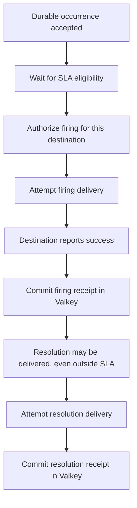

# SLA proxy concepts

The SLA proxy answers two questions: **when is an alert eligible under its SLA calendar, and how does each destination receive firing and resolution notifications in order?** It complements Alertmanager routing, silences and inhibition; it does not replace them or share the event receiver's lifecycle engine.

Three concepts must remain distinct:

- **Notification evidence:** what an individual webhook establishes about an alert's lifetime.
- **Durable known state:** the lifecycle inferred from all accepted webhooks. An occurrence remains firing until a resolution is recorded.
- **Delivery state:** the separate authorization, attempts and receipts maintained for each destination.

## Operating modes

| Mode | Behavior | Meaning of HTTP 200 |
|---|---|---|
| **Observe-only** | Validates notifications and reports calendar/lifecycle evidence. No Valkey state, scheduling or sink calls. | Observation completed |
| **Durable-state-only** | Persists lifecycle, eligibility, scheduling and prepared delivery intents in Valkey. Does not invoke sinks. | Selected state commits accepted, not delivery |
| **Durable delivery** | Adds an asynchronous dispatcher to deliver prepared work to destinations. | Selected state commits accepted, not delivery |

In durable modes, eligibility and delivery can occur **after** the webhook request, without another notification.

## From webhook to delivery

1. **Select a policy** using the alert's labels.
2. **Evaluate the calendar** against the alert's reported interval and find its next eligible opportunity.
3. **Record known lifecycle state** in durable modes and schedule work if necessary.
4. **Authorize delivery** when the occurrence is eligible and its lifecycle permits it.
5. **Dispatch and record receipts** independently for each configured destination, if delivery is enabled.

These are conceptual stages, not necessarily synchronous operations. Calendar overlap alone does not imply that a destination has been authorized or contacted.

## Selecting a policy

The proxy examines `sla_definitions` in configuration order. The first definition whose selection label has a nonempty value determines the policy map to consult.

For example, `sla_id: business-hours-se` selects `business-hours-se` from the `sla_id` definition. A separate definition using `sla_name` may reuse that value with a different schedule. **Policy identity is the selection-label/value pair**, not the value alone.

Missing labels are skipped as `missing_sla_label`. An unknown value is skipped as `unknown_sla` **without trying subsequent definitions**. Selecting a policy does not mean its SLA window is open. In durable modes, known resolutions remain accepted even after policy removal.

## SLA calendars and eligibility

An alert does not need to start during an SLA window to become eligible. An alert that starts outside SLA can become eligible if it is still active when the next SLA window opens.

The calendar engine determines whether startsAt falls inside an SLA window and finds the first eligible instant at or after startsAt. For a resolved alert, eligibility is confirmed when that instant occurs strictly before endsAt. For firing alerts, the durable scheduler considers the alert active until a resolution has been recorded.

For a resolved alert, the active period begins at startsAt and ends at endsAt. The alert is no longer considered active at the exact moment endsAt occurs.

### How firing and resolved alerts interact with SLA windows

An alert may start before an SLA window opens, remain active during the window, and resolve after the window closes.

The SLA Proxy uses the alert's start and resolution times to determine whether the alert was active during an SLA window.

For example, with an SLA window of **08:00–17:00**:

| Alert fires | Alert resolves | Behavior |
|---|---|---|
| 07:30 | 07:45 | The alert resolves before SLA opens. It is not eligible for firing delivery. |
| 07:30 | 08:00 | The alert resolves exactly when SLA opens. There is no overlap, so firing delivery is not authorized if the resolution is already known. |
| 07:30 | 08:30 | The alert is still active when SLA opens at 08:00 and can become eligible for firing delivery. |
| 09:00 | 10:00 | The alert starts during SLA and can be delivered immediately. |
| 16:55 | 17:30 | The alert starts during SLA. Its firing notification can be delivered, and its resolution can be delivered after SLA closes. |
| 17:05 | 18:00 | The alert starts after SLA closes and resolves before another SLA window opens. It is not eligible for firing delivery. |

**How the proxy handles firing notifications**

When a firing notification arrives, the durable SLA Proxy records the occurrence as firing. If the SLA window is currently open, it can become eligible immediately. Otherwise, the proxy schedules it for the next eligible SLA window.

The proxy continues to consider the occurrence firing until it receives a resolution notification.

**How the proxy handles resolutions**

When a resolution notification arrives, the proxy records that the occurrence has ended.

- If the alert resolved before becoming eligible, and firing delivery was not yet authorized, the pending firing delivery is cancelled.
- If firing delivery was already authorized, an external delivery attempt may already be in progress.
- If a destination has a recorded successful firing delivery, the resolution can be sent to that destination even when the SLA window is closed.
- If a destination never received a firing notification, the proxy does not send it a standalone resolution.

**Important:** The proxy makes these decisions based on the notifications it has received, not by continuously checking whether the alert is still firing in Alertmanager. A delayed or lost resolution notification can therefore affect delivery decisions.

### Notification evidence versus durable known state

A **resolved** notification provides a complete interval. Given sufficient calendar coverage, overlap can be established or ruled out.

A **firing** notification establishes activity at `startsAt`, but does **not prove continuous activity until reception**. A firing notification's `endsAt` may be an expiry estimate, not a resolution. `evaluated_at` is the processing clock and observation cutoff; it never replaces `startsAt` or `endsAt` and cannot prove activity at a past calendar opportunity.

In contrast, **durable known state assumes that an accepted firing occurrence remains firing until a resolution is recorded**. This lets the scheduler act at a later SLA opening without another webhook. A delayed or lost resolution can therefore cause delivery after the underlying condition has cleared.

### What `eligibility_status` means

This field describes **notification evidence**, not durable scheduling or destination delivery.

| Status | Meaning |
|---|---|
| `eligible` | A resolved interval demonstrably overlaps SLA; or a firing alert started inside SLA at or before the observation cutoff. Confirms historical overlap, not current activity or delivery. |
| `ineligible` | A resolved interval is proven not to overlap SLA, or is empty. Never assigned solely because a firing alert began outside SLA. |
| `pending` | A firing alert started at or before the cutoff and its first eligible instant is strictly **after** the cutoff. A conditional future opportunity, not a durable pending record. |
| `unknown` | Evidence cannot establish overlap: for example, a later firing opportunity has passed without proof of continued activity, `startsAt` is after the cutoff, or bounded search/coverage is insufficient. |
| `error` | Calendar evaluation failed; no authoritative calendar or lifecycle conclusion is available. |

For an **08:00–17:00** SLA window:

| Notification | Processing time | Observation | Durable interpretation |
|---|---|---|---|
| Resolved 07:30–07:45 | 08:05 | `ineligible` | No overlap for first firing delivery |
| Resolved 07:30–08:00 | Any | `ineligible` | End at 08:00 is excluded |
| Resolved 07:30–08:30 | Any | `eligible` | Historical overlap; actual delivery still depends on lifecycle and authorization |
| Firing since 07:30 | 07:35 | `pending` | Retain firing state and schedule eligibility for 08:00 |
| Firing since 07:30 | 08:05 | `unknown` | With no recorded resolution, durable known state treats it as firing and can make it eligible |
| Firing since 16:55 | 17:10 | `eligible` | Activity at `startsAt` proves overlap |
| Resolved 16:55–17:30 | Later | `eligible` | A sink with a firing receipt can receive resolution outside SLA |
| Resolved 17:05–18:00 | Later | `ineligible` | No overlap |

The distinction is deliberate: **`unknown` observation does not necessarily mean durable scheduling is blocked**. Likewise, `eligible` observation does not guarantee delivery.

## Finding the next eligible time

The calendar searches `startsAt`'s local date and the next `horizon - 1` local dates. The horizon counts **local dates**, not fixed 24-hour periods.

`next_eligible_at` is the first eligible calendar instant **at or after `startsAt`**, expressed in UTC with nanosecond precision. It equals `startsAt` when that instant is inside SLA and can precede `evaluated_at` for delayed notifications. For a resolved alert it can also fall **at or after `endsAt`**; that is a calendar opportunity, **not** proof of overlap with the resolved interval.

If the bounded search finds no eligible instant, `calendar_reason` is `no_eligibility_within_horizon` and no next instant is returned. `calendar_search_until`, when present, is exclusive: no eligible instant was found between `startsAt` and that boundary. A resolved interval ending at or before the boundary can be `ineligible` if coverage is complete; one extending beyond it, or lacking coverage, is `unknown`. A firing alert with no known future opportunity is `unknown`. **Search exhaustion never proves permanent ineligibility.**

In durable modes, the scheduler uses the first eligible instant as its target. Without a recorded resolution it treats the occurrence as firing and records eligibility. Only the enabled dispatcher invokes sinks. Observe-only mode creates no wakeup or durable pending work.

### Overnight windows, holidays and time zones

Holiday exclusions apply to the **local date being tested**, including overnight carry. For a Monday 22:00–Tuesday 06:00 window, a Tuesday holiday excludes the Tuesday portion; a Monday holiday alone does not exclude Tuesday's carry. Explicit dates take precedence over dataset checks within valid coverage. Without a holidays block, only the weekly schedule applies.

IANA time-zone rules apply. Nonexistent spring wall times have no eligible instants; matching repeated autumn wall times are eligible on both occurrences. Partial gaps, non-hour offsets and skipped dates are supported. Window starts are inclusive and ends exclusive.

## Occurrences and known lifecycle

An **occurrence** is the original Alertmanager fingerprint plus exact `startsAt` instant, normalized to UTC without losing nanoseconds. Different starts are different occurrences. `endsAt` records resolution timing but is not part of identity. Original labels, annotations and fingerprints are preserved; the proxy does not enrich or recalculate them.

In durable modes:

- No recorded resolution means **firing in known state**. If the SLA opens later, the scheduler can make the occurrence eligible without another webhook.
- **First resolution wins.** Conflicting `endsAt` values hold work for investigation.
- A late firing notification cannot reopen a retained resolved occurrence.
- An orphan resolution creates terminal state, without retroactively authorizing first firing delivery.

Lifecycle, eligibility, holds and delivery are separate dimensions. The proxy does not query Alertmanager to verify current activity and does not invent a receipt-age timeout. Delayed or lost resolutions can therefore lead to delivery after the underlying condition has resolved.

## Destinations and asynchronous delivery

A destination is a named `http` or `log` sink. Every selected occurrence freezes **all configured destinations at first durable acceptance**, including pending occurrences and state-only mode. New destinations apply only to new occurrences. There is no SLA-dependent destination routing.

Each sink has independent delivery intents, retries and receipts. One sink's failure does not erase another's success.

The following diagram shows the **successful path for one destination**, not all possible races or failures:

A **delivery intent** is prepared work, not proof of an external call. **Authorization** is the durable decision permitting the first firing attempt. A sink success is acceptance at its boundary, not a durable receipt; the **receipt** is committed separately to Valkey.

A firing receipt allows that **same sink** to receive resolution even outside SLA. Resolution **before first firing authorization** cancels unsent firing and does not produce a standalone resolution. Resolution **after authorization** can race an already permitted external call; authorized firing work may still need to complete or be retried.

## At-least-once delivery and recovery

Sink I/O and a Valkey receipt cannot commit atomically. A sink may accept a request just before the process crashes or the receipt commit becomes uncertain. Recovery can then **repeat the same intent**.

Stable intent IDs and an optional HTTP `Idempotency-Key` identify retries, but downstream deduplication is **not assumed**. HTTP `2xx` proves API acceptance, not completed incident processing. A log sink handler's success does not promise `fsync` or log-backend persistence.

Durable work, claims and retry deadlines recover after restart, subject to Valkey persistence. Unresolved occurrences do not expire automatically. Outstanding or held delivery work can retain payloads beyond normal resolved retention. See [operations](operations.md) for recovery and [configuration](configuration.md) for settings.

## File-backed holidays and policy versions

A policy can select one immutable [ICS holiday dataset](holiday-datasets.md). Dates exclude entire **local civil days**; its manifest explicitly declares covered years. Missing required coverage is an error, **not a workday**. Public holidays require an operator-supplied dataset; no country-specific holiday logic is compiled in. Runtime evaluation has no Python, network holiday-provider or reload dependency.

`policy_version` hashes policy configuration, search horizon, holiday provider and calendar rule versions, including the dataset's sorted date-set/coverage hash. It is separate from occurrence identity and does **not** encode the deployed IANA database. Rebuild and retest after time-zone data updates; configuration changes require restart.

Changed holiday dates **or coverage**, including a coverage extension, require a higher durable **policy epoch**. Affected historical bindings are held rather than silently recalculated; saved decisions are retained. There is no automatic migration or persistent dataset snapshot. Follow the [safe update procedure](holiday-datasets.md#install-and-update-safely).

## Evidence identity and precision details

Within one request, calendar evaluations are reused only for the same selected policy pair and exact `startsAt` instant. Equivalent time-zone offsets share a cache entry without losing nanoseconds. No calendar decisions are cached across requests.

Lifecycle observations remain distinct by policy, fingerprint, `startsAt`, alert status and, for resolved alerts, `endsAt`. Exact repeats share `alert_count`; firing/resolved inputs or differing resolution times do not merge. Enrichment remains a no-op.

For exact fields and metrics see the [reference](reference.md); for operations and safe changes see [operations](operations.md) and [configuration](configuration.md).
