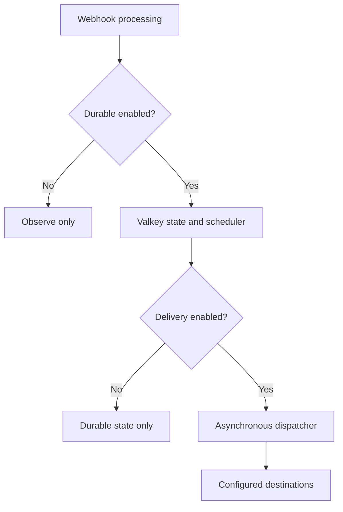
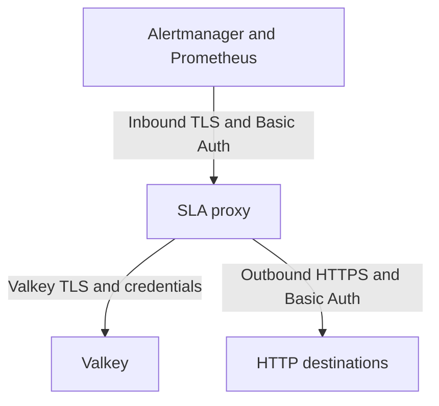

# SLA proxy configuration

[Getting started](getting-started.md) · [Concepts](concepts.md) · [Reference](reference.md) · [Operations](operations.md)

Start with [getting started](getting-started.md) to validate the three operating modes.
Use [minimal examples](../examples/README.md) for common tasks and
[alert-sla-proxy.yaml](../examples/alert-sla-proxy.yaml) for every configurable
field. YAML is loaded once at startup. Unknown/duplicate keys and extra YAML
documents are rejected. Durations are Go strings such as `5s` or `720h`.
Receiver environment variables do not configure this application.

CLI flags: `-config` (string, default `alert-sla-proxy.yaml` in the current directory),
`-version` (boolean, print version and exit), and `-help`. No hot reload or
configuration-check-only flag is provided. Do not start a production durable
configuration merely to validate it: startup can activate its namespace catalog.

## Part I — Configuration guide

Use the following steps to assemble a deployment. The YAML fragments illustrate
individual settings; combine them into one configuration document. For complete,
runnable configurations, use the [examples](../examples/README.md).

### Choose an operating mode



| Setting or dependency | Observe only | Durable state only | Delivery enabled |
|---|---|---|---|
| `durable.enabled` | `false` | `true` | `true` |
| `delivery.enabled` | `false` | `false` | `true` |
| Valkey and scheduler | No | Yes | Yes |
| Destination calls | No | No | Yes |
| Outbound HTTP credentials resolved | No | No | If configured |

Delivery without durable state is invalid. Start in observe-only mode to check
policy selection and calendar behavior. See [operating modes](concepts.md#purpose-and-operating-modes).

### Define SLA policies

This example selects a policy using the alert label `sla_id`. An alert with
`sla_id=business-hours` uses the weekday schedule; `sla_id=always` uses the
full-week schedule.

```yaml
sla_definitions:
  - sla_label: sla_id
    slas:
      business-hours:
        timezone: Europe/Stockholm
        schedule:
          monday: ["08:00-17:00"]
          tuesday: ["08:00-17:00"]
          wednesday: ["08:00-17:00"]
          thursday: ["08:00-17:00"]
          friday: ["08:00-17:00"]
      always:
        timezone: Europe/Stockholm
        schedule:
          monday: ["00:00-24:00"]
          tuesday: ["00:00-24:00"]
          wednesday: ["00:00-24:00"]
          thursday: ["00:00-24:00"]
          friday: ["00:00-24:00"]
          saturday: ["00:00-24:00"]
          sunday: ["00:00-24:00"]
```

Multiple definitions can use different selector labels. Their order matters;
see [policy selection](concepts.md#policy-selection).

### Add holiday exclusions

Add this block alongside `timezone` and `schedule` inside the desired policy:

```yaml
holidays:
  dataset: /etc/alert-sla-proxy/holidays/se.ics
  additional_dates:
    - "2026-12-24"
    - "2026-12-31"
```

Install the dataset and its adjacent manifest before startup. The path above
is illustrative, not a bundled file. Explicit dates can also be used without a
dataset. See [holiday datasets](holiday-datasets.md) for generation, coverage and
safe installation.

### Enable durable state

```yaml
durable:
  enabled: true
  policy_epoch: 1
  valkey:
    address: localhost:6379
    namespace: production-sla
delivery:
  enabled: false
```

Use a dedicated namespace for each independent lifecycle domain. Configure
Valkey persistence and a non-evicting memory policy. Choose the final destination
list before accepting alerts, even in state-only mode: existing occurrences
retain their original destinations. The epoch above is for a new namespace,
not an instruction to reset an existing epoch. See [safe configuration changes](operations.md#change-policies-and-destinations).

### Configure destinations

With durable state enabled, replace the `delivery` block with a configuration
such as the following. The URL is illustrative and must be replaced with the
actual connector endpoint.

```yaml
delivery:
  enabled: true
  sinks:
    - id: local-log
      type: log
    - id: servicenow
      type: http
      http:
        url: https://servicenow.example/inbound_event
        timeout: 5s
        basic_auth:
          username: "${SERVICENOW_USERNAME}"
          password: "${SERVICENOW_PASSWORD}"
```

Supply the referenced credentials in the process environment before starting
delivery. For ServiceNow, configure its [Prometheus connector](https://www.servicenow.com/docs/r/it-operations-management/event-management/prometheus-events-integration.html),
integration permissions and field/CI handling. Verify against a real tenant
before production. The proxy sends generic Alertmanager webhooks; see the
[HTTP destination contract](reference.md#http-destination-contract).

Destination IDs and registered settings must be chosen carefully: changing or
removing a registered destination is not supported. Adding a destination does
not add it to existing occurrences.

### Secure the deployment



These security boundaries are independent and optional according to deployment
mode. Use TLS for credentials crossing untrusted networks. Protect stored alert
payloads, configuration and process credentials.

| Boundary | Settings | Password reference example |
|---|---|---|
| Inbound webhook | `HTTP_*` environment variables | `HTTP_WEBHOOK_BASIC_AUTH_PASSWORD_ENV=WEBHOOK_PASSWORD` |
| Valkey | `durable.valkey.*` | `password_env: VALKEY_PASSWORD` |
| HTTP destination | `delivery.sinks[].http.*` | `password: "${DESTINATION_PASSWORD}"` |

The first two reference a bare environment variable name; the HTTP destination
uses whole-value interpolation. There is no general YAML environment expansion.
See [shared HTTP security](../http-security.md) for inbound setup.

## Part II — Configuration reference

**Required** identifies fields that must be supplied when applicable;
**Common** identifies settings normally changed during deployment; **Advanced**
identifies tuning best left at defaults initially. Defaults do not override
mode-specific requirements. Restart to apply changes and follow the
[safe configuration change procedure](operations.md#change-policies-and-destinations)
for existing durable namespaces.

## Listener and mode

| Key | Type | Default | Purpose / constraints | Level |
|---|---|---|---|---|
| `listen_address` | string | `:9012` | TCP host:port; numeric port 0–65535; 0 selects ephemeral port | Common |
| `webhook_path` | string | `/webhook` | Exact absolute path, distinct from `/metrics`, `/healthz`, `/readyz`; no trailing slash, dot segments or whitespace | Advanced |
| `max_body_bytes` | integer | `1048576` | Webhook request limit, 1–67108864 bytes; raise only for larger expected batches | Advanced |
| `shutdown_timeout` | duration | `10s` | Positive, at most 1m; bounded HTTP drain/runtime shutdown | Advanced |
| `evaluation_horizon_days` | integer | `370` | 1–3660 local dates including startsAt's date; increase for sparse calendars | Advanced |
| `durable.enabled` | boolean | `false` | Enable Valkey state and scheduling | Common |
| `delivery.enabled` | boolean | `false` | Enable asynchronous sink calls; requires durable enabled | Common |

All configured sinks receive structural validation in every mode. Runtime sinks,
outbound HTTP clients/transports and sink credential resolution are created only
when delivery is enabled. Missing outbound HTTP credential environment variables
do not prevent observe-only or state-only startup. Durable Valkey credentials
are needed whenever durable mode is enabled.

## Policies and calendars

| Key | Type | Default | Purpose / constraints | Level |
|---|---|---|---|---|
| `sla_definitions` | ordered list | required for observe-only | At least one definition; durable modes allow an empty list to retain known resolutions after policy removal | Required |
| `sla_definitions[].sla_label` | string | none | Unique selector label matching `[a-zA-Z_][a-zA-Z0-9_]*`; no implicit `sla_id` | Required |
| `sla_definitions[].slas` | map | none | Nonempty map of nonblank policy names, scoped to this definition | Required |
| `slas.<name>.timezone` | string | none | Explicit IANA zone, including `UTC`; `Local` rejected; zone data embedded | Required |
| `slas.<name>.schedule` | weekday → window list | none | Nonempty map; lowercase full English weekdays; windows described below | Required |
| `slas.<name>.holidays` | map | absent | Exclude local dates; omitted means no holiday exclusions | Common |
| `holidays.dataset` | absolute `.ics` path | absent | Local dataset plus adjacent `.ics.json`; see [dataset workflow](holiday-datasets.md) | Common |
| `holidays.additional_dates` | string list | absent | Exact valid `YYYY-MM-DD` local dates; allowed without a dataset | Common |

Policy field paths in the last rows are relative to
`sla_definitions[].slas.<name>`. Definitions are independent policy scopes even
when policy names match. The first nonempty matching label selects its
definition; unknown values are skipped without fallback. Selection is distinct
from calendar eligibility: a valid policy can still be pending or ineligible.
See [selection](concepts.md#policy-selection).

Weekday keys are lowercase full English names. Windows use exact `HH:MM-HH:MM`
syntax; `24:00` is allowed only as an end. Equal start/end is invalid; use
`00:00-24:00` for a full day. Starts are inclusive and ends exclusive. Overnight
windows continue into the following weekday. Overlaps are rejected within and
across weekdays, including Sunday/Monday and Saturday/Sunday boundaries;
adjacent windows are allowed. An empty weekday list represents no configured
windows, though an overnight window from the previous weekday may still apply.

An optional holidays block requires a dataset, explicit dates, or both.
Datasets support any operator-supplied region without country imports and require
explicit coverage and SHA-bound metadata. Explicit dates must be valid, exact
`YYYY-MM-DD` values. See the [dataset workflow](holiday-datasets.md) for public
holidays, subdivisions, company closures and offline generation.

## Durable state and Valkey

| Key under `durable` | Type | Default | Purpose / constraints | Level |
|---|---|---|---|---|
| `policy_epoch` | uint64 | `1` | Positive activation version; increase for catalog/delivery/protocol changes | Common for changes |
| `valkey.address` | string | `localhost:6379` | Single-primary endpoint; numeric port 1–65535 | Common |
| `valkey.database` | integer | `0` | Nonnegative database number | Advanced |
| `valkey.namespace` | string | `sla` | 1–64 bytes; no `{}` or pattern delimiters, colon, backslash or whitespace | Common |
| `valkey.username` | string | empty | Optional server username | Common when authenticated |
| `valkey.password_env` | string | empty | Name of password environment variable; if set, it must resolve nonempty at startup | Common when authenticated |
| `valkey.tls` | boolean | `false` | TLS 1.2+ using system trust roots; no insecure-skip option | Common for remote servers |
| `retention.completed_payload` | duration | `720h` | Positive payload retention after first durable resolution acceptance | Advanced |
| `retention.tombstone` | duration | `2160h` | Longer than payload retention, at most 10 × 365 days | Advanced |

Use a dedicated namespace per Alertmanager lifecycle domain. Use the same namespace, catalog and epoch for ordinary restarts; coordinate a higher epoch for catalog changes.

No Cluster discovery, Sentinel, custom CA or client-certificate fields are
provided. Configure persistence and noeviction on the server; application
acceptance is not a separate disk/replica receipt. Unresolved records have no
automatic expiry. Outstanding/held delivery pins required state past ordinary
retention. Changes to retention do not rewrite existing stored deadlines.
See [operations](operations.md#retention-and-restart).

## Scheduler

All keys below are under `durable.scheduler`. These are advanced settings for
bounded due-work processing; none is needed in a minimal example.

| Key | Type | Default | Change when / constraints |
|---|---|---|---|
| `poll_interval` | duration | `1s` | Due query cadence, 10ms–1m |
| `workers` | integer | `4` | 1–64 concurrent scheduler workers |
| `batch_size` | integer | `100` | 1–1000 records per bounded batch |
| `operation_timeout` | duration | `5s` | Positive, at most 1m; also bounds whole webhook acceptance attempt |
| `lease_duration` | duration | `30s` | At least 2 × operation timeout, at most 10m |
| `retry_initial` | duration | `5s` | Initial transient-error backoff, at least poll interval |
| `retry_max` | duration | `5m` | At least initial backoff, at most 1h |
| `reconcile_interval` | duration | `30s` | Maintenance cadence, at least poll interval and at most 1h |

Durable-specific validation runs when durable mode is enabled. The HTTP write
timeout is max(15s, operation timeout + 1s); header/read/idle timeouts are
5/10/60s. These fixed HTTP timeouts have no separate YAML settings.

## Destinations and authentication

`delivery.sinks` is a list, defaulting to one `{id: default, type: log}`
destination. Durable modes require 1–32 sinks. Explicit list entries replace
the default list. All sink IDs must be unique. Define stable destinations
before accepting alerts: the full set is frozen at first durable acceptance,
even with delivery disabled. Enabling delivery later does not retroactively
add destinations to old occurrences.

| Key under `delivery.sinks[]` | Type | Default | Purpose / constraints | Level |
|---|---|---|---|---|
| `id` | string | required on explicit entry | `[A-Za-z0-9_][A-Za-z0-9_.-]{0,127}`; stable destination identity | Required |
| `type` | enum | required on explicit entry | `log` or `http`; log must not have an http block | Required |
| `http` | map | absent | Required for HTTP sink | Required for HTTP |
| `http.url` | URL string | none | HTTP/HTTPS host required; valid optional port, no userinfo, fragment, whitespace or opaque URL; query allowed | Required for HTTP |
| `http.timeout` | duration | none | Positive and no greater than dispatcher delivery timeout | Required for HTTP |
| `http.basic_auth.username` | string | absent | Literal or exact `${NAME}`; provide with password | Common when authenticated |
| `http.basic_auth.password` | string | absent | Literal or exact `${NAME}`; provide with username | Common when authenticated |
| `http.idempotency_key` | boolean | `true` | Send the stable [delivery intent](concepts.md#delivery-lifecycle) ID in `Idempotency-Key`; destination deduplication is not assumed | Advanced |

Both auth fields may be absent for an unauthenticated destination. Otherwise
each must resolve nonempty when delivery is enabled. Username cannot contain
colon or CR/LF; password cannot contain CR/LF. Literal and environment values
can be mixed. Only whole-value `${NAME}` interpolation is supported, once, in
these two fields; `prefix${NAME}` and malformed references are rejected. Other
YAML fields are not expanded. Valkey `password_env` instead takes a bare
variable name.

Use HTTPS for remote Basic Authentication. TLS verifies system roots; no custom
CA, insecure-skip, client certificate, arbitrary header or per-alert URL
setting exists. Redirects are rejected. HTTP transport can use trusted process
proxy environment settings (`HTTP_PROXY`, `HTTPS_PROXY`, `NO_PROXY`) through Go's
default transport; these are not YAML options. Loopback destinations bypass
the standard proxy lookup. Protect configured endpoints, credentials, Valkey
payloads and outbound connectivity. Inbound listener security is configured
separately through the shared environment variables above; it does not change
outbound destination identity.

**Registered destination identity is immutable.** The destination registry
includes type, URL/query, timeout, authentication references/modes and
idempotency setting. Changing/removing registered destinations is rejected
even with a higher epoch. Credential **values** may rotate on restart;
changes to auth reference names or modes change identity. See
[safe changes](operations.md#change-policies-and-destinations).

## Dispatcher and retries

All keys below are under `delivery.dispatcher`; validation of these shared
tuning settings applies when delivery is enabled. HTTP sink timeout validation
applies even when delivery is disabled.

| Key | Type | Default | Change when / constraints |
|---|---|---|---|
| `poll_interval` | duration | `1s` | Delivery polling cadence, 10ms–1m |
| `workers` | integer | `4` | 1–64 shared workers; slow destinations occupy workers until deadline |
| `batch_size` | integer | `100` | 1–1000 due bindings per batch |
| `claim_lease` | duration | `30s` | Must cover delivery timeout + 3 × durable scheduler operation timeout; at most 10m |
| `delivery_timeout` | duration | `10s` | Positive, at most 1m; upper bound on individual HTTP timeout |
| `retry_initial` | duration | `5s` | Initial retry backoff, at least poll interval |
| `retry_max` | duration | `5m` | At least initial backoff, at most 1h |

See [delivery lifecycle](concepts.md#delivery-lifecycle) for authorization, receipts and ordering.

The default lease of 30s covers a minimum of 25s (10s delivery + 3 × 5s state-store budgets), leaving 5s of margin. This is a configuration budget, not a prediction of actual operation durations.


`Retry-After` may extend an individual retry deadline up to the separately
bounded hint; this does not change `retry_max`. No retry-attempt limit,
redrive endpoint or sink retirement setting exists. See
[retry behavior](operations.md#delivery-ordering-and-retries).

See [registry recovery](redis-debugging.md#incomplete-registry-corruption-and-development-reset) for registry inspection and recovery.

## Inbound HTTPS and endpoint authentication

Both services use the same optional environment variables (strings, empty by
default). These are not YAML settings:

| Variable | Purpose |
|---|---|
| `HTTP_WEBHOOK_BASIC_AUTH_USERNAME` | Webhook username |
| `HTTP_WEBHOOK_BASIC_AUTH_PASSWORD_ENV` | Name of the environment variable holding its password |
| `HTTP_METRICS_BASIC_AUTH_USERNAME` | Independent metrics username |
| `HTTP_METRICS_BASIC_AUTH_PASSWORD_ENV` | Name of the environment variable holding its password |
| `HTTP_TLS_CERT_FILE` | PEM server certificate chain path |
| `HTTP_TLS_KEY_FILE` | Matching PEM private-key path |

An entirely empty pair disables that feature; partial/invalid pairs and missing
referenced passwords fail startup. HTTPS uses the existing listener and port.
Health/readiness routes bypass authentication but still use the listener protocol.
Restart for security changes. Basic Auth over cleartext HTTP is unsafe on untrusted
networks; use HTTPS or an isolated backend behind a trusted TLS proxy. See the
[shared security reference](../http-security.md) for constraints, examples, CA
trust, Alertmanager/Prometheus configuration and rotation. Inbound security is
independent of outbound OTLP, Valkey and HTTP sink security.

