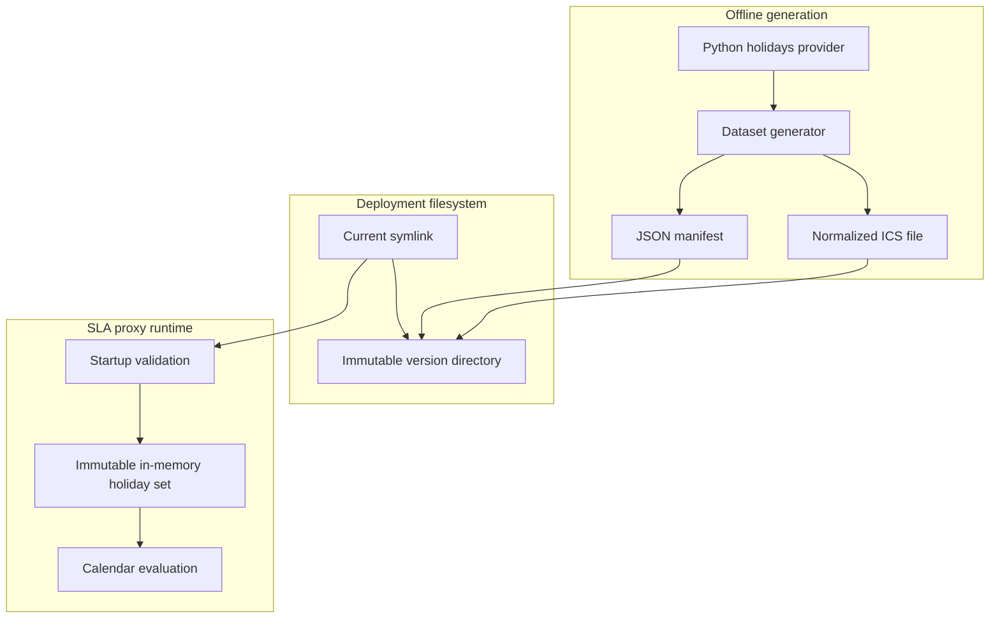
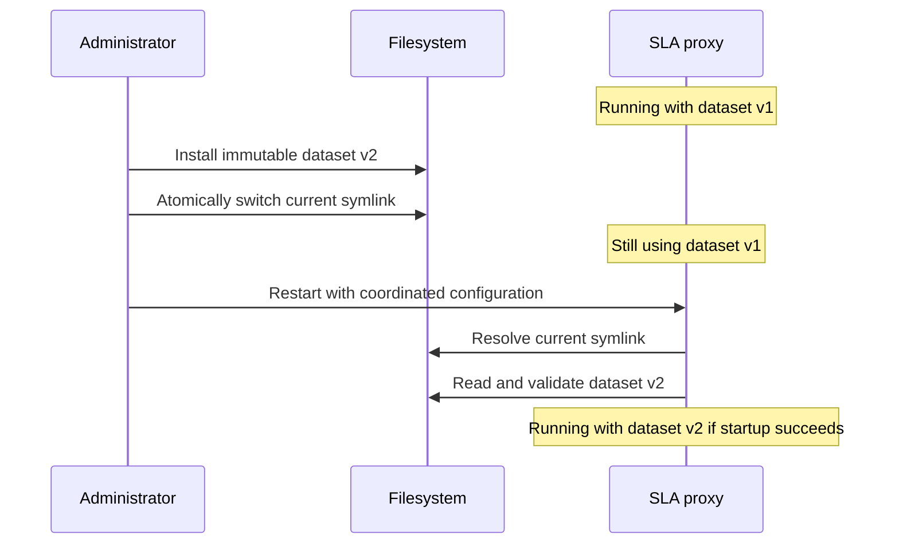
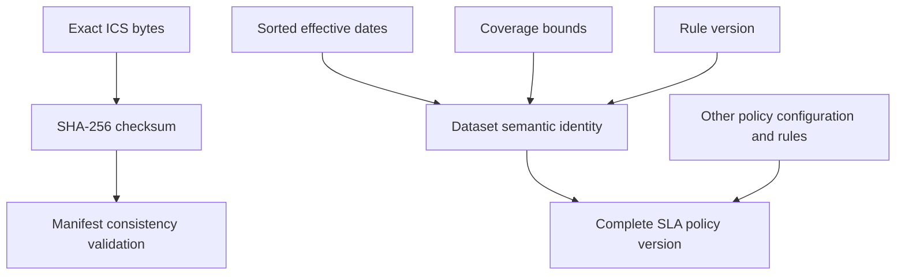
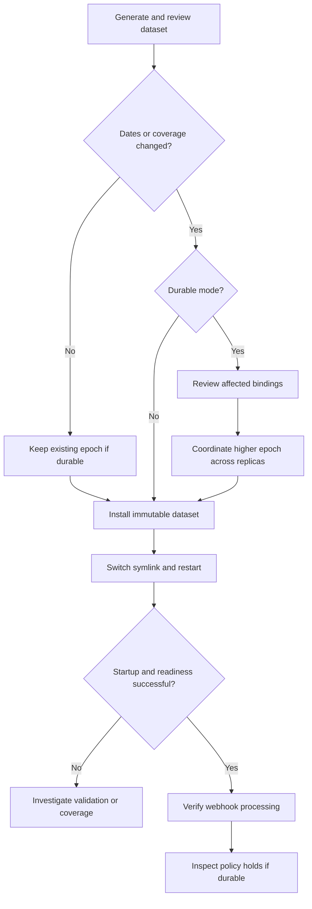

# Use offline holiday datasets

[Getting started](getting-started.md) · [Concepts](concepts.md) · [Configuration](configuration.md) · [Operations](operations.md) · [Reference](reference.md)

Holiday datasets allow SLA policies to exclude public holidays and other closure dates. The operator supplies a local `.ics` file and its adjacent `.ics.json` manifest. New countries and subdivisions require data and YAML configuration, not Go imports.

## Part I — Working with holiday datasets

### Workflow at a glance



Generate offline, review the dates and coverage, install the pair in a new immutable directory, switch the symlink and restart. In durable deployments, coordinate semantic changes with a higher policy epoch before activation.

The Go service never downloads calendars, starts Python, contacts a holiday API or reloads files in the background. The manifest establishes file consistency, not the correctness of holiday law. Restarting loads the dataset but does not migrate existing durable occurrences.

## Configure one policy

```yaml
sla_definitions:
  - sla_label: sla_id
    slas:
      business-hours:
        timezone: Europe/Stockholm
        schedule:
          monday: ["08:00-17:00"]
          tuesday: ["08:00-17:00"]
          wednesday: ["08:00-17:00"]
          thursday: ["08:00-17:00"]
          friday: ["08:00-17:00"]
        holidays:
          dataset: /etc/alert-sla-proxy/holiday-data/current/holidays_se.ics
          additional_dates: ["2027-12-24"]
```

`dataset` must be an absolute local path ending in `.ics`, pointing to a readable regular file. Relative paths, HTTP URLs and webcal URLs are not accepted. Symlinks are resolved once; the manifest is adjacent to the **resolved file**, named by appending `.json`. Policies sharing a canonical path share one immutable loaded set. Different policies can select different files without a global registry.

The dataset must contain all applicable holidays. A Bavaria dataset, for example, must include nationwide and statewide Bavarian dates. Municipality-specific or company closures require suitable data or explicit `additional_dates`. The service does not infer regional law. Manifest country and subdivision fields are informational.

Explicit additions take the `additional_date` reason before `holiday`, within valid dataset coverage. Dates are local civil dates in the policy's time zone, including the local date of an overnight carry; no UTC conversion is applied.

## Generate data offline

On a workstation or deployment preparation host, install the pinned offline tooling in a separate environment. Nothing here is required by the Go binary. Run the commands from the repository root.

```bash
python3 -m venv /tmp/sla-holiday-tools
/tmp/sla-holiday-tools/bin/python -m pip install \
  -r tools/holidays/requirements.txt
/tmp/sla-holiday-tools/bin/holidays-ics --help
```

Generate a new version directory; an existing directory is never overwritten:

```bash
/tmp/sla-holiday-tools/bin/python tools/holidays/generate.py \
  --country SE --first-year 2020 --last-year 2040 \
  --output-dir /tmp/sla-holidays-se-v1 --name holidays_se.ics

/tmp/sla-holiday-tools/bin/python tools/holidays/generate.py \
  --country DE --subdivision BY --first-year 2020 --last-year 2040 \
  --output-dir /tmp/sla-holidays-de-by-v1 --name holidays_de_by.ics
```

Each result contains the normalized `.ics` and adjacent manifest. The helper pins `holidays==0.108` and `icalendar==7.3.0`; all offline dependencies are pinned in [requirements](../../tools/holidays/requirements.txt).

The helper normalizes grouped durations into explicit one-day `DTSTART`/`DTEND` events using the pinned iCalendar parser, validates dates against the provider API, and computes the manifest. It rejects years outside the provider's advertised support. It removes volatile export timestamps, deduplicates dates and uses stable metadata, making repeated exports byte-reproducible with the same dependency versions. Observed dates outside requested years are clipped to declared years. Names are not exclusion rules.

Review legal and observance changes, regional completeness and declared coverage before installation. The exporter and provider remain the source of holiday correctness. The [checked-in fixtures](../../internal/slaproxy/testdata/holidays/README.md) were generated by this workflow. Other data sources are allowed if they meet the [accepted profile](#manifest-and-accepted-ics-profile) and trustworthy coverage contract.

### Inspect raw provider exports

The documented CLI in `holidays==0.108` uses a positional country code, `--years` for an inclusive range, `--subdiv` for subdivision, `--categories public` and `--output` for an explicit file.

```bash
/tmp/sla-holiday-tools/bin/holidays-ics SE --years 2020-2040 \
  --categories public --language en_US \
  --output /tmp/holidays_se.raw.ics

/tmp/sla-holiday-tools/bin/holidays-ics DE --subdiv BY --years 2020-2040 \
  --categories public --language en_US \
  --output /tmp/holidays_de_by.raw.ics
```

Raw exporter files use `DURATION`. **Do not install them directly.** Use the normalization helper above.

## Install and activate a dataset

Use immutable version directories on the destination filesystem. Transfer into a staging directory, verify the pair, and rename the directory into place. A single file rename cannot atomically replace both files; never overwrite the live pair one file at a time. A checksum mismatch fails closed but causes avoidable downtime.

Example layout after a subsequent update:

```text
/etc/alert-sla-proxy/holiday-data/
├── current -> se-v2
├── se-v1/
│   ├── holidays_se.ics
│   └── holidays_se.ics.json
└── se-v2/
    ├── holidays_se.ics
    └── holidays_se.ics.json
```

### Install an immutable version

After generation above, run with suitable privileges and fresh version/staging names:

```bash
install -d /etc/alert-sla-proxy/holiday-data

cp -a /tmp/sla-holidays-se-v1 \
  /etc/alert-sla-proxy/holiday-data/.se-v1-stage

mv /etc/alert-sla-proxy/holiday-data/.se-v1-stage \
  /etc/alert-sla-proxy/holiday-data/se-v1

ln -s se-v1 \
  /etc/alert-sla-proxy/holiday-data/current.new

mv -Tf /etc/alert-sla-proxy/holiday-data/current.new \
  /etc/alert-sla-proxy/holiday-data/current
```

`current` must be a symlink, not an ordinary directory. The symlink rename is atomic on the same filesystem. Provide service-user read access to both files and directory traversal; restrict write access to trusted administrators. Symlink and data directories must be trusted. Keep old versions and consistent Valkey/configuration backups for rollback.



For updates to existing durable deployments, follow [safe updates](#install-and-update-safely) before switching and restarting.

## Part II — Maintaining holiday datasets

## Coverage and readiness

At startup, every dataset must cover **yesterday through today + `evaluation_horizon_days` + 3 days**, inclusive, using each policy's local date. The extra boundary allowance covers civil-date boundaries. This operational window does not promise arbitrary historical or infinite coverage.


Every date from A through D must be covered. With the default horizon of 370 days, the dataset must cover through 373 days after today, as well as yesterday. For example, on 2026-11-24 in the policy's time zone, the required inclusive range is 2026-11-23 through 2027-12-02.

`/readyz` checks the same rolling window. It returns HTTP 503 when refreshing data is needed, potentially long before the last covered year ends. `/healthz` remains liveness only.

Every local date examined by calendar evaluation is coverage-checked, even an unscheduled weekday or an explicit additional date. An uncovered date produces `calendar_error`, never an ordinary non-holiday.

| Situation | Behavior |
|---|---|
| Insufficient startup coverage | Startup fails |
| Insufficient rolling coverage | `/readyz` returns 503 |
| Observe-only evaluation needs an uncovered date | HTTP 500 |
| New durable acceptance needs an uncovered date | HTTP 503 |
| Known durable resolution | Uses retained original decisions |

Readiness failure does not discard work or revoke external sends. Covered historical requests can still be processed; saved decisions and receipts continue following existing durable semantics without inventing new holiday facts.

Refresh before coverage expires. There is no background reload or automatic epoch bump. Extending coverage changes policy identity even if holiday dates remain unchanged.

## Dataset identity and policy changes

File integrity and semantic identity answer different questions.



The checksum detects byte changes. Semantic identity includes the effective sorted date set, coverage and rule version, not filename, event ordering, summary text or source labels. `additional_dates` remain part of the complete policy identity.

| Change | ICS checksum changes | Dataset semantics change |
|---|---|---|
| Rename file | No | No |
| Reorder events | Yes | No |
| Change descriptions | Yes | No |
| Add or remove holiday dates | Yes | Yes |
| Extend declared coverage | Not necessarily | Yes |

## Install and update safely

### Determine whether the update changes policy identity

| Update | Higher `durable.policy_epoch` in durable mode? | Effect |
|---|---|---|
| New bytes, same effective dates and coverage | No | Install matching manifest and restart |
| Move identical data to another path | No | Restart to load new path |
| Change effective holiday dates | Yes | Affected existing bindings held |
| Extend or otherwise change coverage bounds | Yes | Affected existing bindings held |
| Restore original semantics after changed policy activated | Yes, higher than active epoch | Can release compatible holds if coverage remains sufficient |

Assumes other policy/catalog settings are unchanged. See [safe configuration changes](operations.md#change-policies-and-destinations) for other changes.



Starting a changed policy at the same epoch is rejected; old instances are fenced after activation. Increasing the epoch activates the change, not migration or redrive.

Affected existing bindings become `policy_changed` holds, preserving original stored calendar decisions, [delivery intent](concepts.md#delivery-lifecycle) IDs and receipts. Unrelated policies remain unchanged. No automatic reinterpretation, migration or historical sink backfill occurs. Holds can affect unresolved work, outstanding authorized recovery and resolutions awaiting receipts. A previously authorized remote call can still complete during rollout; at-least-once ambiguity and firing-before-resolved ordering are unchanged.

### Rollback and held work

To release compatible held work, restore the exact original policy/dataset semantics under a still higher epoch. Restoring files alone cannot lower the active epoch. The old dataset must still meet startup coverage requirements; if expired, restoration may not be possible.

The service uses safe holds rather than persistent dataset snapshots or automatic migration. Plan coverage extensions and long-lived pending work operationally. No automatic migration/redrive endpoint exists. Do not delete records or registries to bypass holds.

## Troubleshoot

| Failure | Action |
|---|---|
| Absolute `.ics` path required | Supply absolute local path; no CWD-relative resolution or runtime download |
| Read/regular-file error | Check resolved path, sidecar location, permissions and size limits |
| SHA mismatch | Install consistent complete pair; regenerate manifest for reviewed bytes |
| Unsupported temporal property | Normalize offline; do not silently remove recurrence |
| Startup/readiness coverage error | Generate sufficient declared years for policy-local today and horizon, restart following epoch rules |
| `calendar_error` on old/future input | Check evaluated dates against coverage rather than assuming workdays |
| `policy_changed` after refreshing years | Coverage is semantic; follow hold/restore guidance |

Dataset lookups use `sla_proxy_holiday_evaluations_total{result}` with bounded `holiday`, `not_holiday` and `error` results. No path, hash, country or policy name becomes a metric label. Explicit additions within coverage bypass dataset lookup counters. See [reference](reference.md#ics-holiday-datasets).

## Part III — Dataset format reference

## Manifest and accepted ICS profile

### Manifest

A strict UTF-8 JSON manifest is mandatory. Example structure (the digest must match actual bytes, not the placeholder):

```json
{
  "schema_version": 1,
  "format": "ics-holiday-dataset",
  "country": "SE",
  "subdivision": "",
  "first_year": 2020,
  "last_year": 2040,
  "source": "python-holidays",
  "source_version": "0.108",
  "ics_sha256": "<64 lowercase hexadecimal SHA-256 digits>"
}
```

Years are inclusive and between 1 and 9999. Provenance source/version are required; country/subdivision do not select application rules. Unknown/duplicate fields, non-scalar/null values, unsupported schema/format, invalid years, trailing JSON and checksum mismatch fail startup.

SHA-256 verifies consistency, **not authenticity or completeness** of operator-supplied data. Never infer coverage from event extrema. A covered year may legitimately contain no events, but the dataset as a whole must contain at least one event.

### Supported ICS profile

The supported profile is deliberately smaller than general iCalendar:

- Exactly one complete `VCALENDAR`, `VERSION:2.0`, and at least one `VEVENT`.
- Every holiday has `DTSTART;VALUE=DATE:YYYYMMDD`; optional `DTEND;VALUE=DATE` is exclusive. Without `DTEND` it is one civil day.
- Multi-day ranges are expanded to civil dates and duplicate dates deduplicated.
- Folded lines and ordinary escaped text are parsed by the ICS library. Event names, descriptions, UID and timestamp metadata do not determine exclusions.
- `DURATION`, `RRULE`, `RDATE`, `EXDATE`, `EXRULE`, `RECURRENCE-ID`, date-time values, TZID date parameters, cancelled events, non-Gregorian scales and nested/non-event components are rejected. Export explicit dates instead of relying on recurrence.
- Events outside declared coverage, zero/backward ranges and malformed syntax fail.

### Validation and defensive limits

| Item | Limit |
|---|---:|
| ICS file | 8 MiB |
| Manifest | 64 KiB |
| Events | 100,000 |
| Unfolded line | 64 KiB |
| Days per event | 3,660 |
| Total expanded dates, including duplicates | 200,000 |

Only calendar → event nesting is accepted. Files must be regular, not devices, directories or FIFOs. These are defensive limits, not recommended dataset sizes.
