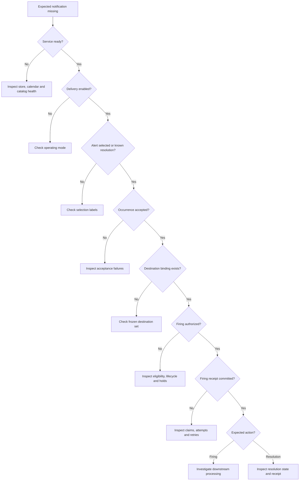
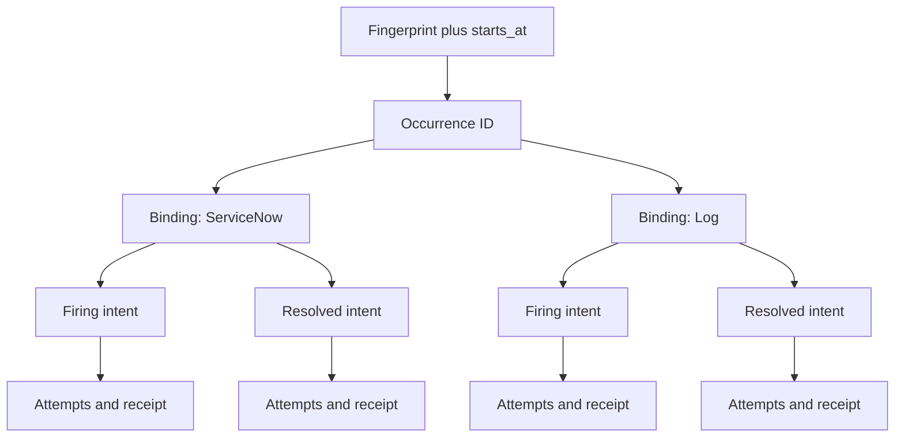
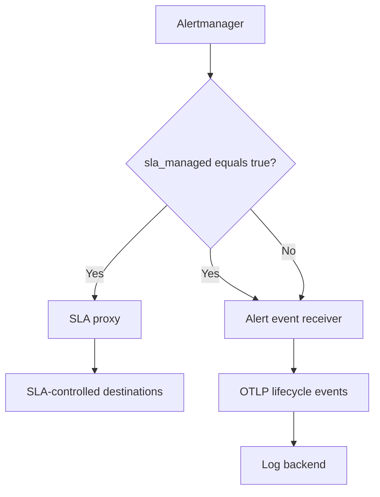
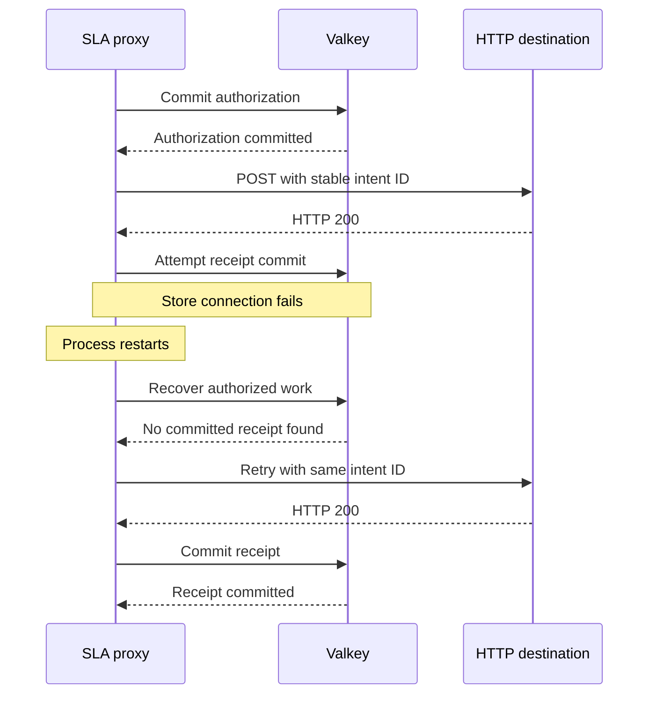
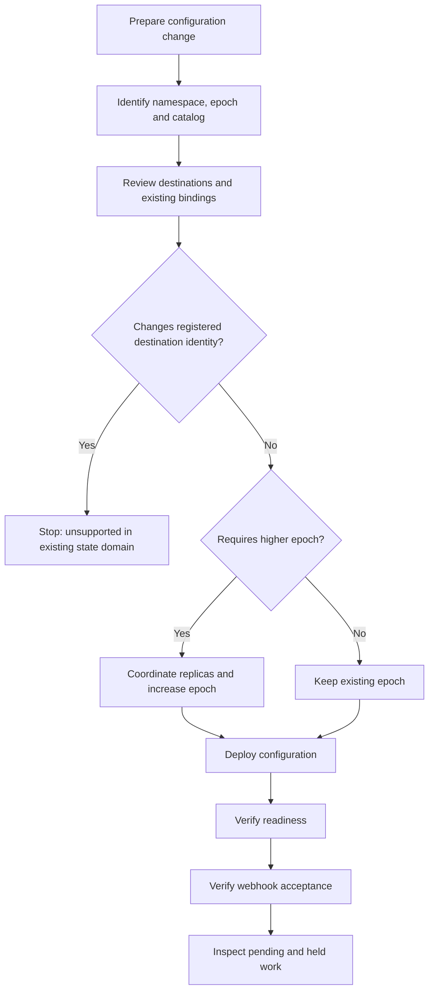

# SLA proxy operations and troubleshooting

[Getting started](getting-started.md) · [Concepts](concepts.md) · [Configuration](configuration.md) · [Metrics and HTTP reference](reference.md)

Use this guide during incidents, routine maintenance and configuration changes. For the underlying lifecycle and delivery model, see [concepts](concepts.md); for exact fields and metrics, see [reference](reference.md).

## Part I — Troubleshooting

## Diagnose a missing notification

Start with the following diagnostic workflow. Readiness failure is a clue, not proof that previously authorized delivery has stopped. Investigate the specific occurrence and destination rather than relying on aggregate metrics alone.



## Health, acceptance and delivery

| Evidence | What it proves | What it does not prove |
|---|---|---|
| `/healthz` HTTP 200 | Listener is alive | Store or destination readiness |
| `/readyz` HTTP 200 | Observation capability and rolling ICS coverage, plus active store/catalog health in durable modes | Queue fully scanned, destinations available, or backlog drained |
| Observe-only webhook HTTP 200 | Valid observation completed (skips possible) | Persistence or forwarding |
| Durable webhook HTTP 200, `persisted: true` | All selected inputs committed to Valkey | Separate disk/replica receipt or sink delivery |
| `forwarded: false` | Handler did not synchronously forward | Delivery dispatcher is disabled; check mode instead |
| Sink success / HTTP 2xx | External operation accepted at its boundary | Durable delivery receipt or completed downstream workflow |
| Committed action receipt | Durable evidence of observed sink success | Exactly-once execution or downstream persistence |

Inspect `mode`, `selected`, `skipped`, `persisted_count` and `failed_count` in the webhook response or observation log. Validation precedes state operations. A durable 503 can follow partial acceptance; retry the whole batch without assuming prior commits were rolled back.

## Find the problem

| Symptom | Likely cause / next action |
|---|---|
| Skipped alert | Check original selector labels and first nonempty matching definition; unknown values never fall through |
| Dataset coverage readiness failure | Refresh data to cover the rolling local-date horizon and restart; existing saved decisions are retained |
| Pending alert | SLA window has not opened; inspect next evaluation, zone, holidays and horizon |
| Observe-only `unknown` | Notification evidence does not establish activity at a passed opportunity; this is not the durable known-state rule |
| Eligible but no delivery | Check delivery enabled, binding hold, retry deadline and worker backlog; eligibility alone is not a receipt |
| HTTP retry | 408/429/5xx, typed transport failure or shutdown; inspect sink/action, status and `failure_class` |
| Permanent delivery hold | Other 4xx/redirect/unsupported status; fix the cause, but no automatic redrive API exists |
| Policy hold | Pinned policy changed/removed; restore exact policy with higher epoch to release compatible work |
| Resolution-conflict hold | First `endsAt` is authoritative; conflicting repeats need investigation, not automatic correction |
| Horizon hold | Bounded calendar search found no opportunity; never treat it as permanent ineligibility |
| Receipt missing after HTTP success | Receipt commit failed or is ambiguous; duplicate recovery is possible |
| Ready check fails after rollout | Compare active policy epoch/catalog and schema readiness; old instances cannot keep committing |
| Incomplete registry / quarantine | Follow [advanced recovery](redis-debugging.md#recovering-from-inconsistent-valkey-state); do not delete control keys |

## Investigate an occurrence

Use the [inspection API](reference.md#occurrence-inspection) to find stored
occurrences by alert name, lifecycle or sink state. Fetch an occurrence by ID
to inspect its per-sink holds, retries and receipts. For example, a query for
`lifecycle=firing&sink_id=servicenow&delivery=delivery_failed` lists firing
occurrences with a failed ServiceNow binding.

Each sink binding can have separate firing and resolved [delivery intents](concepts.md#delivery-lifecycle) stored by the proxy.



The diagram shows possible relationships, not a guarantee that all intents or receipts exist.

| Identifier | Scope |
|---|---|
| `fingerprint` + `starts_at` | Exact alert occurrence |
| `occurrence_id` | Durable occurrence record |
| `binding_id` | Policy and destination binding |
| `sink_id` | Configured destination |
| `intent_id` | Logical firing or resolution delivery |
| `attempt` | Individual attempt |

Use the exact alert occurrence, not just its fingerprint: correlate `fingerprint` **and** `starts_at` from acceptance/lifecycle logs with `occurrence_id`, `binding_id`, `sink_id`, `intent_id`, action and attempt from delivery logs. One occurrence can have several independent sink bindings.

Check the occurrence's known lifecycle and each binding's state. An alert can be eligible under the calendar but not authorized, or authorized for one sink while another remains held or retrying. `SLA HTTP request completed` reports external acceptance; receipt-commit logs are separate. Log sink records omit labels and annotations.

Use those IDs with the read-only commands in [Valkey inspection](redis-debugging.md#read-only-inspection). Inspect `bindings.<binding_id>.intents.firing.receipt` and the resolved receipt. Pending delivery, eligibility, intent readiness and claims are **not** receipts. In particular, a resolution can be delivered to a sink only after that sink has a successful firing receipt, even if the SLA window has closed.

Occurrence JSON contains sensitive original payload data; restrict its output. Do not change Valkey keys while investigating.

## Delivery ordering and retries

| Condition | Action |
|---|---|
| Pending SLA | Persist and schedule; no sink call |
| Eligible, known firing | Ready firing intent for each frozen sink |
| Resolution before authorization | Cancel that sink's unsent firing; no standalone resolution |
| Resolution after authorization | Preserve potentially delivered firing and recover its receipt/retry |
| Successful firing receipt for a sink | That sink may deliver the corresponding resolution, even outside SLA |
| Receipt already committed | Repeated webhooks/discovery do not resend that action |
| 2xx HTTP | Sink success; attempt to commit receipt |
| 408, 429, 5xx, network error or timeout | Durable retry; timeout/connection failure may have an unknown external outcome |
| Other 4xx, redirects or other unsupported status | Explicit permanent failure/hold; no automatic redrive |
| Shutdown cancellation | Retain authorization and a retryable outcome for restart recovery |

**Authorization is the durable send decision; a receipt is evidence of successful sink execution recorded afterward.** Resolution before first authorization cancels the firing. Resolution racing after authorization may coincide with the external call; the firing receipt merges into the latest resolved occurrence and enables that sink's resolution. There is no retroactive **first authorization** after resolution.

Retry delay uses exponential backoff with jitter, default 5s initially and 5m maximum, without an arbitrary attempt limit. Valid `Retry-After` on 429/503 delays the next attempt by at least that hint or the backoff, whichever is longer. Delta seconds and HTTP dates are supported; hints are capped at 24h. Other responses ignore this header. A failing binding does not hot-loop or retry successful sinks.

`Idempotency-Key` defaults to the stable intent ID and can be disabled with `http.idempotency_key: false`. It remains identical across retries. Do not assume ServiceNow or another receiver deduplicates this header. The guarantee is **at least once**, never exactly once. HTTP 2xx means transport/API acceptance, not confirmed downstream event creation, persistence or workflow completion.

No transaction can atomically coordinate Valkey and HTTP/log side effects. A crash after authorization but before I/O is indistinguishable from a successful send followed by a lost receipt. Recovery may retry that authorized firing even when a resolution is now known. Stable intent IDs identify duplicates.

For bounded transport diagnostic classes, log fields and exact metric meanings, see [delivery logs and metrics](reference.md#delivery-logs-and-metrics). TLS errors and cancellation remain retryable. Raw endpoint, auth and transport errors are not retained in HTTP diagnostic errors. At-least-once attempts do not promise success for permanently held work.

### Part II — Operating the service

## Monitoring

The following queries help separate webhook failures, selection problems, sink attempts and durable receipts. Filter by deployment/namespace labels supplied by your scrape configuration when monitoring more than one state domain.

```promql
# Durable webhook/store failures
sum(rate(sla_proxy_notifications_received_total{status="5xx"}[5m]))
sum by (operation) (rate(sla_proxy_state_store_errors_total[5m]))

# Skips and external attempt outcomes
sum by (reason) (rate(sla_proxy_alerts_skipped_total[5m]))
sum by (sink_id, result) (rate(sla_proxy_delivery_attempts_total[5m]))

# Successful durable receipts
sum by (sink_id, action) (rate(sla_proxy_delivery_receipts_total[5m]))

# Namespace-wide work: select replicas of ONE namespace before taking max
max(sla_proxy_pending_occurrences)
max by (sink_id) (sla_proxy_delivery_failed_bindings)
```

Interpret these measurements according to their stage:

- A webhook 5xx rate indicates processing failures, not necessarily that every occurrence in the batch was rejected; durable 503 can follow partial acceptance.
- Sink attempts and receipts measure different events. A successful sink call can lack a confirmed receipt, and an unconfirmed Valkey `EXEC` reply can undercount committed receipts.
- Pending and failed binding gauges describe queued or held work, not simply the number of currently firing alerts.

Give scrape targets external labels for namespace/deployment; do not combine unrelated namespaces under one max. Gauges are sampled namespace-wide snapshots, not process-local counts. Sum counter rates across replicas where appropriate; **never sum namespace gauges**. No metric labels contain fingerprints or URLs. For metric definitions and additional scheduler/dispatcher metrics, see [reference](reference.md#delivery-logs-and-metrics).

### Additional monitoring queries

Filter each expression to the deployment under investigation. The failure ratio is undefined when there is no request traffic.

```promql
# Webhook failure ratio
sum(rate(sla_proxy_notifications_received_total{status="5xx"}[5m]))
/
sum(rate(sla_proxy_notifications_received_total[5m]))

# Policy evaluation errors
sum by (reason) (rate(sla_proxy_policy_errors_total[5m]))

# Scheduler errors
sum by (operation) (rate(sla_proxy_scheduler_errors_total[5m]))

# Delivery retries
sum by (sink_id, action) (rate(sla_proxy_delivery_retries_total[5m]))

# Unresolved and ready work (one namespace)
max(sla_proxy_unresolved_occurrences)
max(sla_proxy_delivery_ready_bindings)
```

### Recommended alerting conditions

| Area | Investigate when |
|---|---|
| Ingestion | Sustained webhook failures or unexpected selection skips |
| Calendar | Policy errors or dataset readiness failures |
| Store | Sustained state-store errors or loss of readiness |
| Scheduler | Increasing lag, persistent errors or growing due work |
| Delivery | Sustained retries, growing ready backlog or held bindings |
| Capacity | Unresolved state or storage grows beyond expected workload |

Choose thresholds and evaluation periods based on normal traffic and operational objectives. Pending SLA work is not inherently a fault; a closed SLA window can legitimately create a backlog. Use the [metrics reference](reference.md#metrics-and-logs) for definitions.

## Alertmanager routing



Configure Alertmanager fan-out so the SLA proxy receives selected alerts and the event receiver still receives all alerts. Adapt this routing fragment to your existing configuration, including grouping and timing:

```yaml
route:
  receiver: event-receiver
  routes:
    - receiver: sla-proxy
      matchers: ['sla_managed="true"']
      continue: true
    - receiver: event-receiver

receivers:
  - name: event-receiver
    webhook_configs:
      - url: http://event-receiver:9011/webhook
        send_resolved: true
  - name: sla-proxy
    webhook_configs:
      - url: http://sla-proxy:9012/webhook
        send_resolved: true
```

The unconditional final child route sends all alerts to the event receiver. A parent's receiver is a fallback, not automatic fan-out. `continue: true` allows selected alerts to reach both child routes. Validate the final configuration with `amtool check-config` and test routing with your Alertmanager before deployment.

Use [native HTTPS and endpoint Basic Auth](../http-security.md), or a trusted TLS reverse proxy with an isolated backend. For HTTP outbound security and exact payload behavior see [reference](reference.md#http-destination-contract).

## Secure webhook and metrics access

Use the [shared inbound security guide](../http-security.md) for native HTTPS, independent Basic Auth, trusted-proxy deployments, CA trust and smoke tests. Defaults remain HTTP/no auth. Security errors fail before listening. Unauthorized requests return 401 before webhook processing; check client credentials rather than investigating lifecycle or sink retries. Health probes bypass Basic Auth but must use HTTPS when TLS is configured. Restrict probe/backend access through network controls. Restart after password/certificate rotation. Inbound security is independent of outbound connections and does not require deleting Valkey state or changing SLA policy epochs.

`/readyz` also bypasses Basic Auth; its existing Valkey/calendar readiness checks remain in effect.

## Retention and restart

Unresolved occurrences have no automatic expiration. Resolved payloads normally compact 30 days after first durable resolution acceptance; tombstones expire after 90 days. Repeats do not extend deadlines. Outstanding/held delivery pins required state beyond retention, including ambiguous authorized firing and resolutions waiting for firing receipts. Maintenance applies retention eventually.

Restart with the same namespace, catalog and epoch to recover pending work and expired claims. Compaction/deletion limits replay protection; very old webhook replays can become new work after tombstones expire. Retention tuning only affects newly recorded deadlines. Monitor unresolved, pending and held gauges and storage.

<a id="shutdown-and-routing"></a>

## Shutdown and restart

SIGINT/SIGTERM stops readiness, closes the listener and drains active HTTP requests for at most `shutdown_timeout`. Expiry force-closes connections and exits nonzero. Listener failures, including occupied ports, also exit nonzero. HTTP header/read/idle timeouts are 5/10/60 seconds. The write timeout is 15s, extended in durable modes when needed to cover the operation timeout plus 1s.

#### Part III — Changes and recovery

## Outages and recovery

| Failure | Behavior / recovery |
|---|---|
| Valkey unavailable before startup | Durable initialization fails; observe-only requires no Valkey |
| Valkey unavailable during operation | Acceptance returns 503, readiness fails, workers cannot safely commit. Restore the same store and restart if needed |
| HTTP destination unavailable | Persisted exponential-backoff retries; other bindings remain independent, subject to the shared worker pool |
| Sink accepted, receipt write unavailable | Outcome is ambiguous; recovery may resend with the same intent ID |
| Process stops during a delivery | Authorized work and expired claims recover after restart; already accepted external effects cannot be undone |
| Store data evicted/lost | Replay protection and pending work can be lost. Restore consistent backups; an epoch increment cannot recreate history |
| Index corruption | Detecting process stops store work and attempts persistent quarantine. Follow the fence-first repair procedure; sibling writes may already have committed |

Configure persistence, `noeviction`, storage capacity and exclusive schema ownership. AOF/fsync always reduces local crash loss; replication/failover still defines the actual loss window. There is no per-request disk/replica barrier. Back up occurrence records and all control registries consistently. Readiness is not proof of completed reconciliation or external destination readiness.

**Recovery principle:** restore the same consistent state domain wherever possible. Do not create a new namespace, increment an epoch, or delete control keys as a substitute for recovering lost occurrences and receipts. A missing receipt after a successful external call remains ambiguous and may cause a duplicate on retry.

### Recovering an ambiguous delivery



This example assumes the receipt was not committed. If it was committed but the reply was lost, recovery can find it and avoid repeating the action. A missing receipt is not proof of missing external delivery.

## Change policies and destinations

`durable.policy_epoch` is a positive, operator-controlled activation version for one namespace. Use the same epoch/catalog for normal restarts or concurrent instances. Increase it when activating policy/catalog/delivery-mode changes. A higher epoch fences old instances, so coordinate the rollout across all replicas.

The full authoritative change matrix is in [configuration changes and key deletion](redis-debugging.md#configuration-changes-and-key-deletion).

| Change | Required action and effect |
|---|---|
| SLA policy change/removal, including effective ICS dates or coverage | Use a higher epoch. Affected pinned bindings are held, not migrated; new occurrences use current selection. Known resolutions still commit. Restoring the exact pinned policy under a higher epoch can release holds |
| Add a destination | Retain every registered destination unchanged and use a higher epoch. Only new occurrences gain the sink, including when old alerts are pending; no backfill |
| Change/remove/rename a destination | Rejected even with a higher epoch. URL, query, type, per-sink timeout, auth mode/reference and idempotency settings are immutable; no application retirement/migration/redrive procedure |
| Rotate credential values | Supported on restart without an epoch change if literal/reference modes and reference names remain the same. Permanent failures are not automatically redriven |
| Change runtime tuning | Workers, polling, shared timeout and backoff changes need no epoch change, subject to validation. Existing retry/lease deadlines remain stored. Per-sink HTTP timeout is destination identity |
| Change namespace/database/server | Creates a separate state domain unless data is preserved; does not migrate receipts, tombstones, authorizations or work |

Before a rollout, identify the namespace, active epoch/catalog, registered sinks and affected pending/held bindings. Coordinate replicas so old processes do not continue attempting writes after the new epoch activates. After rollout, check `/readyz`, acceptance and hold metrics; an epoch increment activates a change but does **not** migrate old work.

Never delete registries or individual keys to bypass startup validation.

### Rollout workflow



## Dataset refresh and expiry

Use [offline holiday datasets](holiday-datasets.md) for generation, manifests, immutable version directories, epoch changes, backup/rollback and failure diagnosis. The manifest binds exact file bytes; policy identity hashes effective dates and coverage. Byte-only equivalent updates do not need an epoch change, but changed dates **or coverage bounds** do. Existing bindings are held, not migrated.

`/readyz` warns when the current local date's rolling horizon no longer fits. Calendar evaluations reject uncovered dates even on unscheduled days or explicit additions. Readiness failure does not cancel already authorized sends or erase receipts. Known resolutions/saved decisions follow their pinned durable semantics. Restoring old bytes must also satisfy startup coverage; if old data has expired, exact restoration may be unavailable. No automatic migration/redrive is provided.

## Advanced recovery

Keep [Redis/Valkey debugging](redis-debugging.md) available for key-level investigation and the [fence-first repair procedure](redis-debugging.md#coordinated-storage-repair). Implementation details are in the [current implementation notes](../specifications/sla-proxy-implementation.md).

