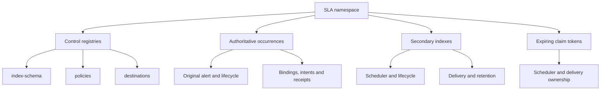
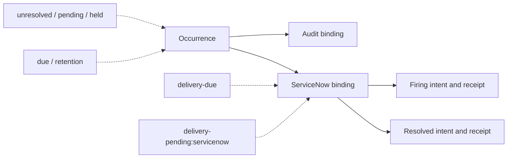
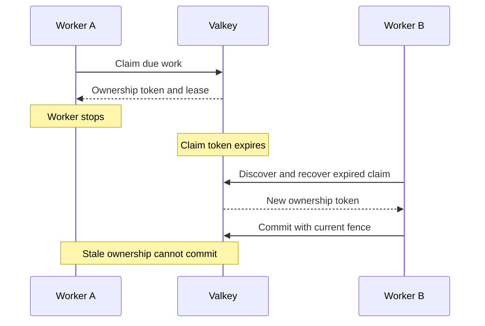
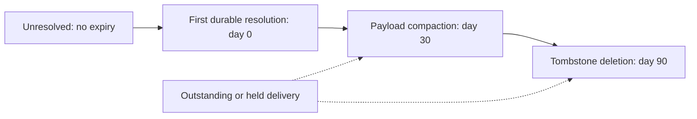
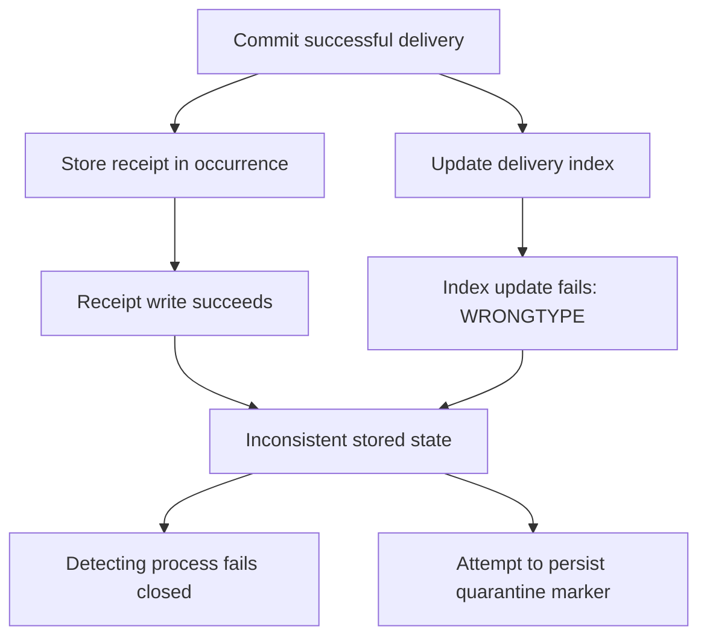
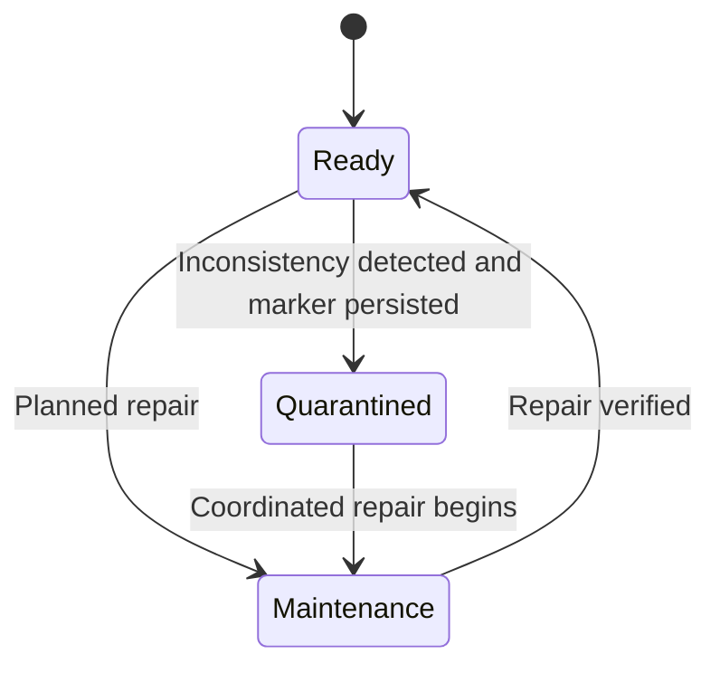
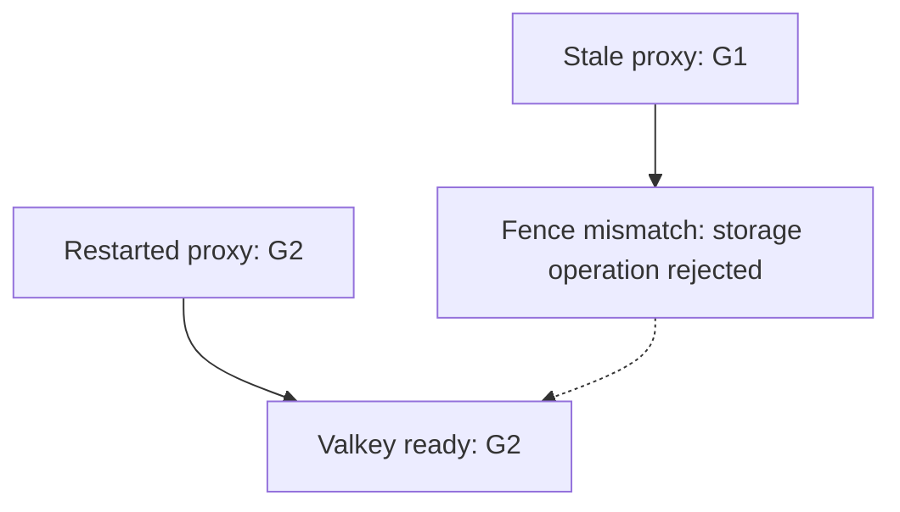
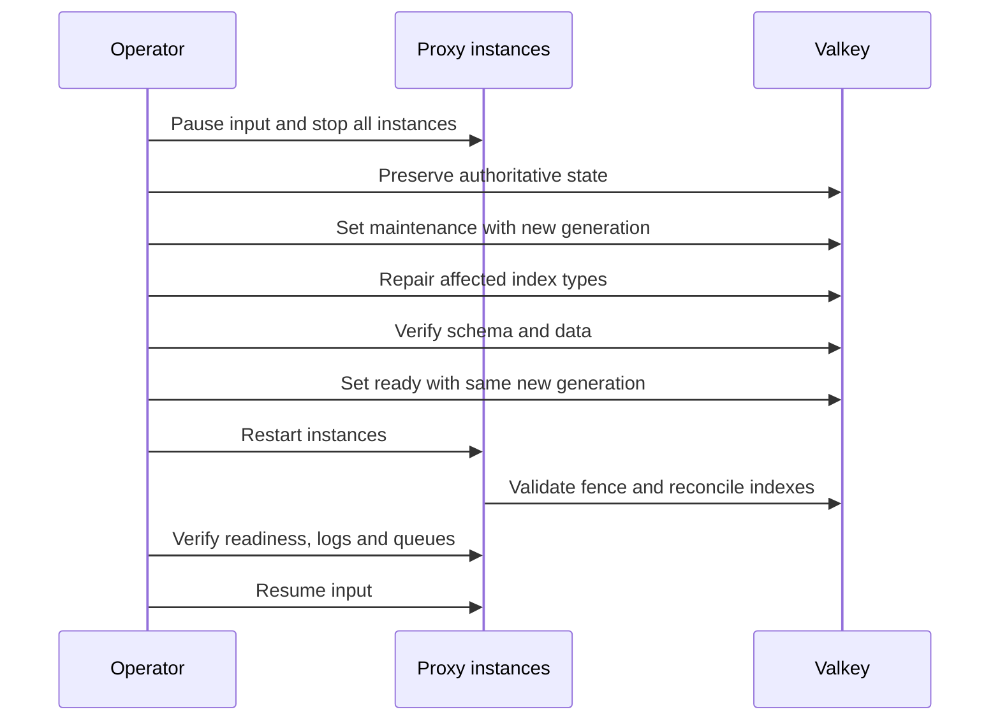

# SLA proxy Redis/Valkey debugging and recovery

[Documentation index](../README.md) · [Concepts](concepts.md) · [Operations](operations.md) · [Configuration](configuration.md)

This guide covers durable modes of `alert-sla-proxy`. Observe-only mode does not require Valkey. The SLA proxy's state is independent of the event receiver's `alertstate:*` and `alertidemp:*` keys; see [event receiver debugging](../event-receiver/redis-debugging.md).

**No routine configuration change requires deleting keys.** Preserve authoritative occurrences, receipts and control registries together. Use read-only inspection first; consult the [change matrix](#configuration-changes-and-key-deletion) before changing a deployment.

## Part I — Understanding stored state

## Namespace and key layout

Examples use database `0` and `durable.valkey.namespace: sla`. Substitute the configured endpoint, database and namespace, and use deployment-approved TLS and authentication. `redis-cli` and `valkey-cli` support the commands shown here.

A namespace is an application-defined grouping of keys, not a native Valkey isolation or access-control mechanism. The prefix `sla:{sla}:` consists of the configured namespace, the literal hash tag `{sla}`, and a suffix. The hash tag co-locates transaction keys in a Cluster slot; it does not imply support for Cluster discovery, MOVED handling or Sentinel failover. The client uses a single primary endpoint.



| Data | Recovery role |
|---|---|
| Control registries | Preserve with occurrences; do not infer from current YAML |
| Occurrence documents and receipts | Authoritative; cannot be reconstructed from indexes |
| Secondary index memberships and scores | Reconstructable from authoritative occurrences through reconciliation |
| Claim tokens | Temporary ownership; preserve during repair, allow normal expiry |

## Control registries created at startup

Successful first durable startup creates three shared JSON string keys, even before accepting an alert. Normal restarts retain them.

| Key | Responsibility |
|---|---|
| `sla:{sla}:index-schema` | Index protocol, readiness and generation |
| `sla:{sla}:policies` | Active configuration epoch and catalog digest |
| `sla:{sla}:destinations` | Registered sink IDs and fingerprints |

### Storage protection registry: `index-schema`

<a id="schema-fence-index-schema"></a>

```json
{"version":1,"state":"ready","generation":"cfb3ca66f88ca34b434010b5afab0985"}
```

`version` is the internal index protocol, not a release, occurrence format or policy epoch. The `state` field controls whether the SLA proxy considers durable processing safe. Quarantine (`quarantined`) is an application-managed protective state used when a storage inconsistency is detected; it is not a Valkey feature. `maintenance` deliberately disables durable processing during coordinated repair, while `ready` permits normal processing subject to other checks.

Processes retain the expected version, state and generation. These checks are called *fencing*: they prevent incompatible or stale instances from committing durable changes. Processes cannot adopt a repaired generation automatically. Normal restarts do not regenerate it. See [what quarantine means](#what-quarantine-means) for operational consequences.

### Policy registry: `policies`

```json
{"epoch":1,"digest":"32d45fda0f67d40ce0c88c5d62239619caaabff648f708701b088c6d324f167b"}
```

The positive operator-controlled `durable.policy_epoch` activates a catalog. Lower epochs and identical epochs with different digests are rejected. The deterministic digest includes ordered SLA namespaces, policy versions, sink catalog, delivery enablement and store protocol, not every YAML option. Individual policy versions include rules, evaluation horizon and calendar provider/rule versions. Activation fences older instances through readiness and transaction checks; coordinate all replicas. An epoch increase does not migrate records or repair missing keys.

### Destination registry: `destinations`

```json
{"audit":"c19963290b35a5810a7780ba0ed2747e4621bb37d741f11a50eab3845c5d40e5","servicenow":"dbfc29de017e47355579268168208dda871869ad9963e12515c18641948821d3"}
```

Each property is a stable sink ID, not a sink type. Its SHA-256 fingerprint covers type, HTTP URL/query, HTTP timeout, credential references/modes and idempotency-header setting. Literal/resolved credential values are excluded; raw URLs, usernames and passwords are not stored in the registry.

The registry is append-only. Existing IDs must retain their fingerprints. Changing or removing a registered destination fails startup even with a higher epoch or apparently completed work. No retirement, migration or redrive API exists.

| Mechanism | Purpose | Change |
|---|---|---|
| Schema version | Index protocol compatibility | Protocol upgrade |
| Schema generation | Fence stale processes | Coordinated repair |
| Policy epoch | Activate catalog | Operator-controlled catalog change |
| Policy version | Identify policy semantics | Rules, horizon or calendar semantics change |
| Destination fingerprint | Preserve sink identity | Registered identity must remain unchanged |

## Occurrences, indexes and leases

All suffixes below use `sla:{sla}:` as prefix.

### Authoritative records and identity

| Suffix | Type | Contents |
|---|---|---|
| `occ:<occurrence_id>` | JSON string | Original alert/group data, lifecycle, bindings, eligibility, intents, retries, claims and receipts |

Occurrence IDs hash original fingerprint and canonical UTC RFC3339Nano `startsAt`. Binding IDs include occurrence, SLA label/value and sink ID. Firing/resolved intent IDs include occurrence, binding and action. Nanoseconds are preserved independently of arrival time.

### Frozen bindings and receipts

First durable acceptance freezes the full sink set, including initially pending occurrences. Each binding has independent firing and resolved receipts. Inspect `bindings.<binding_id>.intents.firing.receipt` and `bindings.<binding_id>.intents.resolved.receipt`. Eligibility, `pending_delivery` and active claims are not receipts. Resolution delivery requires that sink's firing receipt. HTTP 2xx establishes API acceptance, not downstream completion.



Dashed arrows illustrate discovery references, not simultaneous memberships or guaranteed existence of intents.

### Scheduler and lifecycle indexes

| Suffix | Type | Purpose |
|---|---|---|
| `due` | Sorted set | Scheduler work or claim recovery |
| `unresolved` | Set | Known-firing occurrences |
| `pending` | Set | Firing occurrences with pending SLA binding |
| `held` | Set | Lifecycle/policy binding holds |
| `intent-index` | Set | Occurrences with ready uncanceled intents; not receipts or a due-only queue |

### Delivery indexes

| Suffix | Type | Purpose |
|---|---|---|
| `delivery-due` | Sorted set | Delivery/retry or expired-claim recovery |
| `delivery-ready` | Set | Queued binding work including retry delay without active claim |
| `delivery-claimed` | Set | Persisted claims including expired claims awaiting recovery |
| `delivery-held` | Set | Permanent failures or policy/destination holds |
| `delivery-pending:<sink_id>` | Set | Queued work for one sink including retry delay |
| `delivery-inflight:<sink_id>` | Set | Persisted claims for one sink |
| `delivery-failed:<sink_id>` | Set | Held bindings for one sink |

Delivery-index members are `<occurrence_id>:<binding_id>`; lifecycle indexes use occurrence IDs. Sorted-set scores are Unix epoch milliseconds rounded up for fractional milliseconds, preventing premature execution. JSON retains exact timestamps. A due score may represent lease expiry rather than SLA opening. Index membership does not establish external delivery.

### Claims and leases

| Suffix | Type | Purpose |
|---|---|---|
| `claim:<occurrence_id>` | Expiring string | Scheduler ownership token with matching fence/deadline in occurrence |
| `delivery-claim:<occurrence_id>:<binding_id>` | Expiring string | Delivery ownership token |



Expiry permits recovery; it does not prove external I/O failed. A persisted claim can remain after its token expires. Fencing protects state commits, not already authorized external side effects. Do not delete tokens manually to force delivery.

### Retention and index behavior

| Suffix | Type | Purpose |
|---|---|---|
| `retention` | Sorted set | Occurrences due for payload compaction or tombstone deletion |

Occurrence/control keys normally have `TTL = -1`. Maintenance uses `retention`, not native row TTL. Unresolved records do not expire automatically. Defaults are 30 days for resolved payload and 90 days for tombstone retention, both measured from first durable resolution acceptance. Stored deadlines are `compact_at` and `delete_at`.



Outstanding/held delivery pins required state beyond deadlines. Maintenance applies retention eventually. Tombstone deletion limits protection against old replays. Empty sets and sorted sets may be absent because Valkey removes their last-member keys; missing control registries in initialized namespaces are not normal.

## Part II — Investigating stored state

## Read-only inspection

### Check registries and key types

```bash
valkey-cli -n 0 GET 'sla:{sla}:index-schema'
valkey-cli -n 0 GET 'sla:{sla}:policies'
valkey-cli -n 0 GET 'sla:{sla}:destinations'
valkey-cli -n 0 TYPE 'sla:{sla}:delivery-due'
valkey-cli -n 0 --scan --pattern 'sla:{sla}:occ:*'
```

A scan is incremental, not a consistent snapshot; use care on large namespaces. The CLI scan can enumerate the entire matching keyspace.

### Inspect bounded samples and queue counts

```bash
valkey-cli -n 0 SCARD 'sla:{sla}:unresolved'
valkey-cli -n 0 SCARD 'sla:{sla}:pending'
valkey-cli -n 0 SCARD 'sla:{sla}:held'
valkey-cli -n 0 ZRANGE 'sla:{sla}:due' 0 9 WITHSCORES
valkey-cli -n 0 ZRANGE 'sla:{sla}:delivery-due' 0 9 WITHSCORES
valkey-cli -n 0 SSCAN 'sla:{sla}:delivery-pending:servicenow' 0 COUNT 20
valkey-cli -n 0 SCARD 'sla:{sla}:delivery-inflight:servicenow'
valkey-cli -n 0 SCARD 'sla:{sla}:delivery-failed:servicenow'
valkey-cli -n 0 TIME
```

SCAN/SSCAN counts are hints; follow returned cursors to finish a scan. ZRANGE shows earliest scores, possibly future deadlines. Compare with Valkey TIME (seconds and microseconds), converting to epoch milliseconds. Counts represent different stages, not necessarily distinct alerts. Pending SLA work is not the same as queued delivery.

### Inspect an occurrence and its claims

Obtain IDs from structured logs or discovered keys. Correlate fingerprint and exact starts_at with occurrence, binding, sink, intent and attempt identifiers.

```bash
OCC_ID='replace-with-occurrence-id'
BINDING_ID='replace-with-binding-id'
valkey-cli -n 0 --raw GET "sla:{sla}:occ:$OCC_ID"
valkey-cli -n 0 PTTL "sla:{sla}:claim:$OCC_ID"
valkey-cli -n 0 PTTL "sla:{sla}:delivery-claim:$OCC_ID:$BINDING_ID"
valkey-cli -n 0 ZSCORE 'sla:{sla}:delivery-due' "$OCC_ID:$BINDING_ID"
```

PTTL returns remaining milliseconds, -1 for no expiry and -2 for an absent key. Inspect the authoritative document as well as the token and score.

To limit displayed output, optionally use jq:

```bash
valkey-cli -n 0 --raw GET "sla:{sla}:occ:$OCC_ID" |
  jq --arg binding "$BINDING_ID" \
    '.bindings[$binding].intents.firing.receipt'
```

Use the equivalent `resolved` path for resolution receipts. A null result alone does not distinguish a missing binding from a missing receipt. Check record existence and identity. Full occurrence JSON contains sensitive labels, annotations and notification metadata; even filtered commands retrieve the full document locally. Restrict access and avoid public diagnostic dumps. Registry fingerprints exclude payloads and credential values.

## Part III — Configuration changes

## Configuration changes and key deletion

**No routine configuration change requires deleting individual keys.** Preserve occurrences, receipts and registries together.

| Change | Increase policy epoch? | Required action |
|---|---|---|
| Identical restart | No | Recover existing work |
| Schedule, timezone, holidays, policy addition/removal, selector order or horizon | Yes | Affected pinned bindings held, not migrated; new occurrences use active selection |
| Add unique sink, retain existing sinks unchanged | Yes | Only new occurrences gain binding, even if old ones pending |
| Enable/disable delivery | Yes | Disabling pauses dispatch and preserves prepared/authorized work |
| Existing sink type, URL/query, HTTP timeout, auth reference/mode or idempotency setting | Insufficient | Restore registered configuration; new ID may be added but old work not transferred |
| Remove/rename sink | Insufficient | Keep registered configuration; retirement/migration unsupported |
| Rotate literal credentials or values under same references | No | Restart; permanent failures not automatically redriven |
| Shared scheduler/dispatcher workers, batch, polling, backoff or lease budgets | No | Validate timeout/lease relationships; stored claims/deadlines remain authoritative |
| Listener, webhook path, body limit, shutdown timeout | No | Restart with valid configuration |
| Payload/tombstone retention | No | New resolution acceptance uses new durations; stored deadlines unchanged |
| Valkey connection/auth to same database/namespace | No | Preserve state and restart |
| Another database, namespace or empty server | Not migration | Separate domain without automatic transfer of prior work/replay protection |
| Missing registry | Cannot repair | Restore consistent backups; separate namespace only for disposable development |
| Wrong index types or application quarantine | No epoch-only fix | [Coordinated recovery](#recovering-from-inconsistent-valkey-state) |

The catalog excludes runtime tuning; per-sink HTTP timeout is destination identity, whereas shared dispatcher `delivery_timeout` is tuning subject to lease validation. Calendar provider/rule upgrades can change policy versions even with unchanged YAML and require a higher epoch and reviewed rollout. Reordering sinks does not change the ID-to-fingerprint catalog; SLA definition order affects first-match selection.

An epoch activates a compatible catalog, not migration, receipt erasure, arbitrary hold removal or repair. Exact pinned policy restoration under a higher epoch may release compatible holds; different versions cannot reinterpret historical eligibility. See [operations](operations.md#change-policies-and-destinations).

## Part IV — Recovery and repair

<a id="incomplete-registry-corruption-and-development-reset"></a>

## Incomplete configuration registry

```bash
valkey-cli -n 0 EXISTS 'sla:{sla}:policies'
valkey-cli -n 0 EXISTS 'sla:{sla}:destinations'
```

Both should exist after successful startup. Missing registries may indicate deletion or data loss. Do not reconstruct a destination map from current YAML: outstanding intents may belong to other destinations. Do not delete policies, destinations or index-schema to bypass checks. Restore consistent registries and occurrences when work matters.

<a id="wrong-type-indexes-and-quarantine"></a>
<a id="fence-first-quarantine-repair"></a>

## Recovering from inconsistent Valkey state

This is an exceptional recovery procedure, not routine maintenance. Use it when the SLA proxy has placed its shared storage state in quarantine or when an administrator must repair incorrect index key types. Ordinary restarts and supported configuration changes do not require it.

### Why storage can become inconsistent

Consider a worker recording a successful notification delivery. It writes the receipt into the authoritative occurrence and updates the secondary delivery indexes in a Valkey transaction. If an index has the wrong key type, its update can fail even though the occurrence write succeeds. Redis/Valkey `MULTI/EXEC` does not roll back successful sibling commands on runtime command errors.



This is an illustrative failure, not a guarantee about which commands succeeded. Do not assume that an unsuccessful transaction response means no data was written. Restoring an older occurrence could erase a committed receipt and cause another external delivery.

### What quarantine means

Quarantine is a protective mechanism that temporarily removes a system or resource from normal operation when its integrity cannot be guaranteed. Its purpose is to prevent further damage while the underlying problem is investigated and corrected.

In the SLA proxy, quarantine means that the application has detected a storage inconsistency and considers further durable processing unsafe. The detecting process stops unsafe storage processing and attempts to record `state: quarantined` in the shared `index-schema` key. Other SLA proxy instances sharing the namespace reject incompatible storage operations when they observe this marker.

**Quarantine is an SLA proxy mechanism, not a Valkey feature.** Valkey continues to serve commands normally. The marker does not isolate keys, change access permissions or prevent other clients from writing to them.

Quarantine does not delete occurrences or receipts by itself, repair inconsistent data automatically, or expire automatically. It cannot undo an already authorized external HTTP call. A missing committed receipt can result in a retry using the same intent ID after recovery.

### Application-level storage protection

| State | Operational meaning | Initiated by |
|---|---|---|
| `ready` | Normal durable processing is permitted, subject to other compatibility checks | Application initialization or administrator after repair |
| `quarantined` | A detected inconsistency makes durable processing unsafe | SLA proxy |
| `maintenance` | Durable processing is deliberately disabled during coordinated repair | Administrator |



Quarantine is a reaction to a detected problem; maintenance is a deliberate administrative action. Both rely on the SLA proxy enforcing the shared state, rather than Valkey enforcing an access restriction.

Persisting the quarantine marker is best effort. If Valkey is unavailable or cannot persist it, the detecting instance still fails closed, but peers may not see the marker. Stop **all** instances sharing the namespace before repair, even if only one reported the error. Returning to normal operation requires investigation, any necessary repairs, a new schema generation and restarted instances.

### Understanding schema fencing and generations

A fence is an application-enforced compatibility check against shared stored state, not a native Valkey lock or access restriction. Each process retains the expected schema version, state and generation. A generation is a unique identifier for a particular schema incarnation, not a policy epoch or a software release number.

The following illustrative values show the progression of `sla:{sla}:index-schema`:

| Stage | version | state | generation |
|---|---|---|---|
| Normal operation | 1 | ready | G1 |
| Quarantine marker persisted | 1 | quarantined | G1 |
| Repair begins | 1 | maintenance | G2 |
| Repair verified | 1 | ready | G2 |

`G1` and `G2` are shorthand, not values to copy into production. For example, a maintenance fence could have this JSON structure:

```json
{"version":1,"state":"maintenance","generation":"8f2a6c91e4b743d2a019bc65ef873420"}
```

Use a fresh unique generation for each repair. Keep that same generation when changing the state back to `ready`. Never restore the previous ready fence value.



Without a new generation, an old process could encounter the same ready fence it remembered before maintenance. Changing the generation prevents that stale fence from becoming valid again. This is defense in depth, not permission to leave instances running during repair. Processes cannot adopt a repaired generation or clear fatal state in place.

### Determine what needs repair

Start with read-only checks using the configured endpoint, authentication and database:

```bash
valkey-cli -n 0 GET 'sla:{sla}:index-schema'
valkey-cli -n 0 TYPE 'sla:{sla}:due'
valkey-cli -n 0 TYPE 'sla:{sla}:delivery-due'
valkey-cli -n 0 TYPE 'sla:{sla}:delivery-ready'
valkey-cli -n 0 TYPE 'sla:{sla}:policies'
valkey-cli -n 0 TYPE 'sla:{sla}:destinations'
```

Compare the results with the key tables above and investigate command errors, ACLs, persistence and resource problems. A missing empty secondary index is normal; a missing control registry in an initialized namespace is not.

| Finding | Recovery approach |
|---|---|
| Wrong secondary index type | Coordinated maintenance and type repair |
| Missing or orphan index entries | Reconciliation from authoritative occurrences |
| Missing or corrupt occurrence or receipt | Restore consistent authoritative backups where necessary; indexes cannot reconstruct these |
| Missing or corrupt registry | Restore consistent backups; do not infer registry contents from current YAML |
| Expired claim | Allow normal fenced recovery; do not manually delete tokens |

<a id="step-by-step-recovery-procedure"></a>

### Coordinated storage repair

1. **Pause input and stop every instance.** Preserve the namespace, including occurrences, receipts, schema and both configuration registries, in a consistent backup. Investigate the underlying failure. Preserve potentially committed receipts.
2. **Enter maintenance before changing key types.** Set the schema registry to version `1`, state `maintenance`, and a fresh unique generation. Verify that the marker is persisted before proceeding. This is the meaning of *fence-first*: establish the application-level maintenance state and new generation before modifying storage. Use the same protocol for planned type-changing maintenance.
3. **Repair only the affected storage.** Restore the declared index types listed below. Missing discovery indexes can be rebuilt. Do not delete authoritative occurrences, registries or claim tokens as a shortcut. Restore corrupt authoritative data from consistent backups where necessary. The appropriate repair depends on the actual damage; there is no generic safe deletion script.
4. **Verify and reopen.** Verify schema and authoritative data, then set version `1`, state `ready`, retaining the new generation. Restart the proxy instances so they load the new schema generation.
5. **Allow reconciliation and verify recovery.** Bounded reconciliation restores memberships and scores and removes orphan discovery entries. It preserves unchanged occurrence versions, timestamps and active lease expirations. Inspect readiness, logs, queues and holds before resuming input.

| Expected type | Key suffixes |
|---|---|
| Set | `unresolved`, `pending`, `held`, `intent-index`, `delivery-ready`, `delivery-claimed`, `delivery-held` |
| Per-sink set | `delivery-pending:<sink_id>`, `delivery-inflight:<sink_id>`, `delivery-failed:<sink_id>` |
| Sorted set | `due`, `retention`, `delivery-due` |
| String | Occurrences, control registries, schema fence and claim tokens |



### Verify recovery before resuming traffic

Confirm that the registry is ready with the new generation, all restarted instances pass readiness, and storage errors or quarantine messages are not recurring. Use the read-only inspection commands above to check affected occurrences, receipts, holds and queue memberships. Reconciliation is eventual: readiness alone does not guarantee a complete scan or successful delivery. Investigate remaining inconsistencies before resuming input.

A repair generation alone does not require a higher policy epoch if catalog, mode and protocol remain unchanged. Store-protocol upgrades may require a higher epoch; consult implementation/release notes and do not mix incompatible clients. Neither a new generation nor an epoch bump repairs missing authoritative data. There is no repair/redrive API or automatic deletion of corrupt source records.

See [delivery ordering and retries](operations.md#delivery-ordering-and-retries) for ambiguous external calls and same-ID retries.

## Disposable development reset

Stop all instances using the old namespace, choose a new unused namespace and restart:

```yaml
durable:
  valkey:
    namespace: sla-dev-clean-1
```

The new namespace starts empty; old keys remain. Pending work, tombstones, authorizations and receipts do not transfer. Replaying webhooks can create new deliveries. Never run old and new namespaces against the same production stream as an accidental reset.

If intentionally removing abandoned development data, stop all users and establish that its work is disposable. Delete only the explicitly selected old SLA namespace, never unrelated data. Never use FLUSHDB/FLUSHALL on shared backends or remove receiver alertstate/alertidemp keys as SLA cleanup. This guide provides no deletion script.

See [implementation notes](../specifications/sla-proxy-implementation.md) and [hardening evidence](../specifications/sla-proxy-hardening.md) for transaction and error-detection limitations.
