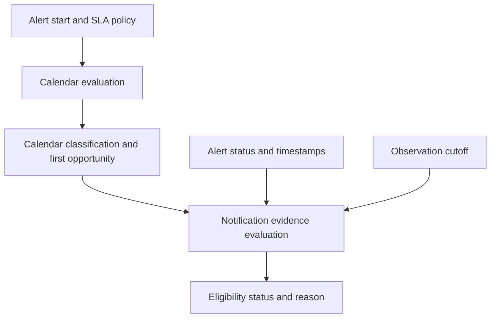

# SLA proxy HTTP, delivery and metrics reference

[Getting started](getting-started.md) · [Concepts](concepts.md) · [Configuration](configuration.md) · [Operations](operations.md)

This is the technical reference for the SLA proxy's HTTP API, outbound
notification format, metrics and structured logs. For the operational meaning
of eligibility, authorization and receipts, see [concepts](concepts.md).
For diagnosis and recovery procedures, see [operations](operations.md).

## HTTP contract

| Method | Path | Meaning |
|---|---|---|
| POST | configured webhook path | Validate a notification batch; observe or persist according to mode |
| GET | `/metrics` | Independent Prometheus registry |
| GET | `/healthz` | HTTP liveness |
| GET | `/readyz` | Observation capability and rolling dataset coverage, or additionally active policy/store readiness in durable modes; HTTP 503 while stopping/unavailable |
| GET | `/api/v1/occurrences` | List stored occurrences in durable modes |
| GET | `/api/v1/occurrences/{occurrence_id}` | Inspect a stored occurrence and its sink bindings |

### Input validation

Webhook input uses the shared Alertmanager v4 wire model. Strict JSON decoding
rejects unknown fields, duplicate keys, null payloads, malformed timestamps and
trailing documents. Require `version: "4"`, a nonempty receiver, group status
`firing` or `resolved`, a non-null alerts array and nonnegative `truncatedAlerts`.
Each alert requires firing/resolved status, a nonempty fingerprint and nonzero
`startsAt`. Resolved alerts also require nonzero `endsAt` at or after `startsAt`.
An explicit empty alerts array is accepted.

Group metadata, original labels, annotations and exact alert timestamps are
preserved; fingerprints are never recomputed. The entire batch is validated
before incrementing alert counters.

Selection follows the [policy selection rules](concepts.md#policy-selection).
Durable modes also accept known resolutions after policy removal.

### HTTP response codes

| Status | Meaning |
|---|---|
| 200 | Successful observation or durable acceptance; selection skips are possible |
| 400 | Invalid webhook payload |
| 401 | Missing or invalid credentials when endpoint authentication is enabled |
| 405 | Unsupported webhook method |
| 413 | Request body exceeds configured limit |
| 500 | Observe-only calendar evaluation failure |
| 503 | Durable acceptance failure, unavailable readiness or stopping service |

For inbound authentication and TLS, see [HTTP security](../http-security.md).
A durable 503 can represent partial acceptance, not a rollback.

### Response semantics by mode

| Mode | Successful webhook response means | Does not establish |
|---|---|---|
| `observe_only` | Notification evidence was evaluated; selected alerts may be eligible, ineligible, pending or unknown | Durable state or sink delivery |
| `durable_state_only` | All selected notifications were committed to Valkey | Sink delivery |
| `delivery_enabled` | All selected notifications were committed to Valkey; dispatch is asynchronous | Sink acceptance or durable action receipt |

A successful response can contain selection skips. `forwarded: false` describes
the **synchronous webhook handler**; it does not mean that an enabled asynchronous
dispatcher will never deliver. Sink acceptance and the subsequent durable receipt
commit are distinct events. See [delivery ordering](operations.md#delivery-ordering-and-retries).

### Common response fields

| Field | Meaning |
|---|---|
| `schema_version` | HTTP response format: 2 for observe-only, 3 for durable modes |
| `mode` | `observe_only`, `durable_state_only` or `delivery_enabled` |
| `persisted` | Durable acceptance of all selected inputs; false in observe-only |
| `forwarded` | Synchronous forwarding by the handler; false in all current modes |
| `received` | Number of alerts in the validated batch |
| `selected` | Number selected for processing |
| `skipped` | Number excluded by selection |

## Occurrence inspection

Both routes are available in durable modes. To require Basic Auth,
[configure separate inspection credentials](configuration.md#inbound-https-and-endpoint-authentication).
Responses are JSON on success and use `Cache-Control: no-store`.

`GET /api/v1/occurrences` accepts these optional parameters:

| Parameter | Match |
|---|---|
| `lifecycle` | `firing` or `resolved` |
| `alertname`, `fingerprint` | Exact occurrence values |
| `sink_id`, `hold_reason` | Exact binding values shown by the inspection API |
| `eligibility` | `eligible`, `ineligible`, `pending` or `unknown` |
| `delivery` | `not_delivered`, `pending_delivery`, `delivered` or `delivery_failed` |
| `limit` | Maximum results per page, 1–100, default 25 |
| `cursor` | Opaque `next_cursor` from the previous page, with the same filters |

Binding filters must all match the same binding. Each matching item includes
all its bindings. Once a binding has a committed receipt for its resolved
notification, inspection omits its `hold_reason` from list and detail results
and excludes that binding from hold filter matches. A firing receipt alone
still allows a hold to appear. The stored hold and Valkey indexes are unchanged.

Resolved records can be inspected until retention deletes them.
Compacted records without an alert name are omitted from exact name searches.

Detail responses include lifecycle and retention timestamps, record version,
resolution conflicts, and per-sink policy versions, holds, next evaluation,
lease expiry, attempts, retry time and committed receipts where present.
`firing` represents the last accepted lifecycle. Stored eligibility can remain
`eligible` after the SLA window closes. See the [inspection specification](../specifications/sla-proxy-inspection-api.md)
for the response and pagination contract.

Invalid list parameters, cursors or occurrence IDs return `400`. Invalid
credentials return `401` when inspection authentication is configured. An
absent occurrence or an inspection request in observe-only mode returns `404`.
An unavailable state read returns `503`.

### Paginate occurrence results

Start without a `cursor`. Set `limit` to the maximum number of items to return.
For example, fetch the first page of firing occurrences:

```bash
page=$(curl -fsS 'http://localhost:9012/api/v1/occurrences?lifecycle=firing&limit=10')
printf '%s\n' "$page" | jq .
```

The response contains an `items` array and, when more candidates remain, a
`next_cursor` string. A response can have an empty `items` array and still
provide a cursor because the list walks a bounded number of stored candidates
per request:

```json
{"items": [], "next_cursor": "<opaque token>"}
```

Pass the returned token as `cursor` with the same filters. You can keep or
change `limit`. Repeat with each new response until `next_cursor` is absent:

```bash
cursor=$(printf '%s\n' "$page" | jq -r '.next_cursor // empty')
if [ -n "$cursor" ]; then
  curl -fsSG 'http://localhost:9012/api/v1/occurrences' \
    --data-urlencode 'lifecycle=firing' \
    --data-urlencode 'limit=10' \
    --data-urlencode "cursor=$cursor"
fi
```

Ordering is unspecified, the walk is not a snapshot, and duplicate items can
appear across pages. Use `occurrence_id` to deduplicate when needed.

## Observe-only responses

Use the fresh [test webhooks](getting-started.md#observe-without-dependencies)
for live tests. The following response illustrates a resolved 07:30–08:30 local
interval overlapping a Swedish business-hours window; it is not a current-time
verification fixture.

Illustrative observe-only response (schema version 2):

```json
{
  "schema_version": 2,
  "mode": "observe_only",
  "persisted": false,
  "forwarded": false,
  "received": 1,
  "selected": 1,
  "skipped": 0,
  "evaluated": 1,
  "eligible": 1,
  "ineligible": 0,
  "pending": 0,
  "unknown": 0,
  "evaluation_errors": 0,
  "evaluated_at": "2026-11-12T09:00:00Z",
  "policy_observations": [{
    "sla_label": "sla_id",
    "sla_value": "business-hours-se",
    "fingerprint": "demo-001",
    "starts_at": "2026-11-11T06:30:00Z",
    "alert_status": "resolved",
    "ends_at": "2026-11-11T07:30:00Z",
    "alert_count": 1,
    "eligible_at_start": false,
    "calendar_reason": "outside_window",
    "eligibility_status": "eligible",
    "eligibility_reason": "active_interval_overlaps_sla",
    "next_eligible_at": "2026-11-11T07:00:00Z",
    "policy_version": "<SHA-256 of calendar configuration and rules>"
  }]
}
```

### Observation response fields

| Field | Meaning |
|---|---|
| `evaluated` | Successfully evaluated selected alerts |
| `eligible`, `ineligible`, `pending`, `unknown` | Counts by notification eligibility status |
| `evaluation_errors` | Selected alerts whose evaluation failed |
| `evaluated_at` | Observation cutoff, not an alert lifecycle timestamp |
| `policy_observations` | Grouped per-alert evidence results |

| Observation field | Meaning |
|---|---|
| `sla_label`, `sla_value` | Selected policy pair |
| `fingerprint` | Original Alertmanager fingerprint |
| `starts_at` | Original start instant |
| `alert_status` | Notification status, firing or resolved |
| `ends_at` | Resolution instant for resolved evidence |
| `alert_count` | Number of equivalent observations represented by this entry |
| `eligible_at_start`, `calendar_reason` | Calendar classification |
| `eligibility_status`, `eligibility_reason` | Notification evidence classification |
| `next_eligible_at`, `calendar_search_until` | Calendar search results, when applicable |
| `policy_version` | Evaluated policy identity |

Observations are grouped by policy pair, fingerprint, exact start instant,
notification status and resolved end instant. Exact repeats share an
`alert_count`; firing and resolved evidence or different resolved end instants
are not merged. Equivalent timezone offsets represent the same instant.

In observe-only mode, HTTP 200 acknowledges successful **observation only**,
including pending and unknown statuses. There is no persistence, forwarding
guarantee or replay. Invalid batches return 400 without observing alerts;
oversized bodies return 413, wrong webhook methods 405, and requests arriving
while stopping 503. Calendar failures return HTTP 500 with
`eligibility_status=error` and a bounded error code; `eligible_at_start`,
`calendar_reason`, `policy_version`, `next_eligible_at` and
`calendar_search_until` are absent for those failed evaluations. Other policies
are still observed. Errors are not counted as authoritative ineligibility.

In observe-only responses, top-level `eligible` and `ineligible` are lifecycle
counts, alongside `pending` and `unknown`. Together these successful counts
equal `evaluated`; `selected = evaluated + evaluation_errors`. Per-observation
counts, including error entries, sum to `selected`. INFO logs contain an
observation object matching the response. Repeated notifications and retried
batches can increase counters again; process-local metrics and logs are not an
exactly-once audit store.

## Durable responses

Both durable modes return schema version 3 with `mode: durable_state_only` or
`mode: delivery_enabled`. Responses include per-occurrence state summaries and
acceptance counts. `forwarded: false` means the handler does not synchronously
forward alerts; enabled delivery runs asynchronously after acceptance.

HTTP 200 and `persisted: true` require every selected notification to commit to
Valkey. A failed input returns HTTP 503 with `persisted: false`,
`persisted_count` and `failed_count`; other inputs are still attempted.
Alertmanager can retry the whole batch, including already committed occurrences,
without creating duplicate [delivery intents](concepts.md#delivery-lifecycle). Valkey acceptance is subject to its
persistence and failover settings; a lost transaction response does not prove
rollback. Validation failures return 400 before state access, and oversized
requests return 413.

The `occurrences` array contains occurrence ID, fingerprint, `starts_at`,
optional `ends_at`, lifecycle and committed version. Each binding summary contains
`sla_label`, `sla_value`, `sink_id`, `policy_version`, eligibility, delivery,
`hold_reason` when present, and `next_evaluation_at` when scheduled. These are
**acceptance-time snapshots**, not later asynchronous delivery results.
`delivery_enabled: true` is present in delivery mode; the false value is omitted
in state-only responses. For lifecycle rules see
[concepts](concepts.md#alert-occurrences-and-lifecycle).

### Durable acceptance fields

| Field | Meaning |
|---|---|
| `persisted_count` | Successfully accepted selected inputs |
| `failed_count` | Selected inputs whose acceptance failed |
| `occurrences` | Acceptance-time occurrence summaries |
| `delivery_enabled` | True in delivery mode; omitted in state-only mode |

Occurrence summaries identify the occurrence, original fingerprint, start and
optional resolution time, known lifecycle and committed version. Binding
summaries describe the selected policy pair, `sink_id`, `policy_version`,
eligibility and delivery state, optional `hold_reason` and scheduled
`next_evaluation_at`. These are not live queries of dispatcher progress.

## Calendar evaluation

### Calendar fields

| Field | Meaning |
|---|---|
| `eligible_at_start` | Whether the start instant is within the SLA calendar |
| `calendar_reason` | Calendar classification or bounded search exhaustion |
| `next_eligible_at` | First eligible instant at or after the start, in UTC with nanosecond precision |
| `calendar_search_until` | Exclusive search boundary when the bounded search is exhausted |
| `eligibility_status` | Classification of notification evidence, not durable delivery state |
| `eligibility_reason` | Reason for that evidence classification |



The first opportunity can precede the observation cutoff or fall at or after
resolution. Its existence alone does not prove overlap. For a nonempty resolved
interval, overlap requires the first eligible instant to be strictly before
`endsAt`. Window starts are inclusive and ends exclusive.

### Calendar reasons

| Value | Meaning |
|---|---|
| `eligible` | Start within an eligible weekly window |
| `outside_window` | Start outside the scheduled window |
| `holiday` | Local date excluded by holiday rules |
| `additional_date` | Local date excluded by an explicit additional date |
| `no_eligibility_within_horizon` | No opportunity found within the bounded search |

### Notification eligibility statuses

| Status | Meaning |
|---|---|
| `eligible` | Evidence establishes activity inside SLA |
| `ineligible` | Resolved interval proven not to overlap SLA |
| `pending` | Firing start at or before cutoff and first opportunity after cutoff |
| `unknown` | Evidence or bounded calendar search cannot establish eligibility |
| `error` | Evaluation failed; no authoritative classification |

### Eligibility reasons

| Value | Meaning |
|---|---|
| `start_in_sla` | Firing starts inside SLA at or before cutoff |
| `active_interval_overlaps_sla` | Resolved interval overlaps SLA |
| `empty_active_interval` | Start equals resolution time |
| `resolved_before_first_eligible_instant` | Resolution at or before first opportunity |
| `resolved_interval_searched` | Complete resolved interval searched without overlap |
| `awaiting_first_eligible_instant` | First opportunity is after cutoff |
| `activity_at_eligibility_unverified` | Opportunity passed but firing evidence does not prove activity there |
| `start_after_observation_cutoff` | Start is later than cutoff |
| `search_horizon_exhausted` | Bounded search cannot establish a conclusive result |
| `calendar_evaluation_error` | Calendar evaluation failed |

### Search horizon and time zones

The search covers the local date of `startsAt` and the remaining configured
number of local dates, not fixed 24-hour periods. The exclusive search boundary
is `calendar_search_until`. A resolved interval ending at or before that boundary
can be classified as ineligible when coverage is complete and no eligible instant
exists. An interval extending beyond the boundary cannot be classified as
ineligible on that basis alone. Exhaustion never proves permanent ineligibility.
Missing required dataset coverage is a calendar error, not a working day.

IANA time zones determine local civil time. Nonexistent spring-forward times
contain no eligible instants; repeated autumn times can both be eligible.
Partial gaps, non-hour offsets and skipped civil dates are supported. Overnight
windows are evaluated against the local date of each instant, including holiday
exclusions on the carried-over portion.

### Identity and evaluation reuse

Occurrence identity is the original fingerprint plus the exact start instant,
normalized to UTC without losing nanosecond precision. Resolution time is not
part of occurrence identity. Within a request, calendar evaluation is reused
only for the same selected policy pair and exact start instant. Equivalent
UTC offsets share the same evaluation. There is no cross-request cache.

`policy_version` hashes policy configuration, search horizon and calendar rule
versions, including effective holiday dates and coverage. It is not occurrence
identity and does not identify the deployed IANA time-zone database. See
[holiday datasets](holiday-datasets.md) for dataset identity and coverage.

## HTTP destination contract

### Outbound payload

Every HTTP request is a POST with `Content-Type: application/json` and **exactly
one alert**, using the original Alertmanager notification metadata and alert
data:

```json
{
  "receiver": "sla-proxy",
  "status": "firing",
  "alerts": [{
    "status": "firing",
    "labels": {"alertname": "HighCPU", "sla_id": "production"},
    "annotations": {"summary": "CPU utilization is high"},
    "startsAt": "2026-11-15T07:00:00.123456789Z",
    "endsAt": "0001-01-01T00:00:00Z",
    "generatorURL": "https://prometheus.example/graph",
    "fingerprint": "original-fingerprint"
  }],
  "groupLabels": {}, "commonLabels": {}, "commonAnnotations": {},
  "externalURL": "", "version": "4", "groupKey": "", "truncatedAlerts": 0
}
```

`receiver`, `groupKey`, group/common labels and annotations, `externalURL`,
`version` and `truncatedAlerts` are preserved where supplied. Missing original
strings stay empty; empty map containers serialize as `{}`. No receiver, group
key, labels or annotations are synthesized from unrelated records.
Fingerprint, `generatorURL`, labels, annotations and nanosecond timestamps are
preserved. Top-level and alert statuses match the intent action. Resolved
delivery uses the stored resolution notification. Firing `endsAt` is forwarded
as originally received; it is **not** used as authoritative resolution state.
No SLA-specific labels are injected.

The full per-alert notification and original group metadata are already
retained in the occurrence. Authorization freezes that notification onto the
intent before I/O, so later webhook updates and process restarts do not change
its logical retry payload. Different alerts in an incoming batch never share
reconstructed payloads.

### External destination expectations

This is a generic Alertmanager webhook, suitable for the
[ServiceNow Prometheus connector](https://www.servicenow.com/docs/r/it-operations-management/event-management/prometheus-events-integration.html).
Configure its Event Management connector/plugin, integration user permissions
and field/CI handling in ServiceNow. The proxy does not implement a ServiceNow
API, severity mapping or guarantee connector processing after acceptance.
Validation uses local HTTP fixtures; a real ServiceNow tenant must be tested
before production.

Use HTTPS for production Basic Authentication. TLS verifies certificates through
normal system roots; there is no insecure-skip option. Plain HTTP is allowed for
local/private deployment testing and exposes credentials/payloads on the wire.
Redirects are never followed. One shared HTTP transport reuses connections;
HTTP/1 with a non-rewindable POST body prevents transparent transport replays,
including when `Idempotency-Key` is present. All retries belong to the durable
dispatcher.

Responses have a 64 KiB header limit; at most 64 KiB + 1 response-body bytes
are read/discarded before closing. Oversized bodies are not retained or logged
and may prevent connection reuse. A 2xx remains API acceptance even if its
discarded body is truncated; body contents do not define application-level
success here.

URLs, authentication values/headers, response bodies and alert payloads are not
included in HTTP delivery logs or returned transport errors. Labels and
annotations are deliberately sent to the configured destination and remain
sensitive stored payload data. Protect YAML, credential environment, Valkey,
logs and network access. There is no arbitrary per-alert URL routing. Endpoints
and any environment proxy settings are trusted operator configuration.

## Metrics and logs

### Webhook, selection and calendar metrics

| Metric | Type | Labels | Meaning |
|---|---|---|---|
| `sla_proxy_notifications_received_total` | Counter | `status` = 2xx/4xx/5xx | Requests to the webhook handler by response class |
| `sla_proxy_webhook_duration_seconds` | Histogram | `status` | Webhook handler latency |
| `sla_proxy_alerts_received_total` | Counter | `status` = firing/resolved | Alerts in fully valid batches, including selected/skipped alerts and repeats |
| `sla_proxy_alerts_selected_total` | Counter | `sla_label`, `sla_value`, `status` | Observation selections by configured policy pair |
| `sla_proxy_alerts_skipped_total` | Counter | `reason` = missing_sla_label/unknown_sla | Selection skips |
| `sla_proxy_calendar_classifications_total` | Counter | `sla_label`, `sla_value`, `classification`, `reason` | Successful per-notification calendar classification at startsAt; inside_sla/outside_sla |
| `sla_proxy_alert_eligibility_observations_total` | Counter | `sla_label`, `sla_value`, `alert_status`, `eligibility_status`, `reason` | Per-notification lifecycle status, including pending, unknown and error |
| `sla_proxy_policy_errors_total` | Counter | `reason` | Failed evaluator calls; one call per unique policy pair plus exact startsAt in each batch |
| `sla_proxy_holiday_evaluations_total` | Counter | `result` | ICS dataset checks, including future search dates; result = holiday/not_holiday/error |

Calendar success metrics count notifications (including within-request cache
reuse); error metrics count actual evaluator calls. In durable modes,
observations are available for accepted records, not failed state reads.
Notification evidence metrics remain separate from durable known lifecycle and
delivery state.

Policy-pair labels are bounded by loaded configuration; unknown values never
create metric series. No fingerprints, alert names, site IDs or alert label sets
are metric labels. The registry includes Go/process collectors, without receiver
metrics. Durable and delivery metrics are described separately below. All
counters reset on restart.

Holiday-check counters measure date checks, not alerts or decisions; explicit
dates within valid coverage and omitted calendars do not invoke the holiday
provider. Error reason labels are bounded: `calendar_error`, `unknown_policy`,
`invalid_evaluation_time`, `cancelled` and `evaluation_error`. Observation
metrics have no sink label. Every configured destination uses the occurrence's
selected policy; there is no destination-specific SLA selection.

### Durable state and scheduler metrics

Durable modes also expose:

| Metric | Type | Labels | Meaning |
|---|---|---|---|
| `sla_proxy_unresolved_occurrences` | Gauge | — | Known-firing occurrences in the namespace |
| `sla_proxy_pending_occurrences` | Gauge | — | Occurrences pending SLA, including policy-held pending bindings |
| `sla_proxy_held_occurrences` | Gauge | — | Occurrences with policy, horizon or resolution-conflict holds |
| `sla_proxy_lifecycle_transitions_total` | Counter | `from,to,reason` | Durable lifecycle transitions |
| `sla_proxy_scheduler_claims_total` | Counter | `result` | Scheduler claim outcomes |
| `sla_proxy_scheduler_evaluations_total` | Counter | `result` | Scheduler evaluation outcomes |
| `sla_proxy_scheduler_errors_total` | Counter | `operation` | Scheduler operational errors |
| `sla_proxy_scheduler_lag_seconds` | Not verified | — | Scheduler lag |
| `sla_proxy_state_store_operations_total` | Counter | `operation,result` | State-store operation outcomes |
| `sla_proxy_state_store_errors_total` | Counter | `operation` | State-store errors |

Durable gauges are namespace-wide reconciliation snapshots: use **max**, not
sum, across replicas. Counters are process-local and reset on restart.

### Structured webhook logs

JSON logs go to stdout. Startup reports the active mode and whether delivery is
enabled. Rejections, policy evaluation failures and shutdown/listener errors
have component and operation fields. Each fully validated webhook produces one
INFO `webhook observation` log with `http_status` and an `observation` object
matching the JSON response, including counts and occurrence/policy
classifications. This includes observe-only HTTP 500 evaluation results and
durable acceptance summaries; separate failure logs provide operational
context. Rejected malformed requests retain their warning logs without an
observation.

The INFO record describes processing, not proof of successful HTTP delivery,
log-output persistence or a sink receipt. It includes fingerprints and selected
policy identifiers, but does not include full webhook payloads, original label
sets or annotations.

## Delivery logs and metrics

### Delivery logs and transport failures

The log destination emits one `SLA alert delivered` structured record per
successful sink call. Record time and `delivery_at` are actual sink processing
time. `starts_at`, optional `ends_at` and `eligible_at` remain separate
historical attributes. Intent/occurrence/binding IDs, sink, action, policy and
attempt are included; full labels/annotations/payloads are omitted. The
handler's reported error is honored and disabled INFO output is not successful
delivery. `slog` does not guarantee durable log storage; a handler that hides
write errors cannot prove persistence. Duplicate log records with the same
intent ID are possible.

HTTP attempts log `SLA HTTP request completed` with sink/type,
intent/occurrence/binding, action, attempt, status, duration and outcome. A
receipt-commit log is separate from sink success. Failure logs omit raw sink
errors.

Transport failures include a bounded `failure_class`:

| Class | Meaning |
|---|---|
| `canceled` | Context cancellation |
| `timeout` | Deadline expiry or typed network timeout |
| `tls_error` | Typed certificate verification or TLS record error |
| `connection_error` | Other typed network operation/DNS error |
| `transport_error` | Other transport failure |
| `none` | Successful call or HTTP status response |

Classification checks cancellation before timeout, then TLS before generic
connection errors; it uses standard error types without hostname inspection
or message matching.

All five transport failure classes remain retryable, including TLS errors and
cancellation. The HTTP metric uses `status_class="network_error"` for these
failures and `result="temporary_failure"`; the finer diagnostic class appears
in structured logs. Raw transport errors are discarded, including from the
returned error chain. HTTP status classification and `Retry-After` follow the
[retry rules](operations.md#delivery-ordering-and-retries). These diagnostics
do not remove ambiguous external outcomes or provide exactly-once delivery.

### Delivery metrics

| Metric | Type | Labels | Meaning |
|---|---|---|---|
| `sla_proxy_delivery_attempts_total` | Counter | `sink_id,action,result` | Calls by success/temporary_failure/permanent_failure |
| `sla_proxy_delivery_receipts_total` | Counter | `sink_id,action` | Observed successful durable receipt commits |
| `sla_proxy_delivery_receipt_commits_total` | Counter | `sink_id,result` | Committed, error or fenced outcome persistence |
| `sla_proxy_delivery_retries_total` | Counter | `sink_id,action` | Calls after first authorized attempt |
| `sla_proxy_delivery_claims_total` | Counter | `sink_id,result` | Claimed, busy, inactive, reclaimed, fenced or error |
| `sla_proxy_delivery_errors_total` | Counter | `operation` | Poll/dispatch operational errors |
| `sla_proxy_delivery_duration_seconds` | Histogram | `sink_id,action` | Individual sink call latency |
| `sla_proxy_delivery_eligibility_delay_seconds` | Histogram | `sink_id` | First SLA opportunity to firing success, after receipt commit |
| `sla_proxy_delivery_pending_bindings` | Gauge | `sink_id` | Queued binding work, including retry-delayed work |
| `sla_proxy_delivery_inflight_bindings` | Gauge | `sink_id` | Persisted claims, including expired claims awaiting recovery |
| `sla_proxy_delivery_failed_bindings` | Gauge | `sink_id` | Held/permanently failed delivery bindings |
| `sla_proxy_delivery_ready_bindings` | Gauge | — | Due work, including expired claims |
| `sla_proxy_delivery_claimed_bindings` | Gauge | — | All persisted binding claims |
| `sla_proxy_delivery_held_bindings` | Gauge | — | All held delivery bindings |
| `sla_proxy_http_requests_total` | Counter | `sink_id,status_class,result` | HTTP API call outcomes with bounded status classes |
| `sla_proxy_http_request_duration_seconds` | Histogram | `sink_id` | HTTP request plus bounded response-drain time |

Gauges are namespace-wide snapshots sampled during polling: use **max**, not
sum, across replicas. Pending delivery gauges count prepared binding work, not
alerts still waiting for SLA with no ready intent. Counters/histograms are
process-local; sum replica rates as appropriate. Labels contain configured sink
IDs and bounded outcomes, never fingerprints, URLs, usernames or alert labels.
A sink success with an unconfirmed receipt can increment attempts without a
corresponding receipt counter. A lost EXEC reply can also undercount actual
persisted receipts.

Enrichment, destination routing rules, sink editing/redrive APIs and downstream
processing guarantees are not implemented. See [Redis/Valkey
debugging](redis-debugging.md) for
operational inspection, configuration changes and recovery.

## ICS holiday datasets

The [dataset contract](holiday-datasets.md#manifest-and-accepted-ics-profile)
defines accepted ICS properties, resource limits, manifest fields and coverage.
Invalid files fail startup. Missing date coverage propagates as
`calendar_error`, never `not_holiday`. Observe-only evaluation failures return
500; failed new durable acceptance returns 503. Existing pinned lifecycle
facts are retained.

The holiday metric uses only `{result}` with three bounded values. No manifest country, paths, hashes or policy
IDs are labels. Explicit additional dates within coverage keep their precedence
and bypass lookup counters. Coverage errors produce the bounded `error` result.
